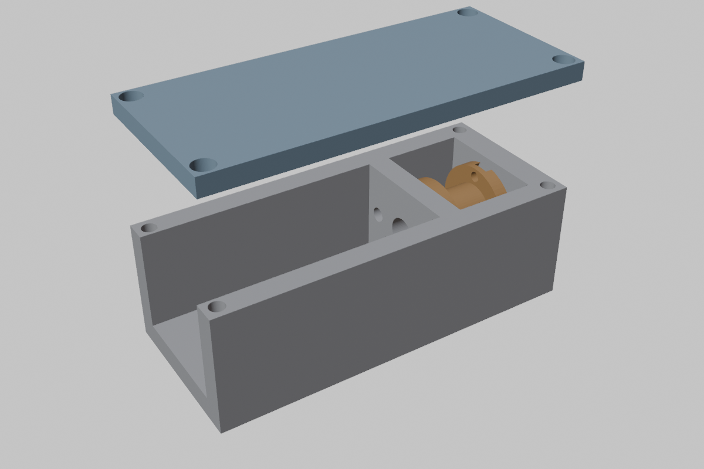

# 02 - The tendon actuator (winch)

One design, three sizes. A motor turns a small drum; braided fishing line winds on the drum and
leaves through a PTFE tube socket tangent to the drum. A self-locking stage holds tension with
no power. A friction drag slips before anything printed breaks. The joint, not the motor, carries
the angle sensor.

```
   motor ---> [gearbox] ---> [worm stage, optional] ---> drum ---> PTFE socket ---> sheathed tendon ---> joint pulley
                                                       |
                                               friction drag (overload)
```

## Physics (the four numbers that matter)

| Quantity | Formula | Design lever |
| --- | --- | --- |
| Tendon force | F = T_drum / r_drum x tackle | smaller drum or more tackle strands = more force |
| Line speed | v = omega_drum x r_drum / tackle | bigger drum or fewer strands = more speed |
| Mechanical power | P = F x v | **only the motor sets this**; drum and tackle just split it |
| Excursion | s = sum over crossed joints of (angle_rad x moment_arm) | sets drum turns and sheath length |

A brushed DC motor delivers peak mechanical power at half its no-load speed and half its stall
torque: P_peak ~ T_stall x omega_noload / 4. That single figure tells you which class a joint
needs before you ever pick a drum.

### Reference results (`python tools/tendon_calc.py`)

| Joint / configuration | Need | Tendon force cont / stall | Full-ROM time | Power need / motor peak | Verdict |
| --- | --- | --- | --- | --- | --- |
| Finger, N20 100:1, 3 mm drum | 15 N, 0.6 s | 13 / 42 N | 0.47 s | 0.9 / 1.3 W | **Good**: fast close, light squeeze, 42 N peak pinch |
| Finger, N20 298:1, 3 mm drum | 40 N, 0.6 s | 37 / 122 N | 1.6 s | 2.3 / 1.0 W | Strong but slow; a "grip" variant |
| Finger, N20 100:1 + 10:1 printed worm | 40 N | 71 / 236 N | 4.1 s | 2.3 / 0.6 W | Worm costs 55 % of the power; too slow for fingers |
| Wrist, N20 298:1, 4 mm drum, 2:1 tackle | 100 N, 0.8 s | 55 / 184 N | 1.9 s | 2.3 / 1.0 W | Marginal; W-mini is the floor for wrists |
| Elbow, JGB37 1:90, 6 mm drum, 2:1 tackle | 137 N, 1.5 s | 128 / 425 N | 3.4 s | 6.7 / 3.3 W | Holds 1 kg; moves at half target speed |
| Shoulder, JGB37 1:270, 8 mm drum, 3:1 | 370 N, 2 s | 295 / 984 N | 21 s | 23 / 2.4 W | **Fails on power**: shoulder is W-max territory |
| Knee sit-to-stand, wiper motor, 15 mm drum, 2:1 | 400 N, 2 s | 500 / 1667 N | 3.7 s | 24 / 18 W | Works, slowly; 0.9 kg per knee |
| Knee sit-to-stand, JGB37 1:270, 4:1 tackle | 400 N, 2 s | 394 / 1313 N | 24 s | 24 / 2.4 W | Force yes, power no |

Loads assumed: 20 kg robot, 1 kg payload in hand, forearm 0.8 kg, whole arm 3 kg. Motor figures
are Pololu-class catalogue values; no-name N20s deliver roughly two thirds of them.

## Locking tension without power

| Option | Holds with zero power | Efficiency | Back-drivable (safety / compliance) | Printable | Verdict |
| --- | --- | --- | --- | --- | --- |
| High-ratio spur gearbox (N20 298:1+) | mostly (creeps under sustained load) | 70-80 % | barely | n/a (bought) | Default for W-mini. Add a small hold current when it matters. |
| Printed single-start worm after the gearbox | yes, hard lock | 35-55 % | no | yes (PETG worm, nylon or PETG wheel, grease) | Use where holding matters more than speed: thumb opposition, neck, spine. Not fingers. |
| Wiper motor (worm built in) | yes | ~50 % | no | n/a | Free lock for W-max if wiper motors are chosen |
| Ratchet + pawl, pawl lifted by a micro servo | yes, one direction | ~95 % | no | yes | Fishing-reel anti-reverse. Good for "grip and hold" fingers if the spur creep proves annoying |
| Friction drag (Belleville or printed spring on the drum) | n/a | n/a | slips at set force | yes | Not a lock: **overload protection**. Every W-mid and W-max gets one. |

Rule: W-mini = spur gearbox only (speed matters, loads are small, a 0.1 A hold is cheap).
W-mid = spur + ratchet or hold current. W-max = worm (wiper) or brake, plus drag.

## Drum design rules

- **Drum diameter >= 10x line diameter** for fatigue life of braided PE. 3 mm core radius with
  0.36 mm (50 lb) line is 17x. Good.
- **Keep wraps in one layer.** Drum width >= turns x line diameter x 1.3. For a finger (1.8 turns
  of 0.36 mm) that is 1 mm; a 5 mm wide drum is generous. For an elbow (4 turns of 0.55 mm) 3 mm.
  For excursions over ~10 turns, print a helical groove (level-wind) so the effective radius
  stays constant and the position loop stays linear.
- **Anchor the line through the flange**, knot on the outside in a counterbore, not through the
  core (a knot in the core makes a bump that changes the radius every revolution).
- **Tangent exit.** The PTFE socket axis is tangent to the drum core at the plane of the drum. The
  line then enters the tube straight and the tube does the steering.
- **D-bore on the motor shaft, stub axle on the far side** riding in the housing, so the motor
  bearing is not cantilevered by tendon load.
- **Closed-loop drum**: two line anchors, lines wound in opposite senses from the drum centre
  outward; the joint pulley has the same two anchors. Pretension by winding both on with the
  joint at mid-range and a 2-5 N spring scale on each strand.

## Line

| Line | Diameter | Break | Stretch | Creep | Verdict |
| --- | --- | --- | --- | --- | --- |
| Braided PE (Dyneema/Spectra), 4 or 8 carrier | 0.28-0.75 mm | 130-900 N | <2 % | slow, real under sustained >30 % load | **Use this** |
| Fluorocarbon | 0.3-0.9 mm | similar | 5-10 % | low | too stretchy for position control |
| Nylon monofilament | 0.3-0.9 mm | similar | 10-25 % | high | no |
| Kevlar/aramid cord | 0.5-1 mm | 200-500 N | <2 % | none | fine alternative, abrades on sharp edges more than PE, dearer |

Working load <= 25 % of break strength (safety factor 4) because every pass over a pulley or
through a tube costs strength. The calculator reports the factor per scenario.

Creep is handled, not fought: hard stops at both ends of every tendon, home on power-up by
driving into the stop at low current, re-home any joint whose joint-sensor-to-motor-encoder ratio
has drifted by more than a threshold. Dyneema creep at our loads is fractions of a millimetre per
day and the homing routine absorbs it.

Knots: a Palomar or a doubled figure-eight in braid holds ~80-90 % of break strength. Melt the
tag end with a lighter into a mushroom; it cannot pull through a 1.2 mm hole.

## Hard guides: hollow needle liners (P-003)

Printed channel walls abrade under a braided line that saws back and forth thousands of times.
Where the tendon path is straight, line the channel with a hollow stainless body-piercing
needle (the same thing as hypodermic tubing) cut to length and pushed in after printing. No
print pause, no mid-print insert, about $13 per hundred.

| Gauge | OD | ID | Use |
| --- | --- | --- | --- |
| 18 G | 1.27 mm | ~0.84 mm | 30-50 lb line, finger channels where space is tight |
| 16 G | 1.65 mm | ~1.2 mm | **default finger / hand liner**, 50-100 lb line |
| 14 G | 2.11 mm | ~1.6 mm | wrist, forearm bank exits, 100-150 lb line |
| 12 G | 2.77 mm | ~2.2 mm | 200 lb line, doubled lines, tackle runs |
| 10 G / 8 G | 3.4 / 4.0 mm | ~2.7 / 3.2 mm | arm and leg tendon runs; 8 G also fits inside a 4 mm PTFE socket bore as a hard exit |

Rules for using them:

- **Press fit, not snap.** Channel diameter = needle OD + 0.1 mm in PETG holds a needle by hand
  force and survives tendon load (the load is along the needle, not trying to pull it out).
  Where a channel must be open on one side (a surface groove), print the groove 0.9 x OD wide at
  the mouth so the needle snaps in laterally and is captured.
- **Cut both ends square, deburr, and keep the bevel inside.** The factory bevel is a blade. Cut
  it off, or push that end deepest into the part. Chamfer the cut rim with a countersink bit or a
  few turns in a drill against a file.
- **The needle stops 1 mm short of every mouth** and the printed mouth is a countersink
  (1 mm radial, 1.2 mm deep in `finger.py`). The line's bend over the joint happens on the
  printed countersink, not on a steel rim. Where the path bends more than ~20 degrees,
  use PTFE tube, which follows the bend; a steel liner is only for straight runs.
- **Also useful as:** 1.27-2.77 mm axles for small printed pulleys and idlers, extension-cord
  guides, and the stiff core of a sheath-end load cell (Phase 6b).

The finger generator sizes its flexor channel for a 16 G needle (1.75 mm bore) with countersunk
mouths on both channels at every body face.

## Direction, return and termination (P-004)

How a joint moves both ways with one motor, what stops it, and how the line is tied off.

### Three ways to get the reverse stroke

| Pattern | Reverse stroke comes from | Line path | Used for |
| --- | --- | --- | --- |
| Single tendon + elastic | an elastic antagonist (silicone cord, dental elastic, TPU band) | one line, out only; it ends at the extremity | fingers, thumb, eyes, jaw |
| Closed loop | the other half of the same line, on the same drum | one line, out through tube A, around and anchored to the joint pulley, back through tube B to the same drum | wrist, elbow, forearm, shoulder, neck, spine, hip, knee, ankle |
| Antagonistic pair | a second motor | two lines, two drums | not used (doubles motor count); only worth it for variable stiffness |

### The closed loop in detail

```
      drum (one motor)                      joint pulley (on the moving bone)
   +---------------+                      +---------------+
   | ) ) ) ) ) )  |--- tube A ---------->|               |
   | anchor A      |                      |  stop bead in |
   |               |                      |  pocket (the  |
   | ( ( ( ( ( (  |<-- tube B -----------|  line cannot  |
   | anchor B      |                      |  slip here)   |
   +---------------+                      +---------------+
   half A wound right-hand, half B wound left-hand, separated by a middle flange
```

- Both ends of the line anchor on the **same drum**, wound in opposite senses on two halves of
  the same core. One turn of the drum takes in on A exactly what it pays out on B, so the loop
  length never changes and the line never goes slack once pretensioned.
- The midpoint of the line is **anchored to the joint pulley** (a crimped stop bead sitting in a
  pocket on the pulley rim, the way a bicycle cable head sits in a brake lever). The loop is a
  positive drive, not a friction capstan, so no wraps are needed and nothing creeps.
- **Equal moment arms both sides.** Half A and half B must have the same radius, and the two
  sides of the joint pulley must too; otherwise the loop length changes with angle and the loop
  binds. This is why a finger, whose palmar arms are 9 / 6.5 / 4.5 mm and whose dorsal path is
  different again, cannot be a closed loop and gets an elastic instead.
- **Both runs sheathed.** Because the sheath carries the compression on both runs, the loop
  length is independent of every joint it passes over on the way, like a bicycle brake cable
  through a bent frame. A shoulder loop driven from the torso does not care what the clavicle is
  doing.
- **Pretension**: set with the joint at mid-range, about 10 % of the working load on each run,
  measured with a spring scale. The sheath end of one run seats on a **bicycle barrel adjuster**
  (M6, ~$0.50, printable socket); turning it lengthens the sheath and adds tension without
  touching the knots. Re-tension once after the first day of running, then rarely.

### Backstops

- **Mechanical stops at the joint**, both directions, on every DOF. They are the reference for
  homing ("drive gently until current rises") and the thing that saves the line when the firmware
  is wrong. The finger's extension stop is its dorsal faces meeting at 0 degrees, its flexion stop
  the palmar chamfers meeting.
- **Software limits** inside the mechanical ones, from `cad/skeleton.json`.
- **Drum overtravel**: a single tendon fully paid out would hang on its anchor knot. The drum
  carries one and a half spare turns beyond full excursion, so the joint stop is always reached
  before the anchor is loaded.
- **Slack on single tendons**: an external push can close a finger faster than the drum pays
  out, leaving slack. The drum flanges and a close-fitting exit keep a slack line on the drum; the
  winch's `tension` mode reels it back in under a current limit, like a fishing reel taking up
  slack. The self-locking stage means slack is never a safety problem, only a position error
  until the next contact.
- **Broken line on a closed loop**: both runs go slack at once and the joint goes free. Detected
  by the joint sensor disagreeing with the motor encoder; the node reports a fault and holds the
  neighbouring joints.

### Terminations: knots, crimps, beads, toggles

| Termination | Strength (of line break) | Where | Notes |
| --- | --- | --- | --- |
| Double overhand stopper + melted tag | ~60-70 % | prototypes, drum anchors, fingertip pockets | Braided PE is slippery: at least a double overhand, pull tight, melt the tag into a mushroom with a lighter. A knot pocket keeps it from sitting proud. |
| Palomar through a hole or toggle | ~85-90 % | anywhere a line passes through a part | Best knot for braid; needs the line doubled through the hole. |
| **Crimp sleeve (fishing leader sleeve), line passed through, around, back through** | ~90 % | **production terminations** | Aluminium or copper sleeves sized to the line, $3 per hundred, crimped with pliers. Repeatable, compact, re-doable: cut and re-crimp to re-tension. |
| **Crimped stop bead on the bare line** | ~80 % | the joint-pulley anchor, elastic-cord anchors, any "pull-through-and-stop" | A sleeve crimped on the line alone becomes a bead that cannot pass a 1.2 mm hole. This is the bicycle cable head. |
| Toggle: lark's head over a 4 mm length of 12 G needle lying across a slot | ~95 % | high-load anchors (knee, hip pulleys) | The line wraps a smooth steel bar instead of biting itself; the slot is printed, the needle is dropped in after printing. |

Rules: no termination ever sits in the bending path; every one lives in a pocket or
counterbore; the drum anchor is through the flange, never through the core; and every
termination is reachable with the part assembled so a line can be replaced without
disassembling the joint.

## Why the "closing in air, squeezing on contact" profile suits a DC motor

Closing a finger in free air costs only the elastic return (~3-5 N). A 100:1 N20 does that at
~90 mm/s, so the hand closes in half a second. On contact the speed drops along the motor's
torque-speed line until it stalls at ~42 N tendon force (~5 N at the fingertip). The driver
limits current to a safe hold value and the gearbox holds the grip. No worm needed, no second
speed, and the same tendon gives speed where speed is wanted and force where force is wanted.

## What the W-mini module looks like

`cad/blender/winch_mini.py` generates it: a 41 x 18 x 13 mm open-top housing that an N20 slides
into from the rear, a bulkhead with the motor's two M1.6 holes and the shaft bore, a drum chamber
with the drum on the shaft's D-flat and a 2 mm stub riding in the end wall, a tangent 4 mm PTFE
socket boss on the side, and a screw-on lid. Nine of them side by side are a forearm bank.



Generated parts (PETG, solid): housing 6 g, drum 0.4 g, lid 1.8 g. All three meshes are manifold.

Next versions: a 2-anchor closed-loop drum, a ratchet variant, the W-mid housing for a 37 mm motor
with a 2:1 tackle block, and the drag clutch (a printed wave spring between drum and a friction
disc keyed to the shaft).
