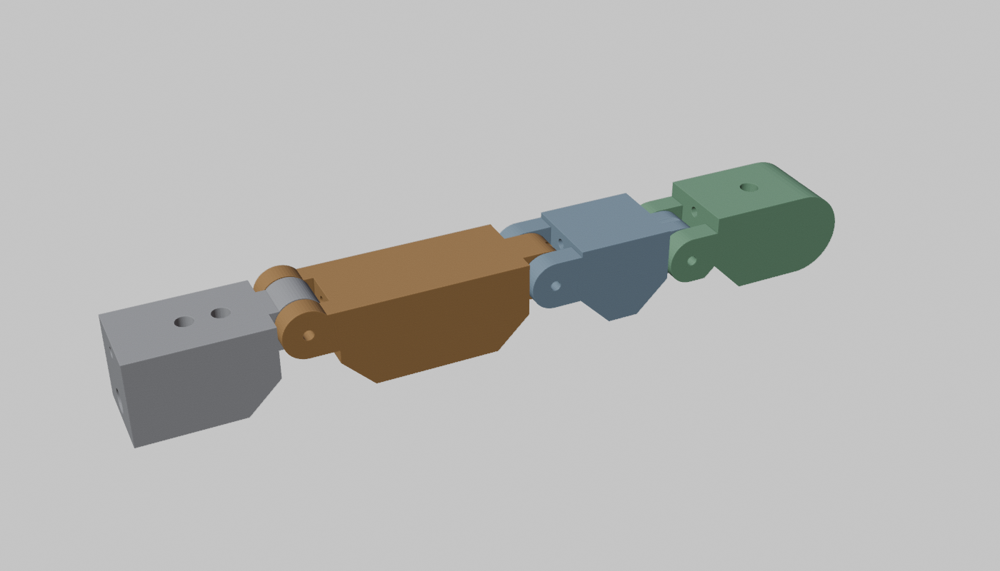
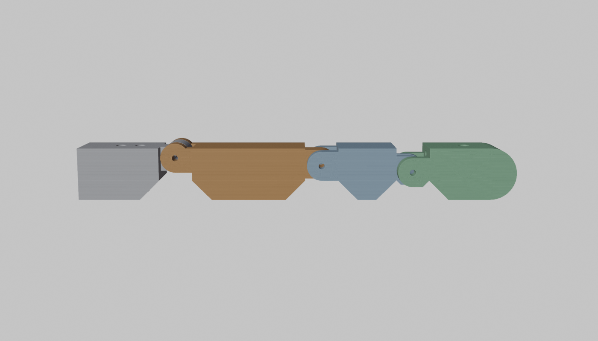
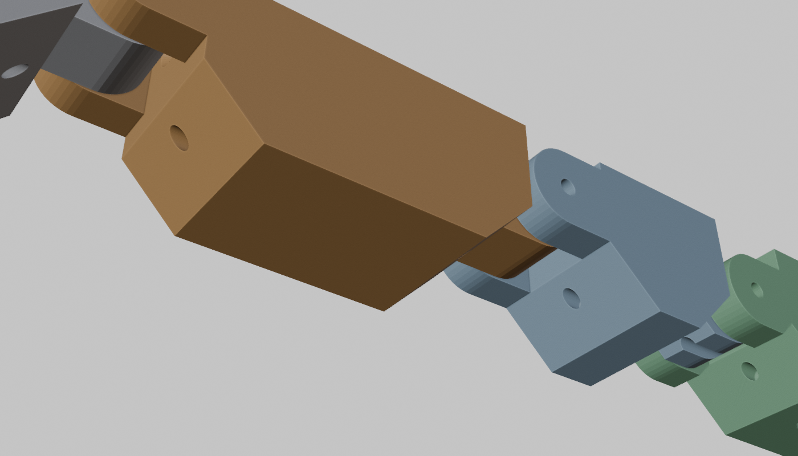
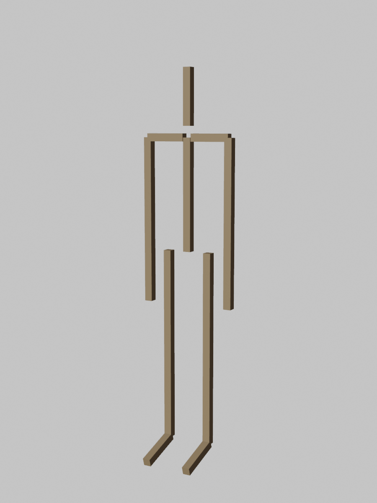
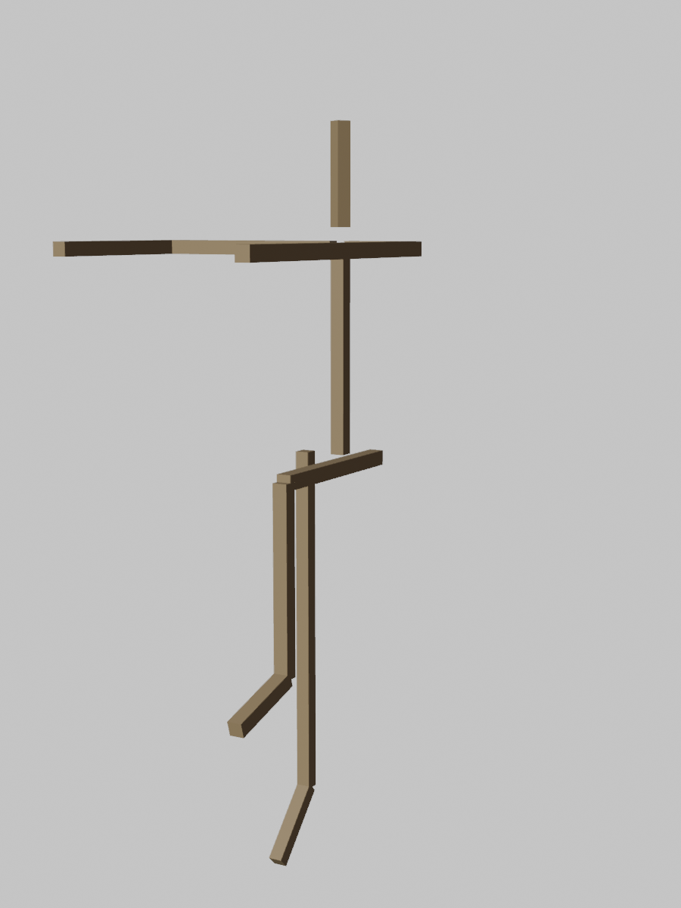

# 03 - Skeleton and joints

## Materials and hardware (all cheap, all common)

| Item | Choice | Why |
| --- | --- | --- |
| Structural prints | PETG, 4 walls, 25-40 % gyroid | Tougher than PLA, does not creep at 40 C, cheap. PLA+ is acceptable for hands and face. |
| Load-bearing prints (hip, knee, shoulder clevises, pulleys) | PETG with 6 walls or ASA/PC if the printer can | Layer orientation chosen so tendon load is in-plane, never peeling layers |
| Flexible parts (finger pads, elastic return bands, drag springs) | TPU 95A | Printable springs and grip pads |
| Big joint axles | 8 mm steel rod or M8 bolts, 608 bearings (8x22x7) | The InMoov standard. ~$0.20 per bearing. |
| Medium joint axles | 5 mm rod, 625 bearings (5x16x5) or printed bushings with PTFE tube liner | |
| Finger joints | 2 mm steel pins (cut from music wire or 2 mm nails), printed bushings | Loads are small, friction is low, cost is nothing |
| Fasteners | M3 heat-set inserts + M3 screws; M2 self-tapping for small parts | One screw size for 90 % of the build |
| Tendon sheath | PTFE tube 2 mm ID / 4 mm OD | Bowden tube |
| Line | braided PE 50 / 100 / 200 lb | see `02-tendon-actuator.md` |

## Print segmentation and pipe bones

Long bones are not printed (P-009). Between two printed joint ends a humerus, forearm, femur,
tibia or spine is an undifferentiated tube, so it is a length of Schedule 40 PVC or ABS pipe (1",
1-1/4", 1-1/2", 2" for forearm/humerus, tibia, femur, spine) cut to length, pushed into the
printed socket at each joint end and held by two M3 set screws. The sheathed tendons and the
wiring run inside the pipe. Details and the per-bone table are in `11-ring-joint.md`.

What remains printed is short: joint ends, winch banks, hands, feet, torso and pelvis shells.
Anything printed longer than 240 mm still splits for a 256 mm bed (the chain generator does this
with alignment pins), but no current part needs it. Target total print time drops to well under
250 hours at 0.28 mm layers.

## Joint catalogue with ROM targets

Targets are the human range; "ours" is what the printed joint will mechanically allow. Where ours
is smaller than human, that is a deliberate trade and the decision log says why.

### Hand (per hand: 7 W-mini)

| Joint | Human | Ours | Mechanism |
| --- | --- | --- | --- |
| MCP flexion | 0-90 | 0-90 | pin joint, 10 mm tendon moment arm (channel offset) |
| PIP flexion | 0-110 | 0-105 | pin joint, 7 mm arm |
| DIP flexion | 0-80 | 0-70 | pin joint, 5 mm arm, coupled to PIP by the same tendon |
| MCP hyperextension | 30 | 10 | hard stop |
| Finger abduction | 20 | 15 | one tendon through a whiffletree spreads all four; elastic closes |
| Thumb CMC opposition | ~60 | 60 | one W-mini on a diagonal axis (saddle joint approximated by a pin at 45 degrees) |
| Thumb MCP + IP | 60 + 80 | 55 + 75 | one flexor tendon, same as a finger |

One flexor tendon per finger runs through all three joints on the palm side; the elastic
extensor runs along the back. The tendon moment arms (10/7/5 mm) make the finger curl distal
first then proximal, which is how a hand conforms to an object. A W-mini per finger plus one for
thumb opposition and one for spread = 7.

#### Phase 0 finger test article (`cad/blender/finger.py`)

Four printed parts on 2 mm pins: a 30 mm palm block with the PTFE socket and two M3 mounting
holes, then 45 / 28 / 24 mm phalanges of 16 x 16 mm section. Each phalanx has a two-lug fork at
its proximal end and a centre tongue at its distal end around a 9 mm knuckle. The flexor channel
(1.8 mm) runs 4 mm palmar of the centreline; the joint axes sit 5 / 2.5 / 0.5 mm dorsal of it,
giving moment arms of 9 / 6.5 / 4.5 mm and a full-curl excursion of 31 mm, which is the number
in the calculator's finger scenarios. The extensor cord (2 mm channel) rides over each knuckle
lug, which doubles as its pulley. Six-millimetre palmar chamfers at every joint clear the
flexion. Print mass is about 34 g solid, under 20 g at 30 % infill.

The flexor channel is a 1.75 mm bore, a press fit for a 16 G hollow piercing needle pushed in
after printing (P-003, D-013). Every channel mouth is countersunk 1 mm so the line bends on
plastic; the needle stops 1 mm inside. In the fingertip both channels end at their knot pockets
instead of breaking out through the rounded tip.

### Wrist and forearm (per arm: 2 W-mini + 1 W-mid)

| Joint | Human | Ours | Mechanism |
| --- | --- | --- | --- |
| Flexion / extension | 80 / 70 | 70 / 60 | universal joint (two pin axes), closed-loop cable on a 15 mm pulley |
| Radial / ulnar deviation | 20 / 35 | 15 / 25 | second axis of the universal, closed loop |
| Pronation / supination | 85 / 90 | 80 / 80 | forearm shell rotates on a ring bearing (printed, with 6 mm airsoft BBs as balls, or a 6808 bearing); W-mid in the upper arm drives a capstan |

### Elbow (1 W-mid)

| Joint | Human | Ours | Mechanism |
| --- | --- | --- | --- |
| Flexion | 0-145 | 0-140 | 8 mm axle, two 608 bearings, 60 mm closed-loop pulley, 2:1 tackle |

### Shoulder (3 W-max)

| Joint | Human | Ours | Mechanism |
| --- | --- | --- | --- |
| Flexion / extension | 180 / 60 | 170 / 45 | ball joint approximated by three serial pin axes (yaw ring in the torso, pitch axle, roll axle), each on 608 bearings; each with closed-loop cable + 2:1 tackle driven from the torso bank |
| Abduction / adduction | 180 / 45 | 165 / 30 | |
| Internal / external rotation | 90 / 90 | 80 / 80 | |

Three serial axes with offsets suffer gimbal lock near 90 degrees abduction; the yaw ring is
tilted 30 degrees forward (like the scapula) so the singularity sits outside the useful workspace.

### Neck (3 W-mini) and face (4 W-mini, optional)

Neck: a two-axis universal at the base of the skull plus a yaw bearing at the top of the spine,
closed-loop cables, all winches in the upper torso. Human ranges 60/70 pitch, 80 yaw, 45 roll;
ours 50/50, 80, 35. Face is cosmetic and comes last.

### Spine (3 W-max)

A single universal joint at the waist plus a yaw bearing (a 6810-class thin-section bearing or a
printed ball ring). Human 60-90 flexion, 30 extension, 35 lateral, 45 rotation. Ours 40 / 20 /
25 / 45. Not a flexible spine: one strong joint at the waist is 80 % of the visible motion at 10 %
of the complexity.

### Hip (3 W-max), knee (1 W-max), ankle (2 W-max)

| Joint | Human | Ours | Mechanism |
| --- | --- | --- | --- |
| Hip flexion / extension | 125 / 20 | 110 / 15 | three serial axes like the shoulder but on 8 mm axles with doubled 608 bearings; cables + 3:1 or 4:1 tackle from the pelvis bank |
| Hip abduction / adduction | 45 / 30 | 40 / 25 | |
| Hip rotation | 45 / 45 | 35 / 35 | |
| Knee flexion | 0-140 | 0-135 | 8 mm axle, 100 mm pulley (50 mm moment arm), 2:1 tackle, W-max in the thigh |
| Ankle dorsi / plantar | 20 / 50 | 20 / 40 | universal joint, W-max pair in the shank |
| Ankle inversion / eversion | 35 / 20 | 20 / 15 | |
| Toes | 70 | passive | elastic hinge for a natural-looking foot |

## Elastic antagonists

Printed TPU bands wear out and relax. Preference order: silicone surgical tubing (cheap, lasts),
dental elastics (precise force, replaceable), TPU bands (printable, fine for prototypes). Elastic
return force should be 10-15 % of the tendon's working force: enough to re-extend quickly, small
enough not to steal grip.

## Integrated tendon channels

Each printed bone carries 4 mm channels for PTFE tubes printed in, with 8 mm bores where a tube
end seats. Tubes are cut to length and pushed in; the tube end seats in the bore and takes the
sheath compression. Where a tendon leaves a tube to cross a joint, the exit is a 2 mm radiused
lip, never a sharp edge. Where a tendon wraps a pulley, the pulley groove radius is >= 5x line
diameter and the groove is printed with the layer lines running around the groove.

Straight runs inside thin parts (phalanges, the palm, the back of the hand, the foot) are lined
with hollow stainless piercing needles cut to length and pressed in after printing (16 G in the
fingers; see the needle table in `02-tendon-actuator.md`). The needle stops 1 mm short of each
printed, countersunk mouth, so the line bends on plastic with a 1 mm radius and runs on steel in
between. Nothing is inserted mid-print anywhere in the robot: every liner, tube, pin, bearing,
magnet and insert goes in after the part comes off the bed.

## Whole-body joint table and rig

`cad/skeleton.json` holds every segment (lengths for a 1.75 m robot), every joint, its axis,
its "ours" and human limits, its winch class and drive pattern. `cad/blender/skeleton_rig.py`
builds an armature from it with a Limit Rotation constraint per joint, skins it with a stick
mesh, prints the DOF table (50 actuated: 21 W-max, 4 W-mid, 25 W-mini, matching
`01-architecture.md`), renders the rest pose and a sign-check pose, and saves
`cad/out/skeleton.blend` for posing by hand.

Sign convention (also in the JSON): pitch, roll and yaw are right-hand rotations about world
X, Y and Z applied in each bone's rest frame. Bones that point up swing forward for positive
pitch; bones that hang down swing backward, so hip, shoulder and elbow flexion are negative and
knee flexion is positive; on the left side a hanging bone moves toward the body for positive
roll, so abduction is negative, and the right side mirrors. The script checks this by posing the
demo and printing each bone's direction; the firmware's joint table is generated from the same
file so controller, planner and CAD agree on every sign.

## What Blender is for here

- Rig an armature with the exact joint axes, offsets and limits above. Drive every bone from a
  slider and watch for collisions and reach.
- Measure tendon excursion vs. angle with a curve that follows the tendon path (geometry nodes
  or a simple Python driver measuring path length), which feeds the calculator's excursion column.
- Mass properties via the 3D Print Toolbox add-on (volume x density) for every shell, summed into
  the 20 kg budget.
- Stress: not in Blender. Hand calculation first; FreeCAD FEM (CalculiX) for the hip and knee
  clevises and the big pulleys.
