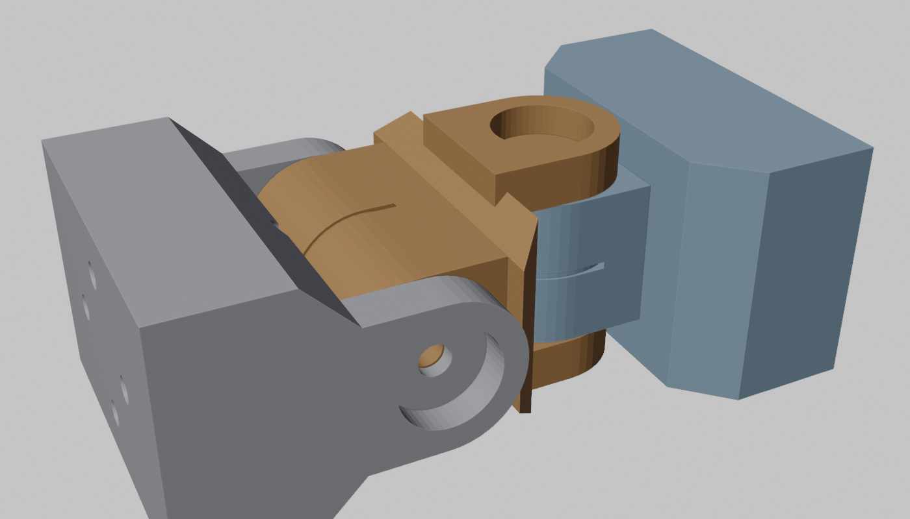
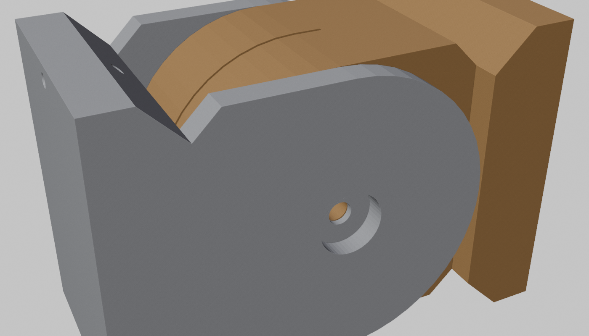
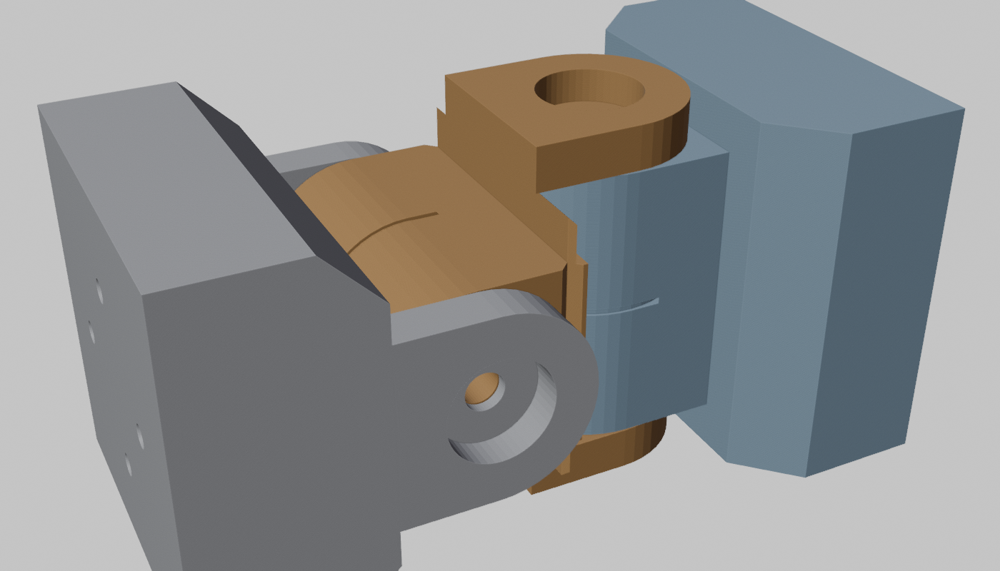
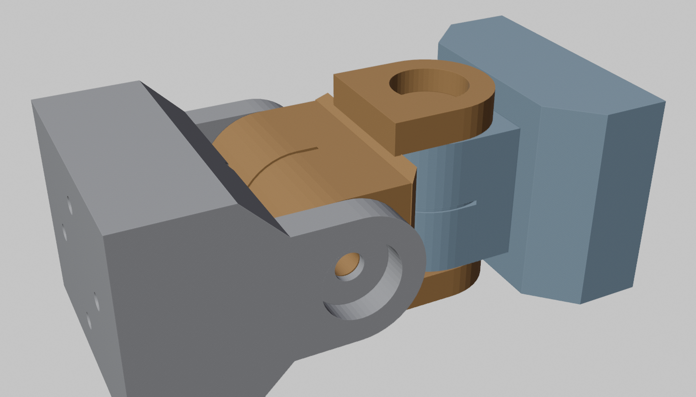
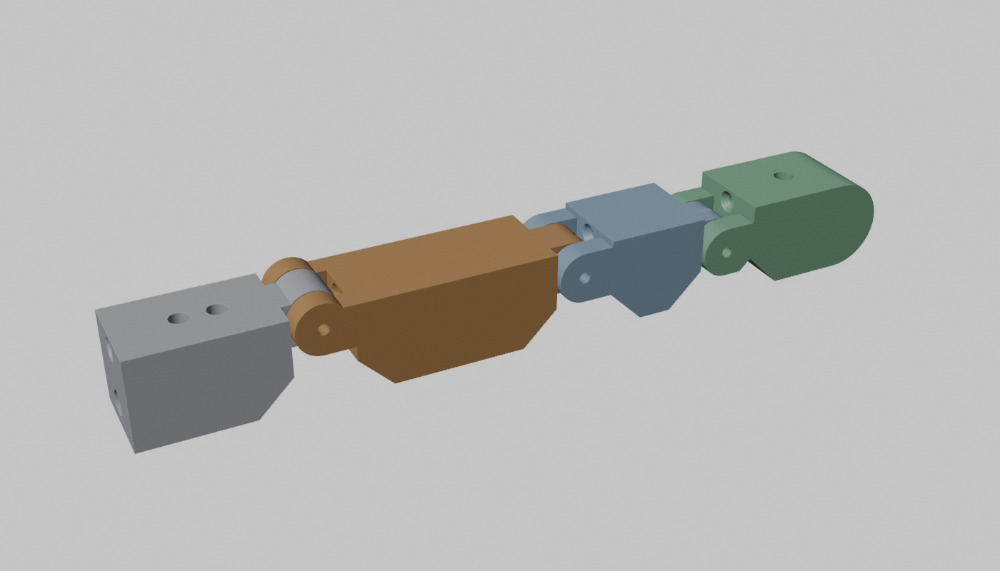
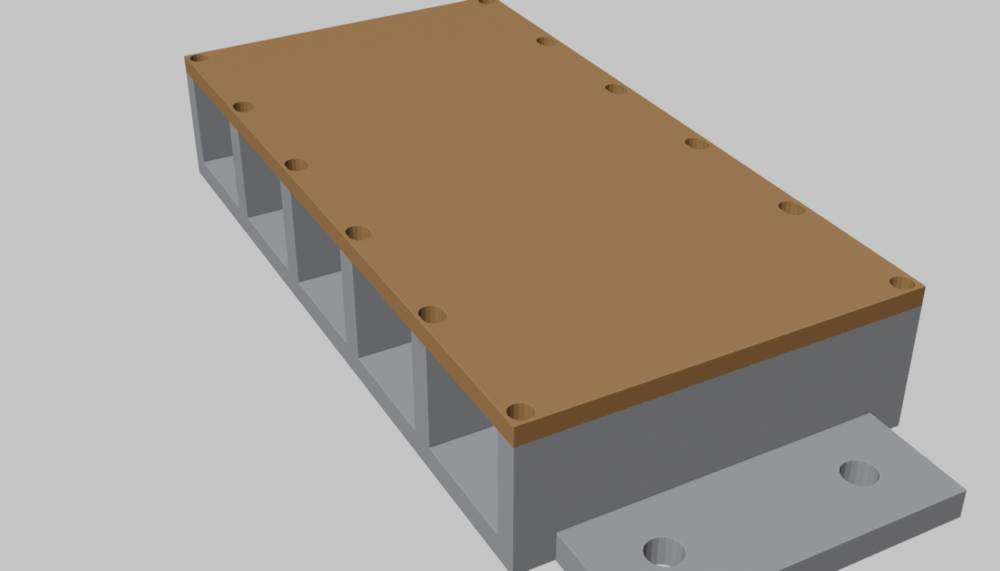

# 09 - The knuckle chain: one primitive for 26 joints (P-007)

The finger is not a special case. Strip it to its principle and it is a **knuckle chain**: rigid
segments joined by fork-and-tongue pin joints, tendons in lined channels, the tongue lug doubling
as the pulley. Counting the joint table against that principle:

| Primitive | Covers | DOF |
| --- | --- | --- |
| **Knuckle chain** (`cad/blender/chain.py`) | fingers, thumbs, toes, wrists, elbows, shoulders (2 of 3 axes), neck (2 of 3), waist (2 of 3), hips (2 of 3), knees, ankles | 34 built now, 36 with the two thumb-opposition knuckles |
| **Ring joint** (next generator) | forearm pronation, shoulder rotation, hip rotation, neck yaw, waist yaw: rotation about a segment's own axis on a thin-section or printed ball bearing | 8 |
| Face mechanisms | eyes, lids, jaw | 4 |
| Whiffletree | finger spread | 2 |

Two mechanical primitives cover 44 of 50 degrees of freedom. The chain generator exists and
produces every instance below; the ring generator does not exist yet.

## Presets generated today

All verified manifold after STL export and re-import. Masses are for solid PETG; real parts
are shells at roughly 35-40 % of that once the hollowing pass exists.

| Preset | Segments | Joints | Axes | Fit | Drive | Section W x H | Instances | DOF | Solid mass / instance |
| --- | --- | --- | --- | --- | --- | --- | --- | --- | --- |
| finger | palm, proximal, middle, distal | 3 | y, y, y, axes offset 5 / 2.5 / 0.5 mm | 2 mm pins | single tendon + elastic | 16 x 16 | 8 | 8 | 34 g |
| thumb | palm, proximal, distal | 2 | y, y | 2 mm pins | single tendon + elastic | 18 x 18 | 2 | 2 | 36 g |
| toe | sole, plate | 1 | y | 3 mm pin | elastic only (passive) | 90 x 14 | 2 | 0 | 141 g |
| wrist | base, cross, end | 2 | y then z | 625 bearings, stub axles | two closed loops | 58 x 40 | 2 | 4 | 220 g |
| ankle | base, cross, end | 2 | y then z | 608 bearings, stub axles | two closed loops | 76 x 60 | 2 | 4 | 589 g |
| neck | base, cross, end | 2 | y then z | 625 bearings, stub axles | two closed loops | 52 x 40 | 1 | 2 | 205 g |
| waist | base, cross, end | 2 | y then z | 608 bearings, stub axles | two closed loops | 120 x 80 | 1 | 2 | 1458 g |
| elbow | upper, lower | 1 | y, 60 mm pulley | 608 bearings | closed loop | 60 x 70 | 2 | 2 | 533 g |
| knee | upper, lower | 1 | y, 100 mm pulley | 608 bearings | closed loop | 80 x 110 | 2 | 2 | 1505 g |
| hip | base, cross, end | 2 | z then y | 608 bearings, stub axles | two closed loops | 82 x 80 | 2 | 4 | 914 g |
| shoulder | base, cross, end | 2 | z then y | 608 bearings, stub axles | two closed loops | 76 x 70 | 2 | 4 | 616 g |

## The variations sewn in

Every preset is the same code with these knobs:

| Knob | Values | What it changes |
| --- | --- | --- |
| `axis` | `y` (pitch, lugs across the width) or `z` (yaw, lugs across the height) | which way the joint swings; two in a row at 90 degrees make a universal |
| `off` | axis offset from the centreline | asymmetric moment arms (finger: flexor arm 9 / 6.5 / 4.5 mm) or symmetric (every loop joint: 0) |
| `fit` | pin (press in the fork, clearance in the tongue) or bearing (seats in the fork lugs, stub axles into the tongue) | load capacity and, unexpectedly, routing (below) |
| `tongue_on` | `prox` (tendon passes through to the next segment) or `dist` (tongue is the moving pulley; the loop ends on it) | single-tendon chain vs loop joint |
| `loop` | none, or the line diameter | adds a groove and a crimped-bead pocket to the tongue rim |
| `chamfer` | leg length | clearance on the faces the joint swings toward: palmar only for single-tendon joints, both sides for loops, both sides for yaw joints |
| channels | position, bore, liner, socket end, pocket end | sheathed runs, needle liners, PTFE seats, knot pockets |

## What solving for similarity taught (the alternative thinking)

1. **The knuckle lug is already the pulley.** In the finger it carries the extensor cord; with a
   groove and a bead pocket it is the drive pulley of a closed loop. One feature, two roles, so
   joint radius and moment arm are the same number everywhere and the calculator's
   `joint_moment_arm_mm` maps straight onto `lug_r`.
2. **Stub axles, not through-pins, for any joint a tendon has to cross.** A second joint's loop
   runs must cross the first joint. Crossing *at the axis* costs zero length change and zero
   coupling, but a through-pin occupies the axis. Two short stub shafts, one per fork lug, each
   pressed into a blind bore in the tongue, leave the tongue centre solid for the crossing runs.
   The generator checks that the runs fit and refuses to build if they do not. That check is what
   widened the wrist from 50 to 58 mm, the shoulder from 70 to 76 and the ankle from 70 to 76:
   **section width is set by tendon routing, not by strength.**
3. **Small universals need bearings for routing, not load.** Pins would carry a wrist, but a pin
   runs through the centre the yaw runs need. So wrists and the neck get 625 bearings with stubs.
4. **A countersink on a chamfer plane must be a dimple, not a cone.** The finger's flexor leaves
   through the 45-degree palmar chamfer. A cone's flat rim grazing an inclined plane produces
   sliver geometry (and physically a cone is the wrong shape for an oblique exit); a spherical
   dimple centred on the exit point is right in both senses.
5. **The big-joint presets are too heavy as prisms and that is the next honest trade.** The knee
   at 1.5 kg solid, ~0.5 kg hollow, is driven by the 100 mm pulley forcing a 110 mm section. A
   40 mm moment arm cuts the section to ~90 mm and raises knee tendon force from 400 to 500 N,
   still inside the 775/planetary budget. Decide at the shell pass with real mass numbers.
6. **Hard stops are still missing.** The chamfers give clearance; they do not define the limit.
   The next chain feature is a pair of printed stop faces per joint matching `skeleton.json`,
   because homing (D-014) drives into them.

## Added at P-009 ("work on all your still-missing steps")

| Feature | How it is done | Where |
| --- | --- | --- |
| **Hard stops** | Each joint takes `rom=(lo, hi)`. The tongue lug grows to 0.4 mm under the other body's face over the arc the joint may not enter, so the body face itself is the stop. Joints with stops get a 2.5 mm body gap so the stop has a real face. Homing drives into it (D-014). | every preset |
| **Stub-axle retention** | A radial M3 heat-set insert hole from the outer face into each blind bore; a grub screw locks the stub. | all bearing joints |
| **Bearing retention** | Two self-tapping pilot holes per lug at od/2 + 2.5 and a printed cap (disc + lip) per bearing size, exported with each preset. | all bearing joints |
| **Thumb opposition** | The thumb is now palm, opposition knuckle (yaw, 0-60 degrees, offset pin, moment arm 9 mm, own tendon and return), then MCP and IP. The flexor and extensor pass through the opposition tongue centre at +-2.8 mm, clear of its pin. | thumb |
| **Hollow shells** | `shell=3`: the body becomes a 3 mm shell with a tube left around every channel, bosses around mounts and pads, and the void kept behind the chamfer zones and pipe sockets. Masses in the table above are now shells for the large presets. | ankle, waist, elbow, knee, hip, shoulder |
| **Winch-bank mount pads** | `pads=grid(...)`: M3 insert holes on a 20 mm pitch in the dorsal face (with bosses inside a shell), matching the tabs on `winch_bank.py`. | waist, elbow, knee, hip, shoulder |
| **Print-bed splitting** | `split_at` or automatic above 240 mm: pieces with 3 mm alignment pin holes. Kept, but unused since pipe bones. | generator |
| **Pipe sockets** | A free end takes a bought pipe (`pipe={"od": ...}`), bore OD + 0.4, two radial M3 set screws, void kept clear. | wrist, ankle, neck, waist, elbow, knee, hip, shoulder |
| **Ring joint** | the second primitive, its own generator | `11-ring-joint.md` |
| **Winch bank** | N W-mini housings sharing walls, floor exits, one lid, mounting tabs | `cad/blender/winch_bank.py` |

Mesh hygiene lessons added to the first six: build a lug and its web as one extruded profile
(coplanar unions between separately made cylinders and boxes leave slivers); twist every
cylinder that is coaxial with another by a fraction of a vertex step and give it an odd vertex
count; keep sector end faces off the 7.5-degree vertex rays of the lug arc; and put dimples, not
cones, on chamfer planes with an icosphere centred just outside the plane. Residual after all of
that: a handful of sliver edges on the thumb palm (4), thumb proximal (12) and shoulder end (3)
after STL re-import, which slicers repair; every other piece is clean.

