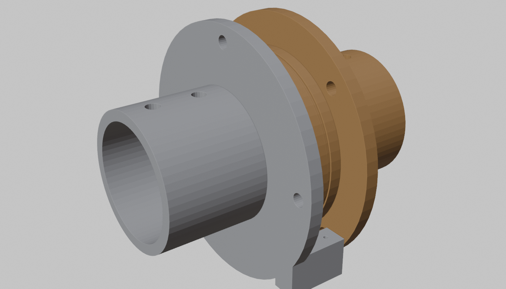
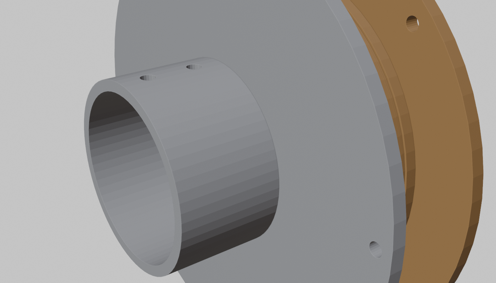
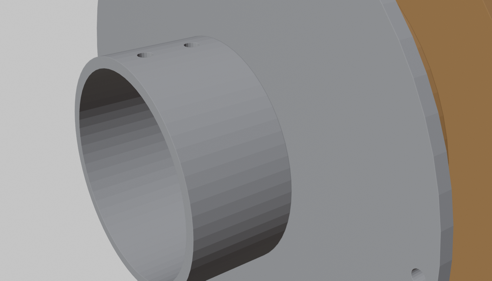

# 11 - The ring joint: the second primitive (P-009)

The knuckle chain (`09-knuckle-chain.md`) cannot rotate a segment about its own axis. Eight DOF
need exactly that: forearm pronation/supination, shoulder and hip internal/external rotation,
neck yaw, waist yaw. Treated the way the chain was: one generator, `cad/blender/ring.py`, with
the variations sewn in as presets, and a set of rules that fell out of making them similar.

## Anatomy

| Part | Fixed to | Carries |
| --- | --- | --- |
| **hub** | the proximal bone | a mounting flange (three M3 inserts) with a socket for the proximal pipe; the inner race (or the seat for a bought thin-section bearing); a stop pin; two bars holding the sheath sockets tangent to the rotor's drive groove; a through bore for every tendon and wire that continues down the limb |
| **rotor** | the distal bone | the outer race; the drive groove with the crimped-bead pocket; the arc track that the stop pin runs in; the ball loading hole; a mounting flange with a socket for the distal pipe |
| **cap** | rotor (bought-bearing variant only) | retains the outer race |

The rotor is its own pulley: the closed loop wraps the rotor's rim, the midpoint bead sits in the
pocket, and the two runs leave tangentially at the sides heading down the limb, so the drive
radius is the rotor radius and the moment arm is as large as the joint itself. That is why the
forearm ring, driven by a W-mid at 130 N continuous, delivers 3.6 N m of pronation torque from a
56 mm part.

## Presets

| Preset | Rotor OD | Bore | Width | ROM | Bearing | Pipe | Instances | Solid mass |
| --- | --- | --- | --- | --- | --- | --- | --- | --- |
| forearm | 56 | 24 | 14 | +-80 | 16 x 6 mm balls | 1" both ends | 2 | 102 g |
| forearm_6808 | 64 | 28 | 14 | +-80 | 6808 thin-section bearing + cap | 1" | 0 (alternative) | 125 g |
| shoulder_rot | 84 | 40 | 18 | +-80 | 28 x 6 mm balls | 1" | 2 | 214 g |
| hip_rot | 100 | 44 | 22 | +-35 | 24 x 8 mm balls | 1-1/2" | 2 | 337 g |
| neck_yaw | 50 | 18 | 14 | +-80 | 13 x 6 mm balls | 1" | 1 | 92 g |
| waist_yaw | 120 | 60 | 24 | +-45 | 32 x 8 mm balls | 2" | 1 | 479 g |

All verified manifold after STL export and re-import except three residual sliver edges on the
shoulder rotor and two on the unused 6808 variant, which slicers repair.

## Rules that came out of it

1. **Print the bearing.** A four-wall square race in PETG running on airsoft BBs (6 mm, 8 mm;
   about $3 per thousand) carries radial and axial load, is loaded through one plugged hole, and
   costs nothing. The bought thin-section bearing is kept as a preset so the hub and rotor can be
   swapped to it without changing anything else if the printed race wears. Section 2 of
   `10-rotational-geometry.md` is the physics; this is the cheapest test of it.
2. **Everything that continues past the joint goes through the bore, on the axis.** A run at
   radius rho across a joint twisted by theta lengthens to sqrt(L^2 + (rho theta)^2)
   (`10-rotational-geometry.md`, section 4 item 2). At 3 mm off-axis a forearm twist of 160
   degrees costs 0.4 mm; at 8 mm it costs 3 mm. So the bore is sized for the whole downstream
   bundle, and the bundle is tied to the axis, not the wall.
3. **The stop is a pin in a track, and the track length is the range of motion.** The arc the
   stop pin travels is 2 x ROM plus the pin width, printed into the rotor's proximal face. Homing
   drives the rotor into one end of the track (D-014). Unlike the knuckle's stop sector, this
   stop is hidden inside the joint and cannot pinch anything.
4. **The sheath ends must stand off the rotor.** The runs leave the rim tangentially at the sides
   and travel 0.7 rotor radii before they enter their PTFE sockets, on bars that reach out from
   the hub flange. Putting the sockets closer collides with the rim; putting them farther wastes
   limb length. 0.7 R is the compromise the generator uses for every size.
5. **The flanges are pipe sockets.** With pipe bones (below) the ring joint is two flanges with a
   bearing between them, and the limb is pipe, joint, pipe, joint.
6. **The rotor and the drum are the same object at two scales.** The winch drum (`02`) is a small
   anchored pulley driven by a motor; the rotor is a large anchored pulley driven by a line. Both
   have a groove, a midpoint anchor, two runs leaving tangentially and a hard stop. The tapered
   and fusee drums of `10-rotational-geometry.md` section 6 apply to the rotor rim too: a
   non-circular rotor rim would give pronation a position-dependent moment arm for free.

## Pipe bones (P-009, second note)

Between two printed joint ends a long bone is an undifferentiated tube, and a bought tube is
better than a printed one: stiffer, faster to obtain, and it costs a dollar. Schedule 40 PVC or
ABS DWV pipe is the default; aluminium or EMT conduit where more stiffness is wanted. PEX and
vinyl are too flexible for bones (fine for nothing structural here).

| Bone | Pipe | OD | Length | Sockets on |
| --- | --- | --- | --- | --- |
| humerus | 1" | 33.4 mm | ~200 | shoulder end, shoulder_rot hub and rotor, elbow upper |
| forearm | 1" | 33.4 mm | ~150 | elbow lower, forearm hub and rotor, wrist base |
| femur | 1-1/2" | 48.3 mm | ~330 | hip end, hip_rot, knee upper |
| tibia | 1-1/4" | 42.2 mm | ~330 | knee lower, ankle base |
| spine | 2" | 60.3 mm | ~300 | waist end, waist_yaw |
| neck | 1" | 33.4 mm | ~60 | neck base, neck_yaw |

Every socket is a bore of pipe OD + 0.4 mm, 30-40 mm deep, with two radial M3 heat-set inserts
as set screws; the pipe butts on a shoulder so it cannot slide into the joint. The sheathed
tendons and the wiring run inside the pipe. 1" Schedule 40 PVC weighs about 0.4 kg/m and has a
bending stiffness EI of roughly 100 N m^2, comparable to a four-wall PETG shell of the same size
at a tenth of the print time. The print-bed splitting feature of the chain generator stays
available but no preset uses it any more: nothing printed is longer than 80 mm.

## Still open

- Rotor rim groove depth versus ball race depth share a thin wall on the small presets; the
  neck rotor wall is 6 mm, which is enough, but the generator does not check it yet.
- The stop pin is a printed boss; the hip and waist presets use a 3 mm one. If it shears in
  the Phase 5 push tests it becomes a steel pin (a cut 8 G needle) in a printed pocket.
- Ball race preload is by ball count only. A printed wave washer under the hub flange is the
  next feature if the joint rattles.
