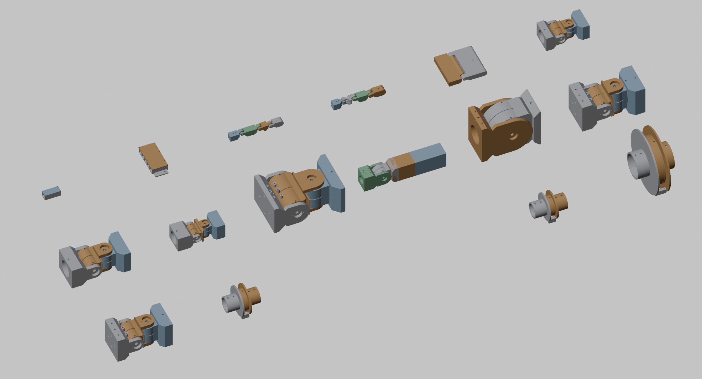

# 12 - Render and simulation (P-009)

Where the project stands on seeing the robot and simulating it, after the generators of 09 and 11.

## Render



The gallery is one headless Blender render of every STL in `cad/out/` laid out on a grid
(scratch script, regenerated whenever the generators change). Per-part renders live in
`docs/img/`. There is no assembled robot render yet: the parts exist, the whole-body rig exists
(`03-skeleton-joints.md`), and parenting parts to bones is the next render step. Pipe bones
(11) make that step mostly a matter of placing joint ends at the bone ends of the rig.

## Simulation pipeline

```
cad/skeleton.json ---- tools/export_urdf.py ----> sim/robot.urdf ----> MuJoCo (tools/sim_check.py)
   segments, joints,         links, joints,            18 links,            floor, locked joints,
   limits, masses            inertia, limits           32 revolute          push tests
                                                       + floating base
                                                                     ----> Isaac Lab (Phase 6b,
                                                                           see references.md)
```

- **One source of truth.** The URDF is generated from the same joint table as the Blender rig,
  so limits, axes and signs cannot drift between CAD, simulation and (later) firmware. Hand and
  face DOF are not exported; hands are rigid bodies for now.
- **Mass model.** `skeleton.json` carries a mass per bone from the 20 kg budget (pelvis with
  battery and bank 3.5 kg, torso 3.5, each thigh 2.2, and so on, 20.3 kg total), with each
  bone's centre of mass at its midpoint until the shells exist. The exporter also does forward
  kinematics on its own, so the centre of mass and the support polygon can be checked without
  any simulator.

### Centre of mass and support polygon (`python tools/export_urdf.py --pose`)

| Pose | CoM (x, y, z) m | Support polygon (feet on the ground) | Stands? |
| --- | --- | --- | --- |
| rest | (0.000, -0.006, 0.932) | both feet | yes |
| sign-check demo (arm forward, leg raised, foot pointed) | (-0.026, -0.111, 1.062) | right foot only | no |
| left leg raised, nothing else | (0.000, -0.061, 0.987) | right foot only, x in [-0.15, -0.05] | **no**: CoM at x = 0 |
| left leg raised, right hip adducted 12 degrees, waist leaned 18 degrees | (0.042, -0.061, 0.984) | stance foot now under the CoM | yes |

The third and fourth rows are the Phase 5 hip strategy stated as numbers: a foot cannot leave
the ground until the stance hip and the waist have moved the body over the other foot.

### MuJoCo (`python tools/sim_check.py`, needs `pip install mujoco`)

MuJoCo 3.17 loads the URDF directly. The check adds a floor, holds every hinge at its rest
angle with a 400 N m/rad spring and 20 N m s/rad damping (a locked winch with tendon give), drops
the robot a centimetre, and pushes it forward at the torso for 0.2 s:

| Test | Result |
| --- | --- |
| stand 3 s | pelvis 0.929 m (rest 0.950), tilt 0.2 degrees: stands |
| push 10 N, 20 N | stands |
| push 30 N and above | falls |

The quasi-static tipping estimate in `08-passive-balance-springs-compliance.md` was 18 N at
shoulder height; a 0.2 s impulse at the torso surviving 20 N and failing at 30 N is the same
answer from a different direction. MuJoCo's subtree centre of mass (0.931 m) agrees with the
exporter's own kinematics (0.932 m).

## What is not simulated yet

- Tendons. Joints are driven as hinges with springs. MuJoCo has a tendon model (spatial tendons
  over wrapping geometry) that matches this robot unusually well; routing the real closed loops
  and elastic antagonists is the next simulation step and the only way to simulate slack,
  pretension and the drag clutches.
- Feet are boxes; the printed sole, TPU pad and force sensors are not modelled.
- Actuator power limits. The 775/planetary torque-speed curve from `tools/tendon_calc.py` should
  become the motor model before any gait is trusted.
- Contact with the robot's own body, and the hands.

## Test scenarios to borrow

See `references.md`: Isaac Lab terrain and push curricula as laid out in primo, microban's walk
engine and foot conventions for the static walk, DreamDojo only once there is teleoperation data.
