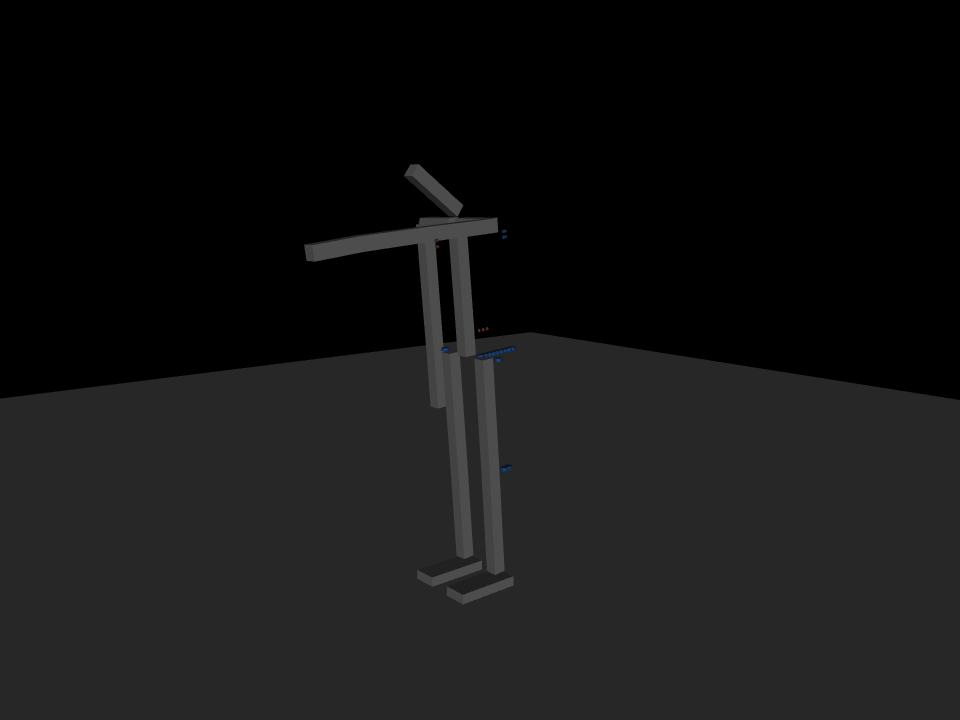

# 13 - Tendon-level simulation (P-010)

Answer to "will the tensions on the lines and other mechanisms be expressed while it exerts and
sustains forces?" Yes, now: every DOF in `sim/robot.xml` is driven by the drive train of `02`,
element for element, and every line's tension, every clutch's slip and every motor's torque and
power are read out per step. "Ready to walk through the gauntlet of the gym?" No: it stands,
takes pushes and holds poses; there is no gait yet and the balance loop is a first cut. This doc
records what the model is, what the tests showed, and the three design changes the results forced.



## The drive train, element for element

```
   motor ----> gear hinge ----> clutch ----> drum hinge ----> line A ----> joint pulley
  DC curve    (self-lock)    (stick/slip)   (drum radius)    line B <----  (closed loop)
```

| Element of `02` | MuJoCo element in `sim/robot.xml` | Parameters (from `tools/tendon_calc.py`) |
| --- | --- | --- |
| Motor + gearbox | `general` actuator on the gear hinge, torque = T_stall (ctrl - w / w_noload), ctrl = voltage fraction | T_stall and w_noload at the drum after gearbox efficiency; reflected rotor inertia as hinge `armature` |
| Current limit (driver) | controller clamps ctrl so motor torque stays below 0.9 x clutch slip torque | the clutch is for external overloads; the motor must not slip it itself |
| Self-locking stage | joint equality on the gear hinge, engaged when the motor is switched off; released above the holding torque, then dry friction | holding torque 0.8 x stall (a worm is higher, a 298:1 spur lower; measure) |
| Drag clutch | joint equality gear = drum (stuck) released when its constraint force exceeds the slip torque; a tendon with `frictionloss` carries the sliding phase; re-stuck when gear and drum move together | slip at one third of line break strength: 297 N (W-max), 148 N (W-mid), 74 N (W-mini) |
| Closed-loop line, each side | `fixed` tendon, length +-(n r_p q - r_d phi), one-sided spring (dead band below its slack length) | stiffness EA / (n L_bowden) with EA = break / 0.08 (2 % at a quarter of break), slack length set for the pretension |
| Pretension / barrel adjuster | the slack length, slightly negative | 25 % of the continuous line force (was 10 %, see below) |
| Sheath friction | tendon `damping` = 0.02 x stiffness | unmeasured; needs the implicit integrator |
| Tackle | coefficient n r_p on the joint, r_d on the drum | 2 at the W-max joints, 3 at the ankle, 1 at W-mini |
| Hard stops | joint ranges from `cad/skeleton.json` | |
| Joint sensor (D-008) | the controller reads joint angle and gear angle separately | |

Per DOF this is 3 hinges, 3 tendons, 2 equalities and 1 actuator; 32 DOF give 102 DOF, 96 tendons
and 32 motors, and the whole suite runs in about ten seconds. `python tools/export_mjcf.py --table`
prints the per-DOF numbers (pulley and drum radii, stall and continuous line force, stiffness,
pretension, clutch torque). Pulley radii are the CAD values: knuckle lugs 12 mm (wrist) and 10 mm
(neck), ring rotors 28 mm (forearm) and 25 mm (neck yaw), and the calculator's moment arms for
the W-max joints (hip 60, knee/ankle/waist 50, shoulder 40 mm).

Two things the soft-constraint solver taught: a friction constraint alone creeps under a static
load, like a damper, so a stuck clutch and a locked worm have to be rigid couplings (equalities)
that the controller switches off at their torque limits; and a drum with no inertia makes those
constraints ill-conditioned, so the drum carries a few percent of the reflected rotor inertia,
which a real drum with its clutch plate has anyway.

## The controller (what the firmware will do)

- Inner loop: position servo on the **gear** (motor encoder), voltage = 3 (phi_des - phi) - 0.02 w.
  The motor's own back-EMF damps it; a joint-side voltage loop through the clutch and the elastic
  line has no damping on the drum mode and chattered at full voltage in the first attempt.
- Outer loop: the gear target comes from the joint target through the loop geometry,
  phi_des = (n r_p / r_d)(q_des + 0.5 e + trim), trim an integral of the joint error clamped at 10
  degrees. This is "the joint sensor is the truth, the motor encoder is for velocity" of D-008 as
  a control law; it absorbs line stretch and clutch creep.
- Lock: when the gear is on target and still and the joint is within 3 degrees, the motor is
  switched off and the lock equality holds the gear. Hysteresis 2:1 on release. The ankle locks
  and re-locks within 0.2 degrees because one degree of ankle is 10 N m through its lines, the
  whole centre-of-pressure budget of the sole; coarser steps rocked the robot on its heels.
- Balance: an ankle strategy on the CoM against the sole centre (from the simulator here, from
  IMU plus joint angles on the robot): 1 rad/m and 0.5 rad s/m, clamped at 1.5 degrees, plus a
  slow integral (0.5 rad/(m s), clamp 4 degrees) that re-plans the standing lean when the posture
  changes (an arm raised forward moves the CoM 35 mm). No hip strategy yet.
- Standing pose: ankles dorsiflexed 5 degrees, body leaned forward 5 degrees about the ankle, so
  the CoM sits over the sole centre instead of 6 mm ahead of the ankle, where the heel margin was
  55 mm. Targets are ramped (1.5 s for an arm raise or a squat); a step slams the drive train.

## Results (`python tools/sim_tendon.py`, baseline; `--stiff-mini` in brackets where different)

These are the P-010 results with the first balance loop. `14-balance-gauntlet.md` (P-011) replaced
that loop; the sustained 15 N and the 30 N push now stand, and the table there is current.

| Test | Result | What the lines did |
| --- | --- | --- |
| stand 4 s | stands, tilt 4 deg, **16 W** (14 W) mean, most of it the neck | ankle lines 146 N each side at 5 deg lean, 72 N pretension elsewhere, no slack on any W-max loop |
| push 10 N, 20 N for 0.2 s at the torso | stands | ankle peak 145 N, SF 6; no clutch slip |
| push 30 N, 40 N | falls | spine line peaks 314 N at 40 N, spine clutch slips 23 deg; same threshold as the locked statue of `12` and the 18 N estimate of `08` |
| sustained 15 N at the torso for 5 s | falls after ~3 s | spine 327 N (above its 288 N continuous rating), knees 250 N; the ankle strategy alone cannot hold 20 N m of lean, this needs the hip |
| left arm raised forward over 1.5 s, 1 kg in the hand for 4 s | stands, tilt 2 deg, 27 W | shoulder pitch line 227 N (SF 3.9), spine 232 N, wrist pitch 77 N which is above the W-mini continuous 37 N (60 N, SF 3.7) |
| quarter squat (hip -10, knee 30, ankle -20) over 1.5 s, held 4 s | stands, tilt 1 deg, pelvis down 3 cm, 22 W | ankle 145 N, knee 133 N; both lines of every leg loop stay taut |

Per-line readouts in every test: peak tension against the continuous rating and break strength,
the fraction of time slack, clutch slip in degrees, motor torque against stall, time above the
continuous torque, time locked, electrical energy. `--csv` writes the tension time series of every
line to `sim/out/`.

The failures are informative, not bugs: a 30 N impulse or a 15 N lean needs the hip strategy and a
spine loop rated above 288 N continuous (or a second W-max on the waist); the model now says so in
newtons.

## What the simulation forced (three design changes)

1. **Pretension 25 % of the continuous line force, not 10 % (D-022).** A closed loop's stiffness
   is 2k(n r_p)^2 while both sides are taut and half that once the unloaded side goes slack. At
   10 % the ankle's unloaded side went slack under the standing load, the ankle sagged 8 degrees
   under its own 14 N m and the body fell forward. At 25 % both sides stay taut through standing,
   pushes and the squat. Cost: 72 N standing in every W-max loop, well inside the line rating.
2. **The W-mini joints as drawn are too soft and too weak (D-023).** With 10 mm neck lugs and
   12 mm wrist lugs the neck is 1 N m/rad and cannot lift the head back once it reaches a stop
   (clutch slips at 0.74 N m, the head needs 0.64 at 59 degrees with the body leaned); the wrist
   swings +-2 degrees with every body sway. `--stiff-mini` (25 mm pulleys, 25 % pretension) holds
   the head within +-2.5 degrees and stops the neck clutch slipping in every test. The chain
   presets need 25 mm lugs at the wrist and neck, or those joints move to the ring primitive.
3. **The driver's current limit sits below the clutch (D-021).** Every class had stall torque
   above its clutch slip torque, so a saturated servo slipped its own clutch and ran away to
   no-load speed. The clutch is overload protection for external loads; the firmware limits motor
   current to 90 % of the slip torque.

And two controller lessons worth keeping: the ankle wants torque-sized steps (fine lock tolerance,
slow re-planning of the lean), and the gear-position cascade is the structure, not a joint-error
voltage loop.

## Reading the numbers against the design docs

- W-max loops at the hip, knee and ankle peak at 145-250 N in standing, squatting and 20 N pushes:
  SF 3.6-6 on the 890 N line, under the 288 N continuous rating. The calculator's walking
  scenarios (640 N ankle push-off) are still the sizing case; standing is not.
- The spine is the first W-max loop to exceed its continuous rating (sustained lean, 40 N push).
- The wrist line exceeds the W-mini continuous rating holding 1 kg; the calculator's wrist
  scenario (2:1 tackle, 4 mm drum) was right and the sim's 1:1 at 3 mm was the CAD preset's
  implicit choice. Same fix as (2).
- Standing costs 8-16 W electrical with the locks engaged, almost all of it the neck and wrists
  hunting; the W-max joints spend 60-95 % of the time locked at zero current. That is the
  zero-power hold of `02` and `08` measured.

## Not yet in the model

- Hands and face (rigid), toes, the sole's TPU pad and force sensors (feet are boxes).
- Spatial tendons over the real pulley geometry (the fixed-tendon coefficients assume the equal
  moment arms of D-014, which the chain and ring generators enforce).
- Hip strategy, stepping, any gait. Motor thermal limits (only reported as time above continuous).
- Line creep, knot slip, sheath compression (the Bowden is rigid here).

## Next (as written at P-010; see `14` for what happened)

Hip strategy and a static-walk engine on this model (the stance leg's lines go to peak load and
the swing leg's go slack, which is exactly what this model can now show), then the Isaac Lab
conversion for the gauntlet proper (`references.md`). The CAD follow-up is the 25 mm W-mini
pulleys. For the learning side, `references.md` now notes LeRobot and the sibling
`ai-embedded-dynamic-diversity` project; this model is the harness that can ground a generic
DOF-and-sensor policy in real tensions, slack and clutch slip.
