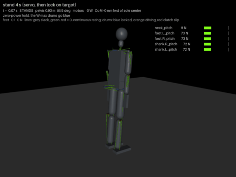

# 14 - Is it connected, the balance controller, and the first gauntlet (P-011)

P-011 asked three things: whether the simulated segments are really connected or could pass
through each other, to see the model animated with its parts working, and to carry the hip
strategy toward the gauntlet. This doc answers the first, records what the second produced
(`docs/img/gauntlet.mp4`, `docs/img/gauntlet.gif`, from `tools/sim_video.py`), and reports what the
balance work found, including the parts that did not work. The ML side (the sibling repository's
harness) is at the end.

## 1. Connected, and self-collision is on

The model is a kinematic tree: every segment is a body whose hinges sit at the bone head of
`cad/skeleton.json`, so adjacent segments can neither separate nor interpenetrate, whatever the
angle. The gaps in the P-010 picture were cosmetic: the segments were 50 mm sticks, and the
loose discs beside them are the winch gear and drum bodies (visual only, no contact).

Whether non-adjacent segments can pass through each other is a separate question, and the
answer was "they collide, but against sticks". MuJoCo's default filter was in force (parent and
child never collide, every other pair does), so a hand would have stopped at the trunk, but a
50 mm stick is a permissive envelope for a 120 mm thigh. The shapes are now the printed
envelope (D-025): capsules for the limbs, neck and head, boxes for the pelvis, trunk and hands,
masses unchanged. A contact census over standing, a quarter squat and an arm bend finds zero
body-to-body contacts; the arms hang 15 mm clear of the 260 mm trunk, the thighs 40 mm apart.
Nothing moves in "no clip" mode; what is still missing is the real shell geometry of the chain
and ring generators, which will replace these primitives when it exists.

## 2. What the recording shows

`tools/sim_video.py` runs the scenario list of `tools/sim_tendon.py` and draws into the render:
every winch's two line runs from its drum to the joint it drives, grey and thin when slack,
green through yellow to red as the tension passes the line's continuous rating; each drum disc
blue when the self-lock holds it with the motor off, orange when the motor drives, red while
the clutch slips; the centre of mass (blue), the measured centre of pressure (orange) and the
CoP the balance loop asked for (white); a HUD with the scene, electrical power, the CoM offset,
the foot loads and the five most loaded lines. The MP4 is 70 s at 30 fps; the GIF holds the
stand, the 30 N push, the sustained lean and the one-foot attempt.

What to look for: in the stand the W-max drums turn blue within two seconds and the ankle lines
sit at 120 N each (the 5 degree lean); in the pushes the white CoP marker jumps to the toe line
in the first frames after the push, the ankle lines go to 146 N on one side and slack on the
other, and the body comes back; in the sustained lean the white marker sits 90 mm ahead of the
CoM for five seconds; in the weight shift the foot loads in the HUD go from 100/100 to 190/10 N
while the hip-roll drums drive; in the one-foot scene the right foot lifts and the robot falls
to the side within a second.

## 3. The balance controller that works (D-024)

The P-010 loop moved the ankle targets in proportion to the CoM error. It had a wrong velocity
estimate (thirty times too large, which is why its gains had to be tiny) and it never asked the
sole for the torque the toe line allows. The loop now (`balance_loop()` in `sim_tendon.py`):

- **Capture point to CoP.** With x the CoM offset from the support reference, v its velocity and
  omega = sqrt(g / h), the CoP the feet must produce is p = (1 + k)(x + v / omega) + integral,
  clamped 30 mm inside the toe and heel lines (100 mm from the sole centre).
- **Disturbance observer.** The CoM acceleration (IMU) less what the measured CoP explains is
  an external force, carried as the CoM offset it is equivalent to and added to x. A 15 N push
  at the chest is 94 mm of equivalent offset, and the CoP demand goes there in the first
  100 ms instead of after the body has moved.
- **Ankle as a torque source through its lines.** The ankle torque for that CoP is m g times
  the CoP's distance from the ankle; it becomes a gear position through the loop's stiffness
  (2 k (n r_p)^2 while both runs are taut, half that beyond the pretension range), added to the
  planned ankle angle. The lines are the series spring; the gear encoder closes the loop; the
  joint sensor trim is off for the ankle so it does not fight the torque.
- **Lock gating.** The ankle may switch its motor off and lock only after its torque demand has
  been steady for a second. Locking and unlocking inside the loop rocked the sole.
- **Start pre-stretched.** The ankle gears start where the standing torque needs them, so the
  first half second is not a fall onto the lines.

Results (`python tools/sim_tendon.py`):

| Scene | Result | Lines and motors |
| --- | --- | --- |
| stand 4 s | stands, **8 W** (was 16), W-max drums locked | ankle lines 119 N, every W-max loop taut |
| push 10, 20, 30 N for 0.2 s at the torso | **stand** (30 N fell before) | ankle 146 N peak, SF 6; CoP at the toe line for 0.3 s; no clutch slip |
| push 40 N | falls | the capture point leaves the sole: this needs a step (Phase 6b) |
| sustained 15 N at the torso for 5 s | **stands** (fell before) | ankle 140 N for 5 s, 16 W; CoP held 72 to 122 mm ahead of the sole centre, CoM within 13 mm |
| arm forward, 1 kg for 4 s | stands | shoulder 202 N, spine 228 N, wrist 77 N (W-mini, above rating as in `13`) |
| quarter squat 4 s | stands, 17 W | knee 151 N, ankle 130 N |
| weight shift onto the left foot | stands | 190/10 N on the feet, CoM over the left sole, hip-roll loops at 12 to 15 N m |
| one-foot stance, right foot lifted | **falls** within 1 s of the lift (stands since P-013, `15`) | see section 5 |

## 4. What the hip could not do (and why it is in the code with zero gain)

The sustained-lean failure of P-010 looked like a job for the hip strategy. Three versions were
built on top of the CoP loop: a slow trunk lean back against the push, a fast one (20 deg/s),
and the textbook flexion toward the push. Every one fell sooner than the ankle alone. The
trace shows why: a 15 N chest push on a 20 kg body with a 130 mm toe margin needs the CoP 95 mm
ahead of the CoM, which the ankle can supply; any hip motion fast enough to matter puts a
reaction on the pelvis that lifts the heels, and the body goes over the toes. The quasi-static
benefit of a trunk lean (8.5 mm of CoM per degree) arrives too late. The sagittal hip term
stays in the code (`HIP_GAIN`, `HIP_RATE`) at zero. A real hip strategy here means stepping, or
a whole-body controller that accounts for the angular momentum it generates.

## 5. The weight shift works; the one-foot hold does not yet (D-026)

Superseded at P-013: the one-foot hold stands for 10 s (`15-one-foot-hold.md`, D-027, D-028).
The diagnosis below was half right (the stance hip does run past its 14 N m range on the 50 mm
pulley) and half wrong (that is not what made it fall; four controller faults did).

The lateral side taught more than the sagittal. Letting both ankles run CoP control in double
support oscillated at once: two planted legs are a closed chain, and an ankle roll inside it
moves 100 N between the feet for a 10 mm CoM motion. Now the hip rolls shift the pelvis (P + I
+ D on the lateral CoM error, slewed at 9 deg/s), the ankle rolls follow with the opposite
angle so the soles stay flat, and the ankles never fight the chain. The robot puts 95 % of its
weight on one foot with its CoM over that sole in about five seconds, calmly.

The lift then fails in the first second, three ways in turn, each fixed and revealing the next:
the balance loop switched support feet on foot height, too late (now on foot load, with the
planner declaring the swing foot); the swing hip's target stepped to its plan while the foot
still carried 100 N and pushed the body sideways (now eased, and held until the foot has left
the ground); the lift itself pushed off through the toes (now knee first). What remains is the
stance hip: once the body hangs off the outboard hip, its roll loop carries 15 to 26 N m, above
the 14 N m pretension range of its 50 mm pulley and tackle 2, so one run goes slack, the loop
is half as stiff and sags 3 to 6 degrees, and a pelvis roll of a few degrees moves the CoM past
the 40 mm the stance sole can correct. Attempts to steer the stance hip from the lateral CoM
error gave opposite results in successive runs: with both the hip and the ankle compliant, the
sign of the CoM's response to a hip command depends on what the ankle is doing at that moment.
The honest state is: double support solved, single support open, and it is an actuator-sizing
question as much as a control one. `export_mjcf.HIP_ROLL_60` puts the hip roll on the 60 mm
pulley with tackle 3 (the ankle's arrangement) for the next attempt; a lateral two-link model
with the hip as a torque source is the controller to build on it.

## 6. The harness: functioning parts under a learned controller

The controller above is the firmware's, not a neural one. What P-011 did on the learning side
is make the model reachable as an embodiment of the user's `ai-embedded-dynamic-diversity`
project (`references.md`), in a worktree there on branch `feat/robot-tendon-harness`:

- `sim/robot_tendon.py` loads this repository's `tools/sim_tendon.py` and registers
  `humanoid_tendon32`: 32 controls (joint targets in [0, 1], delta mode by default so an
  untrained policy cannot slam the drive train, the firmware cascade and balance loop running
  underneath) and named sensor channels in the families joint_angle, joint_rate, gear_angle,
  strain (64 line tensions against the continuous rating), slack, clutch_slip, lock, current,
  imu, pressure (foot loads, CoP) and com.
- `add-sim robot-tendon --policy hold|random|zero` rolls it out and reports the standing
  fraction, the mean electrical power and the worst line against its rating; `--spec-output`
  writes the spec `discover_from_spec` takes. Tests skip without MuJoCo or this checkout.

So the parts function under whatever that project's core outputs, and every slack or
overloaded line is a sensor channel the core sees. Training a policy on it is that project's
work; LeRobot stays the route for the manipulation side.

## Not yet

Stepping (the 40 N push and anything beyond the sole), the single-support hold (section 5),
spatial tendons over the real pulley geometry, the sole's TPU pad and force sensors as sensors
rather than contact sums, motor heating, line creep. The neck flopped into its stop in the
baseline model until the presets were regenerated with 25 mm neck lugs (D-032).

## Next (as written at P-011; the one-foot hold is done in `15`)

The one-foot hold with the 60 mm hip roll and a lateral two-link model, then the first static
step on this model (the stance leg's lines at peak, the swing leg's slack, which is what this
model exists to show), then the Isaac Lab conversion.
