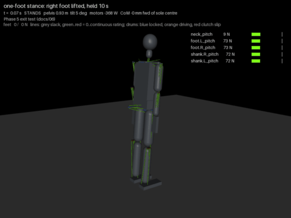

# 15 - The one-foot hold: single-support balance on the tendon model (P-013)

The Phase 5 exit test of `06` (stand on one foot with the other lifted) failed at P-011 within a
second of the lift (`14`, section 5). This doc records what it took to pass it, in the order the
simulation forced each change, because most of them were not the thing I set out to build. The
scenario is `onefoot` in `tools/sim_tendon.py`; the recording is `docs/img/onefoot.mp4` and
`docs/img/onefoot.gif` (`python tools/sim_video.py --only shift,onefoot --gif --out onefoot`).

## Result

| Scene | Result | Lines and motors |
| --- | --- | --- |
| weight shift onto the left foot | stands | 190/10 N on the feet, hip-roll loops 12 to 15 N m |
| one-foot stance, right foot lifted 100 mm, held 10 s | **stands**: CoM within 14 mm of the stance sole centre after the first second, within 5 mm after the third; pelvis roll within 1 deg | stance hip roll 15 to 25 N m (232 N peak on the line, SF 3.8, one run slack 7 % of the time); stance ankle pitch 10 to 22 N m; 33 W mean over the 19 s scenario |
| the same on the 50 mm, tackle 2 hip roll of `14` | stands | stance hip roll 20 N m against a 14 N m linear range: one run slack 27 % of the time, 238 N peak |

Every other scene of the gauntlet is unchanged (stand 9 W, pushes 10 to 30 N stand, 40 N falls,
sustained 15 N stands, arm hold and squat stand).

## What it took, in order

1. **The stance ankle lost its parallelogram term at the lift.** In double support the ankle
   rolls hold minus the hip shift so the soles stay flat under the shifted pelvis. When the model
   entered single support the stance ankle switched to torque mode and its target became the
   plan plus the torque offset, without the shift: a 5 degree step that rolled the whole body
   over the sole's outer edge in a quarter of a second. The first trace showed the measured
   centre of pressure sitting at 46 to 48 mm (the edge is 50) from the first frame after the
   lift. The ankle now keeps the parallelogram term in every mode.
2. **The knee-first lift pushed the sole into the floor.** With the swing ankle holding the
   sole rigid, bending the knee pressed the heel down: the swing foot's load rose from 19 N to
   128 N and the push shoved the body sideways. A fold with hip, knee and ankle together (sole
   kept level, foot straight up) removed the push-off but not the fall.
3. **The lift was a stiffness discontinuity.** The torque-mode ankle drops the proportional
   term of the outer loop and freezes its integral trim, so the stance ankle went soft at the
   moment it had to carry everything. The body picked up a lateral velocity the 50 mm sole could
   not capture (capture point past the edge 0.35 s after the lift). In single support the stance
   ankle now stays in position mode.
4. **Which way does the stance hip move the CoM?** With the ankle in position mode, a +2 degree
   step on the stance hip moved the CoM left and a -2 degree step moved it right, cleanly, in two
   probe runs. The reason is the geometry of (1): the ankle target follows the hip, so a hip
   command leans the whole leg over the foot while the pelvis stays level. It is a one-leg
   parallelogram, and the hip's own torque is only what keeps the pelvis level. The stance hip
   runs a capture-point loop on that, hip = hold - SS_KP (e + v / omega) - SS_KI integral(e),
   with 1.5 rad/m, 1.0 rad/(m s) and a 0.5 rad/s slew. With this the hold lasted 10 s for the
   first time, in two gain settings; the control run with the hip merely holding fell at 10 s.
5. **The velocity estimate blew up at every support change.** It was the derivative of the CoM
   offset from the support reference, and the reference jumps by the foot spacing when a foot
   leaves. One such jump during the weight shift (a 10 ms bounce unloaded a foot) read as
   4 m/s and threw the new hip loop to its 20 degree clamp. The velocity now comes from the CoM
   itself (the IMU's job), and a foot leaves support only after 0.15 s below 5 % of the weight
   unless the planner declared it the swing foot.
6. **Where the swing leg hangs matters more than its mass.** Hanging straight down from its hip,
   the swing foot sat beside the stance foot, 85 mm from its centre, and the 100 mm wide soles
   touched; the swing hip wound up to 40 N m against the contact. Held parallel to the leaning
   stance leg, its mass sat out wide, the stance hip ran out of range and the body fell the
   other way. The fold is now 10 degrees of hip and 50 of knee with the sole level, which puts
   the foot 100 mm up and 0.2 m behind the stance foot, and the swing hip hangs 3 degrees
   abducted. People lift the heel behind for the same reason.
7. **The disturbance observer oscillated the sagittal loop in single support.** With one
   rocking sole the measured CoP is noisy, and the hip-roll loop's own accelerations read as a
   push; the sagittal CoP demand swung across the whole sole every half second and the ankle
   pitch ran at 30 to 40 N m. The observer's time constant is 0.25 s in single support (0.08 s
   in double, where the 15 N push test needs it).

## What the hip actually does here

The task on the hub asked for a lateral two-link model with the hip as a torque source. What
works is simpler and worth stating plainly: the stance ankle positions the leg, the stance hip
keeps the pelvis level, and the CoM loop commands both through the parallelogram coupling. The
hip's torque is the pelvis-levelling torque (the trunk and the swing leg hanging off it, 15 to
25 N m), not a balance torque. The lateral authority is still the sole's 50 mm; the loop just
stops wasting it. A real hip strategy (rolling the trunk against the leg) would add authority
beyond the sole, at the cost of the reaction that lifted the heels in `14`; it is not needed to
stand on one foot, and it stays out until stepping asks for it.

## Hip roll pulley (D-028)

The 60 mm pulley with tackle 3 is now the baseline for the hip roll (`export_mjcf.HIP_ROLL_60`;
`--hip50` restores the old one). The controller, not the pulley, fixed the hold: the 50 mm pulley
also stands for 10 s. The 60 mm one keeps the stance hip inside its pretension range (linear
to 26 N m instead of 14), so one run goes slack 7 % of the time instead of 27 %; on the real
robot that is the difference between a loop that reads its tension and one that chatters.

## Not yet

The swing foot still brushes the stance foot for a few frames during the first two seconds of
the hold (the fold passes it). The arm hanging against the thigh takes 250 N on its roll line
when the folded leg leans on it (`upperarm.R_roll`): the arms should be held clear in single
support. The neck still flops into its stop (W-mini presets, D-023). The sagittal loop in single
support runs the ankle pitch at 10 to 22 N m against a 22 N m linear range; a quieter hold
needs the ankle pitch pre-stretched for one foot's load.

## Next

The first static step on this model: shift, lift, place 100 mm ahead, shift back, with the
per-line readout the model exists for (hub task `first-static-step`).
