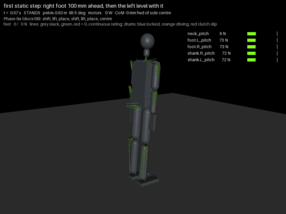

# 16 - The first static step on the tendon model (P-014)

The first step of `06` Phase 6a, on the MuJoCo tendon model of `13` with the controllers of `14`
and `15`: shift onto the left foot, lift the right, place it 100 mm ahead, move the weight onto
it, lift the left, place it level with the right, centre. The scenario is `step` in
`tools/sim_tendon.py`; the recording is `docs/img/step.mp4` and `docs/img/step.gif`
(`python tools/sim_video.py --only step --gif --out step`). It took most of a session and two
dozen traces, and most of what it took was planner work, not controller work.

## Result

The step completes and the robot stands at the end, pelvis at 0.928 m, 5.3 degrees of tilt (the
standing lean), 111 N and 87 N on the two feet. Electrical energy 1259 J over 32 s, 39 W mean.

| Phase | Time | Power | Stance-leg lines at peak | Swing-leg lines slack > 25 % | Leg drums locked > 90 % |
| --- | --- | --- | --- | --- | --- |
| 1 shift onto L | 9.1 s | 23 W | ankle pitch L 163 N, hip roll L 131 N | none | 8 of 12 |
| 2 lift R | 2.0 s | 53 W | hip roll L 215 N, ankle pitch L 165 N | none | 4 of 12 |
| 3 place R | 2.4 s | 60 W | hip roll L 221 N, ankle pitch L 199 N | (stance) hip roll L 25 % | 3 of 12 |
| 4 transfer onto R | 6.3 s | 42 W | ankle pitch L 255 N, hip roll L 222 N, hip roll R 178 N | none | 4 of 12 |
| 5 lift L | 2.0 s | 49 W | ankle pitch R 227 N, knee R 193 N, hip pitch R 180 N | none | 4 of 12 |
| 6 place L | 2.5 s | 34 W | ankle pitch R 184 N, hip roll R 160 N | none | 4 of 12 |
| 7 centre | 8.0 s | 44 W | hip roll R 207 N, ankle pitch R 171 N | none | 4 of 12 |

Where the feet landed: the right 120 mm ahead of the left (planned 102); the left 29 mm past
level with the right (planned level). The trailing ankle pitch in the transfer (255 N) is the
highest leg line of the run, against a 288 N rating: SF 3.5.

**Exit test** (no fall, no line above its continuous rating for more than 0.5 s): every leg,
hip, spine and arm line passes, the worst at 255 N of 288. Two lines do not: the neck pitch line
is above its 37 N rating for 32 s and the neck roll for 0.54 s. Both are the W-mini neck of D-023,
which is above its rating standing still (3.6 s in the 4 s stand scene); the step does not change
that verdict and no step-specific winch or pulley change is needed. The new `hot s` column of the
report is the longest continuous time each line spends above its rating.

**Sensitivity.** On the 50 mm, tackle 2 hip roll of `14` (`--hip50`) the step also completes, but
the hip roll lines reach 304 N and 295 N against 288 (for 0.09 s) and the hip clutch slips 8
degrees: the 60 mm pulley of D-028 is what keeps stepping inside the rating. On the 25 mm W-mini
variant (`--stiff-mini`, which fixes the neck standing still) the step falls: the left foot lands
51 mm long and the centring tips over it. The step works, but its margin is the accuracy of the
landing, and that is the next thing to fix.

## What it took, in order

Each item was a fall in a trace, found by printing the CoM error, foot loads, hip and knee
angles, foot positions and pelvis attitude every 0.25 s.

1. **The swing foot's ankle carried the stance torque.** In torque mode the swing ankle took its
   share of the sagittal balance torque, pointed the toe down and struck the floor at a 30 degree
   knee. The planner's swing foot now runs its ankle in position mode (sole level) and blends its
   torque share back in over 0.3 s after landing.
2. **The sagittal ankle torque was split equally between the feet.** A lightly loaded foot asked
   for half the torque rocks onto its toe and pushes the body. Splitting by the measured load
   feeds back (the loaded foot pushes itself off, the load slams across at 2 Hz); splitting by the
   planner's weight runs ahead of the real transfer. It is now split by where the CoM sits
   between the soles. This passes the whole gauntlet and makes the weight shift cheaper (30 W to
   17 W).
3. **The CoP limits were taken from the support reference.** With the CoM biased half a step
   ahead the demand reached past the toe. The limits now come from the soles on the ground.
4. **The leg targets came from guesses.** The planner now derives every leg pose from geometry
   (the leg that leans most is straight and sets the hip height; any other leg's knee from the
   law of cosines), from the feet, CoM and hip positions as measured. The leading foot slid 46 mm
   in one transfer and a plan from its old position landed the next foot behind it; the hips sat
   up to 40 mm from the CoM and a plan that put them on it landed the foot off its mark. A
   transfer measures the hip offsets at its start and holds them: re-measured every step they
   closed a loop through the trunk sway that dragged a lightly loaded planted foot 75 mm.
5. **The one-foot hold's fold does not suit a step.** Its ankle target (-45 degrees) sits on the
   -20 degree stop, so the sole hangs toe-down and caught the stance heel. The step folds 25
   degrees of hip and 38 of knee with the sole level, foot up ahead, where the step is going.
6. **A bent knee in position mode cannot carry a share of the weight.** The leading leg of a
   staggered stance has its knee bent; held at a fixed angle it gives as its lines stretch, the
   foot unloads, the support flips between one foot and two and the stance CoP pins at an edge.
   The leading knee is now a torque source about its planned angle (`Rig.knee_tau`) carrying the
   share of the weight the CoM position implies, all of it once the other foot is released.
   With the feet level both knees are nearly straight, the torque mode has no lever and the leg
   went weak, so the centring runs both knees in position mode.
7. **Replanning the instant a foot lands pulled it back up.** The landing pose reaches 20 mm
   below the floor; the transfer's pose 3 mm. The reach now eases between them over the
   transfer.
8. **A foot carrying 0 to 40 N flips the controller between one foot and two.** One flip ran the
   stance hip to its clamp with the pelvis rolled 45 degrees. Once a transfer has taken the
   trailing foot below a tenth of the weight, the planner declares it the swing foot, so the
   controller enters single support once.
9. **The placement came down before it came back.** From the fold the foot moved down and back
   in one ramp and touched the floor before it had travelled back, landing 48 mm long. Placement
   is now two moves: carry the foot level to 40 mm above its mark, then lower it.
10. **The hands rested on the thighs.** Hanging, the hands touched the thighs throughout and the
    wrist and shoulder roll lines carried the legs' sway (wrist rolls above rating for 4 s,
    shoulder roll 283 N). The arms are held 10 degrees clear for the step; wrist rolls now peak
    at 36 N.

## The observer changed the outcome

Halfway through, the same step stood in the console runner and fell in the recorder. The
ground-contact debounce (a foot leaves support after `UNLOAD_T` below 5 % of the weight) advanced
its timer every time `soles()` was called, and `soles()` is called by the balance loop twice per
step, by the planner's lift gate, by the trace and by the recorder's overlay. Watching the robot
moved its timing by a few milliseconds, which was enough to flip the step. The timer now advances
once per control step, in `control()`; every other call reads it. `UNLOAD_T` reads 0.075 s, the
value the controller of `15` was actually tuned on (0.15 s counted twice). Stand, pushes, arm,
squat and shift are unchanged to the joule; the one-foot hold still stands, at 38 W instead of
27 W: its lift gate also called the timer, so its lift moved. The console runner, the trace
and the recorder now agree on the step to the joule.

## Landing accuracy: five attempts that made it worse (P-015)

Both feet land long, so the next step was to correct the swing foot from its measured position
before it touches down. Five versions were tried; each made the baseline step worse than the open
loop placement above, which stays in the code.

| Version | Right foot (planned about 100 mm) | Outcome |
| --- | --- | --- |
| open loop (kept) | 120 mm | stands |
| aim point integrating the error through the hover and the descent | 2 mm | falls (the integral wound up during the carry, when the foot is far from its mark by design) |
| the same, integrating only over the mark, clamped to 50 mm | 67 mm | falls |
| the same, hip offsets held through the placement | 87 mm (98 on `--stiff-mini`, and the left 9 mm against 11) | falls; the landed foot was dragged 68 mm by the next transfer |
| the same, with the pelvis pitch fed into the swing leg live | 60 mm, never reached the floor | falls sideways (the swing hip's reaction pitched the pelvis and fed itself) |
| hover, one measured correction, lower open loop | 26 mm (measured 32 mm short, 33 mm long after the correction) | falls |

Why: the planner expresses the foot's target relative to the CoM and the hips, and while the foot
hovers the balance loop keeps moving the body under it. A correction computed from the measured
foot is overtaken by the balance loop's own motion, so the two fight. The one fact the attempts
established is a model error worth fixing in any version: the planner's leg geometry assumes the
pelvis keeps its standing pitch, and during the step it wanders up to 3.4 degrees, about 50 mm at
the foot (a + pelvis pitch moves the ankle exactly as the same + hip pitch does, measured). The
fix that should work is a swing-leg controller in the world frame: each step, the swing leg's
joint targets from the full measured pose of the pelvis and the target foot position on the
floor (inverse kinematics on the model's own chain), rather than planner geometry relative to the
CoM. That is filed as hub task `swing-leg-world-ik`.

## Not yet

- **Landing accuracy.** Both feet land long (18 mm and 29 mm here, 51 mm on `--stiff-mini`,
  where it falls). The landing pose is computed once from the CoM and hip positions at the start
  of the hover; the body leans during the placement. Correcting it from the measured foot made it
  worse five ways (above); the next attempt is a world-frame swing-leg controller.
- **The neck.** The 25 mm neck presets are in (D-032): within its rating standing, still above it
  in this scene. On that model the step falls: the right foot lands 123 mm ahead (planned 101), and
  the planner then places the left foot 333 mm behind, so the robot falls in the second transfer. The
  swing-leg controller has to pass on this model; `--stiff-mini` is now only the wider wrist.
- **The one-foot hold's arms** still rest on the thigh (hand roll above rating for 2.6 s); the
  step's 10 degree arm clearance should be applied there too.
- **Speed.** 32 s for one step: the transfers are 5 s ramps because the hip-roll shift is slow by
  design (D-026). A second step and a repeatable gait cycle come after the landing is accurate.

## Next

A world-frame swing-leg controller (hub task `swing-leg-world-ik`), then a second step (the left
foot ahead of the right) to make a gait cycle, on the D-032 model. The swing leg is `18`; the step that
stands on every variant is `19` (this doc's step is now `--open-swing`).
