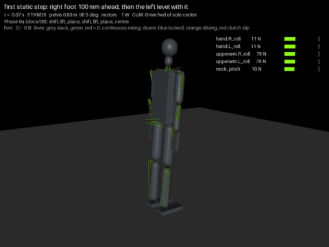

# 19 - A step with margin: staged transfers, no drum locks while stepping (P-027)

`18` left the swing leg landing within 10 mm but the step standing in at most 2 of 6 variants, with the falls
in the weight transfers and the centring. This doc records the transfer rebuilt for margin (hub task
`transfer-for-margin`). The step now stands in every variant of the grid, both feet land within 4 mm, no line
goes above its rating, and it costs a third of the energy.

## Result (`python tools/sim_tendon.py --only step`)

| | `16` (now `--open-swing`) | This doc (default) |
| --- | --- | --- |
| Grid: 2 models x 7 step lengths, 85 to 115 mm (`tools/step_sweep.py`) | stands 2 of 14 | **stands 14 of 14** |
| Landing error, right / left foot | 18 to 29 / 4 to 1148 mm | **2 to 4 / 2 to 3 mm** |
| Step lengths that stand (both models) | scattered | 50 to 150 mm; 170 mm times out at the second lift |
| Worst leg line | 255 of 288 N (SF 3.5) | **186 of 288 N (SF 4.8)** |
| Neck lines | above rating for 32 s | within rating throughout |
| Electrical energy, 100 mm step | 1259 J, 39 W mean (v0.1.0 model) | **444 J, 10 W mean** (44 s) |
| Exit test (no fall, no line above rating for 0.5 s) | neck fails | **passes, no flags** |

The rest of the gauntlet is unchanged to the joule: every flag below acts only inside the step.

| Phase | Time | Power | Lines at peak |
| --- | --- | --- | --- |
| 1 shift onto L | 11.4 s | 5 W | hip roll L 119 N, ankle pitch L 117 N |
| 2 lift R | 2.0 s | 18 W | hip roll L 137 N, ankle pitch L 130 N |
| 3 place R | 2.2 s | 18 W | ankle pitch L 139 N, hip roll L 135 N |
| 4 transfer onto R | 8.5 s | 17 W | ankle pitch L 186 N, hip roll L 157 N, hip roll R 141 N |
| 5 lift L | 2.0 s | 9 W | hip roll R 135 N, knee R 114 N |
| 6 place L | 2.2 s | 10 W | hip roll R 134 N, knee R 109 N |
| 7 centre | 16.0 s | 7 W | hip roll R 138 N, ankle pitch R 119 N |

## What it took

1. **The drums do not self-lock while stepping (`STEP_LOCKS`, D-034).** With 14 variants instead of 6, the
   grid still flipped between configurations at random. The weight shift, run on its own, showed why: with the
   weight on one foot the feet traded 25 to 33 N at 1 to 2 Hz. Turned off one at a time, the joint damping,
   the ankle loops and the weight-shift gains each changed the ripple a little; turning off the drum locks
   took it from +-33 N to +-5 N. A self-locking drum engages when its joint is still and on target and
   releases once the target has moved away; inside a balance loop that keeps nudging targets, that is a
   stick-slip cycle. Locks are for holding a pose at zero power, so the planner turns them off from the first
   weight shift to the end of the centring and back on once the robot stands. With that the step became
   repeatable: both models and every step length gave the same first landing (+3 mm), and each remaining
   fall became a fault that could be traced once and fixed.
2. **The transfer in stages, from planned geometry (`TRANSFER_PLAN`).** A: the CoM forward to half a step
   behind the leading sole centre at an even weight share (the staggered stance, which holds), both hips
   sinking 12 mm. B: the share ramped onto the leading foot as the first weight shift does it, the trailing
   leg shortened only as far as the CoM has arrived over the leading foot. Release when the trailing load is
   under a tenth and the lateral CoM has settled. The legs come from the plan alone (each hip's height from
   the lower straight leg less the crouch), so no measured height or offset closes a loop through the trunk.
3. **The weight share's lateral move fed forward into the hip shift (`TP_SHIFT_FF`).** The double-support
   weight shift integrates its error at a fraction of a degree per second; the transfer stalled 35 to 57 mm
   short for 6 s. The support reference moves sideways by a known amount, so the shift is told: that
   distance over the leg length.
4. **The crouch is kept through the second swing (`TP_KEEP_CROUCH`).** A foot landing level with the stance
   foot, from a straight stance leg, has no reach to press with: its leg hits full length on the floor.
5. **Damped least squares in the IK (`IK_DAMP`, `IK_STEP`).** At full length the landing target is out of
   reach; the plain solve then took huge steps and the leg flailed the foot 300 mm into the air.
6. **The centring in stages (`centre_plan`).** Press the landed foot until it carries load and the body is
   still, ramp the share back to even with the same feed-forward, move the CoM forward, straighten. Its
   press starts at zero (`TP_LAND_REACH`): starting it at the landing's 20 mm below the floor pushed an
   outward-leaning leg down and shoved the hip over the stance foot at 105 mm/s.
7. **The landed leg's rolls return to the weight-shift parallelogram only while it is loaded**
   (`restore_rolls`): returning them earlier dragged a light foot across the floor.

`LAT_FF` (the feed-forward inside the balance loop itself) stands 14 of 14 as well and halves the weight
shift's ripple, but it changes every scene that shifts weight; it stays off until the gauntlet is re-baselined
on it.

## Not yet

- **Locks and the rest of the gauntlet.** The one-foot hold still runs with locks (811 J, 41 W) and probably
  rocks the same way; the same switch would cut its cost. The hand-written controller's random pushes and
  the teacher recordings (`17`) were made with locks on.
- **170 mm steps** time out at the second lift: the CoM ends too far behind the leading foot for the trailing
  leg to unload. Longer steps need the transfer's end point scaled with the step.
- **Speed.** 44 s for one step. Every stage is gated on settled quantities, so it is slow by construction;
  shortening the stages is now measurable on the grid.

## Next

A second step to make a gait cycle (the left foot ahead of the right, then the right ahead again), judged on
the same grid, then re-recording the teacher demonstrations (`17`) from the stepping controller.
