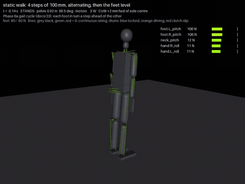

# 23 - A static walk: four steps and back to level (P-037)

The single step of `19` (with the landing press of D-037 and the locks of D-038) generalised to a gait cycle
(hub task `gait-cycle-static`): the right foot a step ahead, the weight onto it, the left foot from a step
behind to a step ahead, the weight onto it, and so on; after the last step the trailing foot comes level and
the robot centres.

## How (`tools/sim_tendon.py`)

`take_step(r, n_steps)`; the `step` scene is `n_steps = 1` (unchanged to the joule), the `walk` scene is
`WALK_STEPS = 4`. Every swing is `place()` (the world-frame IK of `18`), every transfer `transfer_plan(to)` (the
staged transfer of `19` with the landing press of D-037), the end `centre_plan(landed)` for either foot. The
drums stay unlocked from the first shift to the end of the centring (D-034, D-038).

One fault had to be fixed, and it only shows from the second step on. A transfer leaves the stance leg
crouched (`TP_KEEP_CROUCH`, docs/19), so a walk step starts from a crouched stance; the transfer's first stage
(the landing settle of D-037) planned the stance leg with no crouch, so it straightened at the plan's slew
rate as soon as the next transfer began, threw the body up and forward and kicked the new foot back off the
floor. The transfer now starts from the crouch the stance leg has (`c0`): none in the single step, the kept
crouch in a walk.

| Walk grid: 2 models x 7 step lengths (85 to 115 mm) x 3 mass sets | 20 kg | 775 roll-up | worm roll-up |
| --- | --- | --- | --- |
| first version | 14 | 1 | 1 |
| the CoM ended a quarter step behind the lead sole (`WALK_BACK=0.5`) | 9 | 4 | 0 |
| a 25 mm crouch in the walk's transfers (`WALK_CROUCH`) | 0 | 0 | 0 |
| the stance hip sinking while a straight swing leg cannot reach (`PLACE_SINK`, 30 mm) | 14 | 2 | 0 |
| **the transfer starting from the stance leg's crouch (default)** | **14** | **14** | **14** |
| the same with `PLACE_SINK` 30 mm | 12 | 13 | 14 |

42 of 42, every landing within 6 mm of its mark. The other flags stay in the code, off.

## The walk (20 kg model, 100 mm steps)

Stands, no flags: no line above its continuous rating, worst leg line 192 of 288 N (left ankle pitch), the neck
within its rating throughout. 93 s and 1113 J (12 W mean) for 400 mm.

| Phase | Time | Energy |
| --- | --- | --- |
| weight onto the left foot | 11.4 s | 60 J |
| first step (lift, place, transfer) | 15.7 s | 259 J |
| each further step (lift, place, transfer) | 15.7 to 16.1 s | 196 to 231 J |
| closing step (lift, place) | 4.2 s | 40 J |
| centring | 14.0 s | 116 J |

A walking step is about 16 s and 200 J for 100 mm: 6 mm/s, 2 J per mm. The transfer is three quarters of
both.

## Speed

One try, judged on the 42-variant walk grid: the transfer's stages at 2, 2 and 0.5 s instead of 3, 3 and 1
(`TP_A`, `TP_B`, `TP_HOLD`) stand in 39 of 42 (13, 12 and 14 by mass set; landings within 9 mm), so the
defaults stay. A faster walk needs the stages gated on what they wait for (load, CoM speed) with shorter
fixed ramps, not uniformly shorter ramps.

One stage at a time (P-045, docs/27): `TP_HOLD` 0 or 0.5 s stands 42 (step and walk), `TP_A` 2 s 39, `TP_B` 2 s 41.
The hold is dropped (D-046): the walk takes 92 s instead of 99.

## Not yet

- Speed (above): every stage waits for settled quantities; the transfer is the slow part.
- Turning, longer steps (170 mm timed out in `19`), slopes, and wind (hub task `wind-gauntlet`: walking into,
  with and across gusting wind, the sibling project's obstacle).
- The walk on the worm-torso and brushless builds' own masses beyond the two roll-ups.

## Next

Wind (`wind-gauntlet`), then a learned controller cloned from these walks.
