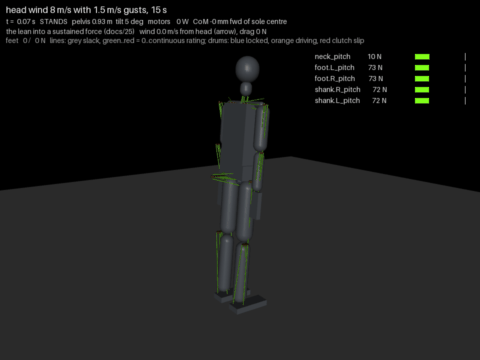

# 25 - Wind: drag on every body, gusts from any side, and a robot that leans into it (P-038, D-042)

Wind was one of the intended obstacles of the sibling project (its world has wind as a smoothed random control),
and the owner asked whether the robot walks against and away from winds of changing strength (hub task
`wind-gauntlet`). Until now the model had no wind. Now it does. Standing, the robot carries 12 m/s head-on or
from behind and 10 m/s from the side, with 1.5 m/s gusts to 8 to 10 m/s. Walking, it carries 3 m/s from any
side with gusts, 5 m/s steady from behind or the right. The walk is the weak point.

## The wind (`tools/sim_tendon.py`)

- **Drag:** MuJoCo's own fluid model, air at 1.2 kg/m^3 (`opt.density`), the wind set each step (`opt.wind`).
  Each body is drag on its inertia box, which for this skeleton is its printed shell (`export_mjcf.SHELL`), with
  Cd 1 on the box faces. Measured on the 20 kg model:

| From | Drag at 10 m/s | CdA | Centre of drag above the floor |
| --- | --- | --- | --- |
| head or tail | 25.6 N | 0.43 m^2 | 0.95 m |
| the side | 22.0 N | 0.37 m^2 | 0.88 m |

  So the robot feels a 10 m/s wind as 13 % of its weight. A person (70 kg, CdA ~0.7) feels it as 6 %: the robot
  is light for its size, and its winds are a person's winds about 1.4 times faster.
- **Speed:** a mean ramped in over 2 s, plus Ornstein-Uhlenbeck gusts on the along-wind speed (sigma = `gust`)
  and the cross-wind speed (0.75 `gust`), time constant 2 s. With 1.5 m/s gusts at 8 m/s, the peaks reach
  11.5 m/s.
- **Direction:** `dir` is where the wind comes from: `head`, `tail`, `left`, `right`, or degrees (0 head, 90 left).
- **Use:** `WIND = dict(mean, gust, tau, dir, seed)` for every scene, `rig.set_wind(...)` inside a scene, or
  `--wind 8,1.5,head` on `sim_tendon.py` and `sim_video.py`. The report prints the mean and peak drag.
- **New gauntlet scene `gust`:** 15 s in an 8 m/s head wind with 1.5 m/s gusts.

## What had to change

At first the standing robot fell at 10 m/s head-on and from behind (8 m/s stood). There were two causes:

1. **The locks.** A wind that builds slowly keeps the body still, so the lock gate of D-038 locked every drum.
   The locked ankles then carried a growing load until the body tipped, and released only once it was falling.
   The gate now also resets when the disturbance estimate has moved 20 mm since the body went still
   (`LOCK_RELEASE_D`). That alone changed nothing in the map, because of the second cause.
2. **No lean.** The balance loop kept the CoM over the sole centre and carried the force with the CoP alone. The
   CoP can move 100 mm toward the heel, so the robot could carry about 21 N, which is 9 m/s. A person leans into
   the wind instead.
   - **The lean (`LEAN`).** The slow part of the disturbance observer's estimate moves the CoM target upwind:
     the lean is that slow part (low-passed over `LEAN_TAU` 0.4 s, lateral `LEAN_TAU_X` 1.5 s), with a 20 mm dead
     band and an 80 mm limit.
   - **Why the integral could not do it.** It has to move the ankles' planned angle. The ankle is a spring about
     its plan (the lines are the spring), and the capture-point integral can hold only about 25 N m of it off the
     plan. Leaning 80 mm takes about 100 N m.
   - **Sideways**, the lean moves the hip-roll shift's target, fed forward like the shift's geometry.
   - **With the lean**, the CoP comes back toward the sole centre and gravity carries the force.

What did not work, or cost too much:

| Variant | Result |
| --- | --- |
| the lean through the capture-point integral only, any gain | no change: the fall at 10 m/s at the same time |
| no dead band | the step and the pushes cost 10 to 20 % more energy (the robot's own motion is read as wind) |
| the lateral lean at 0.4 s | 192 of 200 random pushes (a short side push moved the hips); at 1.5 s, 199 |
| the ankle lean in a staggered stance | tilting both ankles by one angle fights the legs when the feet are a step apart and lifted the landed foot; it now fades out over 40 mm of stagger (`LEAN_STAGGER`) |

Physically, holding the CoP on the sole margin and the CoM at the toe gives about 55 N head-on, 14.7 m/s. The
lean is limited to 80 mm, which gives about 38 N, 12 m/s. That matches the map below.

## The failure map (`tools/wind_sweep.py`, 20 kg model)

Each cell shows the seeds that stood, then where the first run fell (phase@time). Standing is 20 s, two gust
seeds. The other scenes use one seed.

**Standing, 20 s**

| m/s | head, gust 0 / 1.5 / 3 | tail | left | right |
| --- | --- | --- | --- | --- |
| 4 | 2 2 2 | 2 2 2 | 2 2 2 | 2 2 2 |
| 6 | 2 2 2 | 2 2 2 | 2 2 2 | 2 2 2 |
| 8 | 2 2 1 | 2 2 1 | 2 2 2 | 2 2 2 |
| 10 | 2 1 0 | 2 1 0 | 2 2 0 | 2 2 0 |
| 12 | 2 0 0 | 2 0 0 | 0 0 0 | 0 0 0 |
| 14 | 0 0 0 | 0 0 0 | 0 0 0 | 0 0 0 |

Before this doc, 10 m/s steady fell from every side. Gusts of 3 m/s (peaks over 2.5 times the mean's drag) are
the limit at 8 to 10 m/s: the lean cannot follow a gust that comes and goes in 2 s, and the CoP alone carries
only 21 N.

**One foot, step and walk** (S stood, F fell; gust 0 / 1.5 m/s)

| Scene | m/s | head | tail | left | right |
| --- | --- | --- | --- | --- | --- |
| one-foot hold | 3, 5 | S S | S S | S S | S S |
| | 7 | S S | S S | S F | S F |
| | 9 | S S | S S | S F | S F |
| step | 3 | S S | S S | S S | S S |
| | 5 | S F | S S | F F | S S |
| | 7 | F F | F F | S F | S F |
| | 9 | F F | F F | S F | F F |
| walk (4 steps) | 3 | S S | S S | S S | S S |
| | 5 | F F | S F | F F | S F |
| | 7, 9 | F F | F F | F F | F F |

- **The one-foot hold** carries 9 m/s from the front or back, gusts included. From the side, 9 m/s steady holds
  but gusts do not.
- **The step and the walk** fail mostly in the transfer onto the leading foot (phase 4), and at 9 m/s already in
  the lift (phase 2). The map is not monotonic from the side (5 m/s from the left falls where 7 stands): the step
  was tuned on a knife edge (`19`) and wind moves it. The planner's stages wait for loads and CoM positions
  planned for still air, and the lean moves the CoM away from them.

## Regressions (no wind)

| Check | Before (D-038 / D-039) | Now |
| --- | --- | --- |
| gauntlet (now 13 scenes with `gust`) | all stand | all stand |
| step grid, 42 variants | 42 | 42, landings within 4 mm |
| walk grid, 42 variants | 42 | 42, within 6 mm; walk 1113 J (unchanged) |
| 200 random pushes | 199 | 199 |
| sustained 15 N push | 81 J | 54 J (it leans instead of pushing the CoP to the heel) |
| pushes 10 / 20 / 30 / 40 N | 19 / 24 / 26 / 42 J | 22 / 28 / 35 / 44 J |
| arm forward with 1 kg | 162 J | 238 J (the hand load is an outside force: it leans back, and the sway of `22` grows) |
| squat, shift, one-foot hold, step | 33, 43, 562, 471 J | 27, 43, 562, 471 J |

## Learned control

- **Teacher data:** `record_teacher.py --winds 60` adds 60 episodes of 12 s standing in a random wind (mean 0 to
  9 m/s, gusts 0 to 2 m/s, any direction). All 60 stand. The re-record has 272 episodes and 107 243 steps
  (gauntlet scenes with `gust`, 199 of 200 pushes, 60 winds). The observation has no wind channel: the robot has
  no anemometer, so a policy must read the wind from its own motion, as the disturbance observer does.
- **Sibling project (PR #54, issue #53):** the stand-in env has the same wind as domain randomisation
  (`EnvConfig.wind_mean`, `wind_gust`, `wind_tau`; `--wind-mean lo,hi --wind-gust lo,hi`). It is off by default
  and bit-identical when off. Each variant has its own mean, direction and gusts, and the privileged observation
  gets the wind. `tendon_eval` has `wind5` and `wind8` scenes.

## How close is this to real wind, and to real feet (P-039, D-043)

**The drag force** is about right in size and placement:

| Check | Result |
| --- | --- |
| Drag area | MuJoCo's equivalent inertia boxes give 0.436 m^2 head-on; the printed shells' own silhouettes are 0.484 m^2. The boxes are 10 % smaller (a capsule's equivalent box is 1.73 r wide, not 2 r). |
| Drag coefficient | The boxes use Cd 1. Short cylinders (limbs, length/diameter 3 to 6, Reynolds number 2e4 to 1e5) are 0.7 to 1.0; the trunk box is about 1.05; long cylinders 1.2. Both errors together put the drag within about 25 % of the real shape's. |
| Missing | Shielding (from the side the far leg sits in the near leg's wake, so side drag is overstated); vortex shedding (side forces on a limb at 25 Hz at 10 m/s, small and uncorrelated between limbs); lift. The air's added mass is negligible. Viscous skin friction (`opt.viscosity` 0) is under 1 % of the pressure drag at these Reynolds numbers. |
| Included | Drag on the relative velocity: the robot's own motion through the air is damped. Rotational drag of each box. |

**The wind speed is the speed at the robot, not a weather report.** The model blows the same speed at the feet as
at the head. Real wind near the ground follows a log profile. A forecast or anemometer quotes the speed at 10 m
height, and at 1 m it is lower:

| Ground (roughness z0) | Speed at 1 m for 10 m/s at 10 m | Drag on the robot | Centre of drag |
| --- | --- | --- | --- |
| uniform, as modelled | 10 m/s | 26.2 N | 0.95 m |
| open grass (0.03 m) | 6.0 m/s | 8.8 N | 1.07 m |
| rough field (0.1 m) | 5.0 m/s | 6.0 N | 1.12 m |
| suburb (0.5 m) | 2.3 m/s | 1.6 N | 1.21 m |

So the 12 m/s the robot stands in is about a 20 m/s forecast over open grass, a gale. The 3 m/s it walks in
is a 5 m/s forecast, a light breeze. The profile also lowers the drag on the legs more than on the trunk,
so the centre of drag rises by 0.1 to 0.25 m. A `WIND` profile (`z0`) is listed under Not yet. Gusts near the
ground are relatively stronger than aloft: turbulence intensity at 1 to 2 m is 15 to 25 % in the open and
30 % or more between buildings. The 1.5 m/s gust at 8 m/s is 19 %; 3 m/s is 37 %, a built-up site. The 2 s time
constant matches an integral length of about 15 m at 8 m/s. The OU spectrum falls as f^-2 where real turbulence
falls as f^-5/3, so it is slightly short of fast buffeting.

**Foot friction.** Every contact has sliding friction 1.0 (MuJoCo's default, `export_mjcf`), on a pyramidal
cone with soft constraints. Real soles: a TPU sole on dry concrete or wood is 0.6 to 0.9, PLA on smooth tile
0.3 to 0.4, any sole on a wet or dusty floor 0.2 to 0.4. Measured from the contact forces (20 kg model):

- **The friction the robot uses** (horizontal over vertical force at a loaded foot, 99th percentile) is about
  0.15 standing still, 0.16 in a 10 m/s head wind, and 0.21 to 0.28 when stepping in wind. The feet push
  outward against each other even without wind. On a floor of 0.4 the one-foot hold and standing in 10 m/s
  wind are unchanged. The step falls in 3 m/s with gusts (phase 7). At 0.3 the step and the walk fall with no
  wind.
- **The feet creep.** MuJoCo's soft contact lets a foot under a steady side load slide slowly, at any
  friction coefficient. In a 10 m/s head wind both feet slid 78 mm downwind in 20 s at 4 mm/s, with no
  pitch, using 16 % of a friction of 1.0. A real sole does not move. Its shear compliance gives a few mm
  that spring back. Without wind the creep is 5 mm per 20 s standing, and 7 to 12 mm per stance in the
  step and the walk.
- **The no-slip solver removes it.** `NOSLIP = 5` (MuJoCo's noslip iterations) holds the same feet to
  1.6 mm. An elliptic cone with impratio 10 brings it to 5 mm. The no-slip run is about 40 % slower.
  `FLOOR_MU` sets the friction for a floor test.

With the feet held, D-043:

| Check | Soft contact (the results above) | `NOSLIP=5` | `NOSLIP=5 FLOOR_MU=0.4` |
| --- | --- | --- | --- |
| gauntlet scenes (stand, push 20 / 40, lean15, arm, squat, shift, one-foot, gust) | all stand | all stand | |
| standing and the one-foot hold in wind (head and left, 8 and 10 m/s with 1.5 m/s gusts, seeds 0 and 1; steady to 12 m/s) | | the same cell by cell | |
| step grid, 42 variants | 42 | **23** | 40 |
| walk grid, 42 variants | 42 | **16** | 13 |

- **Standing and the wind map** are unchanged, seed by seed.
- **The step and the walk depended on the creep.** They fail mostly on the two rolled-up mass sets, in the
  transfer, with the lift gate timed out (`F4g`): the trailing foot never unloads enough to lift. With both
  feet held, the legs' internal push against each other carries load the planner expects to move. A slipperier
  floor (0.4) lets the feet settle and the step stands 40 of 42 again, but the walk does not.
- The cause is not traced yet. The fix belongs to the transfer (unload the trailing foot by force, not by
  waiting for the creep), and then every step and walk grid runs with `NOSLIP=5`.

## Held feet: the landing press (P-042, hub task `step-on-held-feet`)

`step_trace.py` on a failing row (the 26 kg worm mass set, `NOSLIP=5`) showed:

- **The landing.** The swing foot counts as placed at the first contact spike (15 % of the weight). A heavier body
  sags on its stance leg, so the landed leg touches down with the knee still bent 9 to 13 deg.
- **The press.** The transfer planned that leg from its unpressed straight length and straightened it within
  0.3 s. With held feet the lightly loaded foot was levered up and out, 20 to 45 mm, and the pelvis rolled over.
  With the soft contact the foot slid instead.
- **The fix** (`TP_PRESS_FROM_LANDED`): the press starts from the landed leg's measured length and catches up at
  `TP_PRESS_CATCHUP` (0.05 m/s) until it reaches the plan, then deepens by load as before. The centring's press
  starts from the measured length too.

| Grid, 42 variants | Before, held | Fix, held | Before, held, mu 0.4 | Fix, held, mu 0.4 | Before, soft | Fix, soft |
| --- | --- | --- | --- | --- | --- | --- |
| step | 23 | **40** | 40 | 38 | 42 | 42 |
| walk | 16 | **23** | 13 | 12 | 42 | 39 |

The catch-up rate was swept on the held step grid: 0.02 m/s stands 27, 0.05 stands 40, 0.1 stands 39.

- **Default.** The fix is off by default. It costs the soft-contact walk 3 variants, and soft contact is still the
  default (D-043).
- **The walk on held feet still fails** in its later transfers (`w3`, `w4`) on the rolled-up mass sets, at the
  lift gate. The landed foot is pushed sideways 20 mm while lightly loaded.
- **What did not help:**
  - Counting touchdown only after the load is held 0.05 or 0.15 s: the walk then fails from the second transfer.
  - Taking the stance leg's crouch from measurement instead of the plan: it fails one transfer earlier.

The lateral push is the open problem. Its likely source is the roll side of the transfer, which the press does not
plan.

**Traced (P-044).** On the worm mass set at w4 the landed foot carries 11 to 25 N, under the 15 % a foot needs to
count as grounded (`GROUND_LOAD` with its hysteresis). So the balance loop is in single support. It treats the landed
foot as a swing foot and abducts it to `SWING_CLEAR`, and the stance hip's capture-point shift rolls the pelvis.
Either way the light foot is carried 20 to 80 mm sideways. Three fixes were tried on the 42-variant walk grid on held
feet (press fix on, 23 without them), and none was kept:

| Change, only while the landed foot takes its load | Walk, held | Note |
| --- | --- | --- |
| The landed hip keeps its roll | 14 | the stance hip then rolls the pelvis and the held leg with it, 80 mm |
| The landed hip follows the stance hip's roll (parallelogram) | 12 | the 20 kg rows now fail too |
| The landed foot counts as grounded (double support) | falls at the first transfer | traced on 775 and worm |
| Any foot not the planner's swing keeps its roll (broad) | 10 of 18 (3 lengths) | stood the worm trace; the step on soft contact fell to 6 of 18 |

The abduction at touchdown seems to help the 20 kg walk. The next lever is not the roll but how the load builds on
the landed foot: a press that waits for the pelvis to settle, or a compliant sole.

## Not yet

- **Walking in wind** above 3 m/s: the planner's gates and stages are geometry for still air. The transfer onto
  the leading foot is where it fails.
- **Gusts beyond the sole:** the answer is a stepping strategy (a capture step downwind), which a static walker
  does not have.
- **The arm scene's sway** is worse with the lean (`22`'s limit cycle).
- **The step and the walk on held feet** (`NOSLIP=5`): 23 and 16 of 42; they relied on the contact creep. With
  `TP_PRESS_FROM_LANDED` the step stands 40 and the walk 23; the walk's later transfers push the landed foot
  sideways.
- **Simplifications:**
  - Drag is per body box, Cd 1 (within about 25 %). No shielding of one body by another, no lift, no ground
    boundary layer: the wind speed is the same at the feet as at the head, so a speed here is a forecast about
    1.7 times higher over open ground.
  - Contacts: friction 1.0 on every surface, soft contact that creeps under a sustained side load.
  - The wind's direction is fixed in a run. The sibling's stand-in fixes it per variant.
- **Not run in wind:** the rolled-up masses and the pessimistic motors (`24`). The 26 kg build has more weight
  for the same area, so it should carry more wind; the low motors less.

## Next

First the step and the walk on held feet (`NOSLIP=5`, and `FLOOR_MU=0.4` for a hard floor): trace an `F4g`
row, unload the trailing foot by force, then make `NOSLIP=5` the default and re-run every grid and the wind map
on it. Walking in wind: gate the transfer stages on the leaned CoM, not the still-air plan, and judge it on the walk
map at 5 and 7 m/s. Then a capture step for gusts, and wind for the learned controller in the sibling (clone
from the new teacher data, train with `--wind-mean 0,8`).
