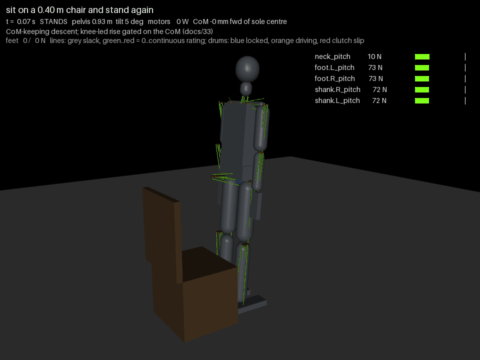

# 33 - Sitting on a chair and standing again (P-056, D-056)

The owner's side quest (P-047, hub task `sit-and-stand-chair`), given priority on 2026-11-05: sit on a chair and stand
again at seat heights of 0.35, 0.40, 0.45 and 0.50 m, with and without armrests, on the 20 kg model. The robot is
0.93 m at the pelvis standing; human chairs are about 0.43 to 0.46 m.

Short answers:
- **It sits and stands again from 0.40, 0.45 and 0.50 m seats, with or without armrests. From 0.35 m it sits but
  cannot stand.**
- **The limit is the forward reach, not the knee.** To leave a seat slowly the whole-body CoM must be over the soles.
  The hip's 110 degrees of flexion, the ankle's 20 degrees of dorsiflexion and the spine's drive stop the CoM 6 to 10 cm
  behind the sole centre (the heel is 13 cm behind it), so every rise below 0.50 m needs momentum: a trunk swing.
- **The spine's drive is what binds.** Arms held forward move the CoM 3 to 6 cm forward but load the spine past its
  clutch (29.7 N m at the joint): commanded to 35 degrees of bend, it sagged to 7. The rise plans on 20 degrees and
  commands 15 more.
- **The armrests do not help with this arm.** The hands can push at most 9 to 25 N each on a rest 0.20 m above the
  seat, and at 0.40 and 0.45 m cannot reach its top at all: the wrist's drive slips at 1.3 N m and the elbow's at
  8.9 N m, and the forearm and hand are 0.44 m long. A slow rise would need about 120 N from the hands.

| Sitting on a 0.40 m chair and standing again (the lowest that passes) |
| --- |
|  |

## The chair in the model

`export_mjcf.CHAIR_GEOMS`: a seat (0.46 m wide, 0.40 deep), two armrests (0.06 m wide, 0.20 m above the seat, their
centres 0.21 m from the midline) and a back, as mocap bodies after the robot. They are out of the way and do not collide
until `Rig.set_chair(seat, arms)` places them, 0.10 m behind the ankles (`CHAIR_FRONT`). Mocap bodies, because a
geom moved or resized at run time is missed by MuJoCo's collision tree, and a body whose geoms are all switched off at
compile time is also dropped from collision until its `body_contype` is set. `Rig.chair_load()` gives the vertical
force on the seat and on the armrests; the rig's mass leaves the chair out. Every other scene is unchanged to the
joule (stand, pushes, arm, squat and step compared against the commit before).

## Static: can it leave the seat slowly?

`python tools/sit_static.py` searches symmetric poses on the stand-in for the seat-off moment (the buttock just on the
seat, both feet flat) with the CoM over the soles, and reports the knee, hip, ankle and spine torques against their
clutches. With the CoM allowed 4 cm ahead of the heel (`margin=0.09`) a pose exists at every height, but only with the
spine past its clutch (1.03 to 1.09 of it below 0.50 m). Kept under 90 % of it (`spine=0.9`), none does: the CoM stays
4 to 7 cm short. The knee and hip need about half and 60 % of theirs; the ankle almost nothing. On the full model with
the head held level (`sim_tendon.sit_path`), the reach at the hip's stop is:

| Seat | 0.35 m | 0.40 m | 0.45 m | 0.50 m |
| --- | --- | --- | --- | --- |
| The CoM behind the sole centre at seat-off | 10.4 cm | 9.2 cm | 7.8 cm | 6.2 cm |

`python tools/sit_static.py hands` checks the armrests: every shoulder, elbow and wrist pitch that puts the hand's tip
on the rest top, and the most each hand can push within 80 % of the three clutches. At 0.35 m, 9 N; at 0.40 and 0.45 m
the hand cannot reach the top (the arm would pass through the rest); at 0.50 m, 25 N with the hand 0.46 m behind the
ankle. That is far from the 120 N a slow rise would need.

## The sequence (`sim_tendon.sit_stand`, scenes `sit35` to `sit50`, `sitNNa` with armrests)

- **Down.** `sit_path` plans 20 poses from standing to seat-off. The knee bends until the buttock is 1 cm into the
  seat with the hip at its stop. The ankles reach their 20 degree stop early, so the shanks lean forward first, the
  spine bends to 20 degrees, the arms go forward and the head stays level. At each pose the hip is solved so the CoM
  sits a growing share of the seat-off reach behind the sole centre. The balance loop runs throughout, its CoM target
  (`com_bias`) following the plan, over 4 s.
- **Onto the seat.** The balance loop goes off, the hips sit back 8 degrees and the trunk comes upright with the hands
  over the lap. Every joint's target is then set where the seat stopped it, so nothing presses into the chair and the
  drums lock on the CoM's stillness (`still_gate`).
- **Up.** The trunk swings to the seat-off pose: in 1.0 s where the reach is over 6.5 cm (0.35 to 0.45 m), else in
  1.5 s. A faster swing threw the robot forward at 0.50 m; a slower one could not leave the 0.40 m seat. Then the
  knees lead.
  - The knee target stays 12 degrees ahead of the measured knee and moves at most 25 degrees/s. It slows to a stop
    when the CoM is 2 cm further back than planned.
  - The hips, ankles, spine and arms follow the plan at the *measured* knee angle, not the clock. The hips flex
    further while the CoM is behind.
  - The ankles stay in position mode until the knees are under 30 degrees. With the balance loop on at seat-off, its
    ankle torque mode let the shanks rotate back under the half-loaded feet and the robot sat back down.

The rise's earlier forms failed in instructive ways: driven by the clock, the knees lagged and the hips rose first, so
the CoM went behind the heels; leaning back on the chair's back looked like standing until the back was checked.

## Results (20 kg, nominal motors)

`python tools/chair_sweep.py` (each case in its own process):

| Seat | Armrests | Sits | Stands again | Knee line peak / rating, SF | Hip line peak / rating, SF | Seated | Energy, to seated / all |
| --- | --- | --- | --- | --- | --- | --- | --- |
| 0.35 m | no | yes | **no** | 326 / 288 N, 2.7 | 274 / 288 N, 3.2 | 17 W | 336 / 1204 J |
| 0.35 m | yes | yes | **no** | 326 / 288 N, 2.7 | 274 / 288 N, 3.2 | 17 W | 336 / 1204 J |
| 0.40 m | no | yes | yes | 192 / 288 N, 4.6 | 263 / 288 N, 3.4 | 25 W | 339 / 1028 J |
| 0.40 m | yes | yes | yes | 192 / 288 N, 4.6 | 263 / 288 N, 3.4 | 25 W | 339 / 1028 J |
| 0.45 m | no | yes | yes | 160 / 288 N, 5.6 | 260 / 288 N, 3.4 | 38 W | 393 / 981 J |
| 0.45 m | yes | yes | yes | 160 / 288 N, 5.6 | 260 / 288 N, 3.4 | 38 W | 393 / 981 J |
| 0.50 m | no | yes | yes | 223 / 288 N, 4.0 | 254 / 288 N, 3.5 | 44 W | 439 / 1258 J |
| 0.50 m | yes | yes | yes | 205 / 288 N, 4.3 | 254 / 288 N, 3.5 | 44 W | 439 / 1255 J |

- **0.35 m:** the knee line runs over its continuous rating in the deep bend (326 N), and the rise stalls with the hip at
  its stop and the CoM 17 cm behind the sole centre. The task expected the knee's deep-flexion torque to be the limit;
  it is the balance, with the knee as a second.
- **Hip lines** peak at 254 to 274 N, under the 288 N rating but at a safety factor of 3.2 to 3.5, below the gauntlet's
  flag of 4. It comes in the swing and the first part of the rise.
- **Clutch slip** is in the neck only (0 to 534 degrees of its motor, a W-mini): the head is held level through the
  trunk's swing, and the neck line peaks at 62 to 88 N against its 37 N rating. Letting the head move with the trunk
  slipped it more and lost the 0.50 m rise. The knee clutches slip 25 to 27 degrees at 0.35 m.
- **The armrests change nothing** (the rows match): the hands are over the lap, and the arms are forward in the rise.
- **Seated** the robot draws 17 to 44 W, against 5 W standing: every drum locks but the elbows'. They hold the forearms
  level over the lap: more than the elbow drive's self-lock holds, so the lock creeps and the servo takes over again,
  in a small limit cycle. They did not lock in any lap pose tried.
- **Robustness** (without armrests, 0.40 to 0.50 m): 10 of 12 nudged cases pass. A knee rate of 18 degrees/s and a
  swing 0.2 s slower pass at all three. A knee rate of 35 degrees/s loses 0.50 m, and a swing 0.2 s faster loses
  0.40 m. The rise works, but not with a wide margin.

The ankle range and the foot placement allow it from 0.40 m: the feet stay where the robot stood, the shanks lean
forward to the ankle's 20 degree stop, and the seat's front edge is 0.10 m behind the ankles.

## The full grid: the 26 kg build and the motor ranges (P-057, D-057)

The task's full grid, the same sequence with no retuning: the 20 kg model and the 26 kg build
(`ROBOT_MASSES=sim/masses/rollup_775.json`), each on the sourced nominal (`ROBOT_MOTORS=nom`) and the pessimistic
(`low`) end of every drive and line (D-040). Stands again, without / with armrests (every case sits):

| Build | Motors | 0.35 m | 0.40 m | 0.45 m | 0.50 m | Reach at seat-off, 0.35 to 0.50 m | Energy, all | Seated |
| --- | --- | --- | --- | --- | --- | --- | --- | --- |
| 20 kg | model (above) | no / no | yes / yes | yes / yes | yes / yes | 10.4 to 6.2 cm | 1.0 to 1.3 kJ | 17 to 44 W |
| 20 kg | nom | no / no | yes / yes | yes / yes | yes / yes | 10.4 to 6.2 cm | 2.9 to 3.6 kJ | 26 to 51 W |
| 20 kg | low | no / no | yes / yes | yes / yes | **no** / yes | 10.4 to 6.2 cm | 7.9 to 13.9 kJ | 58 to 200 W |
| 26 kg | nom | no / no | **no / no** | **no / no** | **no** / yes | 16.5 to 11.7 cm | 3.3 to 5.1 kJ | 31 to 62 W |
| 26 kg | low | no / no | **no / no** | **no / no** | yes / yes | 16.5 to 11.7 cm | 9.2 to 18.8 kJ | 89 to 224 W |

- **The 26 kg build stands again only from 0.50 m.** Its extra mass is in the pelvis (5.3 kg) and the trunk (8.5 kg),
  which sit over the seat at seat-off: the CoM is 12 to 17 cm behind the sole centre against 6 to 10 cm at 20 kg, and
  a trunk swing within the drives cannot carry it that far. Thirteen variants of the rise on it (a faster or slower
  swing, a looser CoM gate, more hip flexion while behind, a faster or slower knee, a larger lead, a 30 degree spine
  at seat-off, 25 or 35 degrees of spine overshoot, and combinations) gained no seat below 0.50 m. 25 degrees of
  overshoot stands the 26 kg nominal build from 0.50 m without armrests too, but loses the 20 kg 0.50 m case and the
  26 kg low one, so the overshoot stays at 15 degrees (D-057).
- **The 0.50 m rise is on a knife edge.** Which 0.50 m cases pass changes with the build and the motors in no
  monotone way (the 26 kg build stands on the weak motors and not on the nominal ones); the 0.40 and 0.45 m results
  do not move at 20 kg.
- **The pessimistic motors cost energy, not seats, at 20 kg.** Their continuous rating is 47 N per line (107 N
  nominal): the knee, hip and spine lines run 4 to 7 times over it in the sit and the rise, the energy is 8 to 14 kJ and the
  seated draw 58 to 200 W. A sit-and-stand is a few seconds' load; it is the seated rest that would heat them.
- **The knee line passes 300 N** in the 26 kg build's deep bend at 0.35 to 0.45 m, and the spine line runs to 385 N:
  past the 20 kg model's 288 N continuous figure.

## Not yet

- A rise for the 26 kg build below 0.50 m: weight off the pelvis and trunk (the 20 kg target), or the 0.35 m list
  below.
- The 0.35 m seat: more hip flexion (to 120 degrees), a stronger spine drive, or hands that can push.
- Hands that use the armrests: a wrist that holds more than 1.3 N m and a shorter reach (or the forearm on the rest).
- A seated rest at zero power: the elbows' limit cycle, or a rest for the hands that loads nothing.
- The neck's W-mini through the swing (it slips, and its line runs at twice its rating).

## Next

The spine drive's margin, which sets both how low a seat the robot can leave and how far it can lean with its arms out,
and with it the 26 kg build's chair; the seated rest's power.
