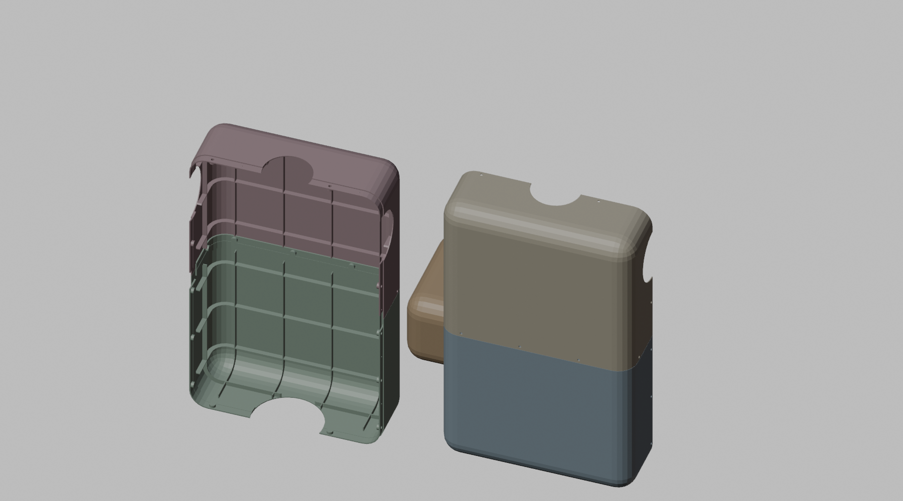
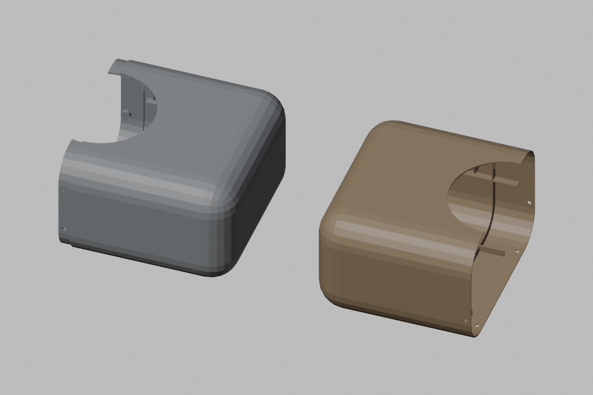

# 35 - The torso and pelvis as keyed thin shells (P-059, D-059)

The idea (P-059) came from lifecasting: a mother mold is a thin rigid shell in sections that part cleanly along
planned lines and register on keys, over a flexible skin. For the robot the same construction makes the torso and
pelvis one thin, ribbed shell that is both the structure and the cover, in place of an inner frame (the roll-up's
800 g torso and 600 g pelvis guesses, D-036) with a cover still to come.

Short answers:
- **`cad/blender/shell.py` builds them**: six panels, all manifold, each fitting a 256 mm bed, printed outer face
  down without supports. The torso is 711 g, the pelvis 259 g at a 1.2 mm wall.
- **Against the roll-up as it stood, they save 0.1 kg**: the pelvis comes down 190 g, the torso goes up 110 g
  (the shell plus 200 g of brackets against an 800 g frame). But that frame had no cover, and a plain 1.2 mm cover
  over this torso alone is about 620 g. Against a covered robot the shells save about half a kilogram.
- **At a 0.8 mm wall** (two perimeters, the ribs carrying the stiffness) the two shells are 725 g against 970, and
  0.33 kg under the old frame guesses. To try on a printed panel before it is the default.
- **Corrected by docs/36 (D-060):** the trunk's mass is not what loses the chair. The pelvis and the light arms are,
  and the Next below (shoulder drives into the pelvis) makes it worse.
- **The shell does not fix the trunk's mass.** On the brushless build (docs/34) the trunk is 5.9 kg against the
  model's 3.5: nine drives at about 295 g, their wiring (0.4 kg), the fasteners (0.3 kg) and the line (0.25 kg) are
  booked there. That is what the chair rise feels.

| The torso shell: the back panels opened (rib grid, bank bosses, the lap strips at the seams) and the front | The pelvis halves |
| --- | --- |
|  |  |

## The construction

```bash
"$B" -b -P cad/blender/shell.py -- --out cad/out [--preset torso|pelvis] [--wall 0.8]
```

- **Shape**: the collision boxes of `export_mjcf.SHELL` with 25 mm rounded edges; the torso 250 mm wide (10 under the
  box, so its panels fit a 256 mm bed), 160 deep, 400 tall; the pelvis 280 x 160 x 100.
- **Wall and ribs**: a 1.2 mm wall (three 0.4 mm perimeters) with a 1.2 x 6 mm rib grid at about 60 mm inside,
  kept clear of the seams.
- **Parting lines**: the torso splits front/back and upper/lower (four dishes about 250 x 80 x 200 mm); the pelvis
  splits left/right at the midline (two tubs that print on their sides). Every panel lifts off its neighbour along
  one axis and prints outer face down, so the wall rises straight from the bed.
- **The overlapping built-up edge**: one panel of each seam carries a 1.6 mm lap strip that reaches 10 mm past the
  seam inside the neighbour's wall with a 0.15 mm gap (front panels carry the vertical seam's, lower panels the
  horizontal seam's; the pelvis's left half carries its strip).
- **Keys and screws** along every straight run of a seam, alternating at 35 mm: a 0.8 mm hemispherical key on the
  strip into a 0.95 mm dimple in the neighbour's wall, and an M3 button-head screw from outside through the
  neighbour's wall into a heat-set insert (4.0 x 4 mm) in a pad on the strip.
- **Bosses**: 9 mm bosses with heat-set inserts on a 60 mm grid on the back face (20 in the torso, 4 in the
  pelvis) carry the drive banks, the battery tray and the electronics.
- **Openings**: neck (64 mm), waist joint (92 mm), shoulders (72 mm) and hips (72 mm).

## The roll-up (`tools/mass_rollup.py`)

The shells are generated parts now (`PARTS`, built by `--build`), and the frames become brackets on the shells'
bosses: 150 g in the pelvis, 200 g in the torso, both guesses. `--frame` restores the pre-shell estimate.

| Build | Before (frames) | With the shells, 1.2 mm | Pelvis / trunk with the shells |
| --- | --- | --- | --- |
| 775 + BTS7960 | 26.13 kg | 26.05 kg | 5.06 / 8.61 kg |
| 775 + VNH5019 class | 24.98 kg | 24.90 kg | 4.73 / 8.12 kg |
| 5010 brushless (docs/34) | 19.88 kg | 19.80 kg | 3.28 / 5.93 kg |

## Not yet

- No panel printed: the lap's 0.15 mm gap, the key fit, the first-layer overhang where the rounded edge meets the bed,
  and whether a 0.8 mm wall with these ribs is stiff enough to carry the drive banks.
- The internals are not laid out: the bosses are a grid, not placed for the nine W-max drives, the W-mini bank and
  the battery, so the 150 and 200 g of brackets are guesses.
- The thighs, the other large continuous areas, are still pipe and joint ends with no cover.
- The shells are not in the model's collision shapes (the torso is 10 mm narrower than its box).

## Next

The trunk's 5.9 kg, which the shell does not reach: lay out the drives and banks in the shells, and try moving the
shoulder drives down into the pelvis on longer sheaths (lighter, lower trunk; softer shoulder lines) on the
gauntlet and the chair grid. Then print one torso panel to settle the wall.
