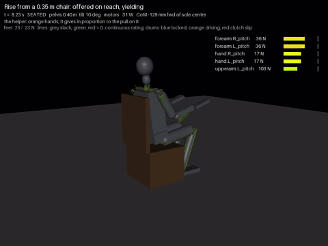

# 44 - The nurturing helper v0 on the 0.35 m chair (P-068, D-070)

The first piece of the training rounds (docs/43, hub task `helper-instructor-chair`). The robot sits on the 0.35 m
seat but cannot stand from it (docs/33): at seat-off its CoM is 10.3 cm behind the soles' centre. The hand-written
chair controller runs unchanged. A scripted helper holds the robot's wrists and is faded in phases.

| The yielding helper (Phase B) on the 0.35 m chair, 2x speed |
| --- |
|  |

```bash
python tools/helper.py --phases [--seat 0.35]     # the per-phase table below (7 runs in parallel)
python tools/helper.py --fade                     # the firm helper weakened step by step
python tools/helper.py --one B [--trace] [give=0.25 cap=60 ...] [--video name]
```

## The helper

- **The model:** `export_mjcf.HELPER` (or `ROBOT_HELPER=1`) adds two mocap hands, a site at each robot wrist, and a
  connect equality between them, off until the helper takes hold. Without the flag the model is unchanged.
- **Where it holds:** the wrist (the hand's joint), not the hand's grip point. Held at the grip point, every pull
  bent the wrist, and its W-mini clutches slipped 235 to 377 degrees.
- **How it pulls:** along the robot's arm, shoulder to wrist, in tension only. The pull is G times how far the CoM is
  behind the soles' centre (less 3 cm), capped. Once the CoM is over the feet it stops pulling.
  - An earlier version led the hands along the rise's planned path. It pulled across the arms (elbow lines 2.7x
    their rating) and kept pulling once the robot was up, so the robot fell forward.
- **Give and take:** each hand moves with the robot's shoulder plus (F + pull) / B. F is the robot's pull on it and B
  a damping. So it gives in proportion to the force on it and follows the body. `give` (0 firm, 1 yielding) sets G
  from 800 to 100 N/m for both hands, and B from 150 to 25 N s/m.
- **When it takes hold:** once a wrist is 96% of the arm's length ahead of its shoulder, so the arm is out and
  straight. When it took hold as the trunk's lean began, the elbow was still straightening against it, and the elbow
  line reached 137 N (2.1x its rating) against 90 N unassisted.
- **The robot's side:** while held, the robot keeps its arms forward until its knees pass 90 degrees, then lowers
  them with the knees (`sim_tendon.SIT_ARMS_HOLD`, off by default). The helper lets go at the same point.
  - Lowering the arms in one step when the hold ended swung them down against the helper and pulled the robot over
    forward.
- **What it logs:**
  - its impulse per hand and its peak force;
  - its work on the robot;
  - the time it holds;
  - the rise's energy;
  - clutch slip;
  - the arm lines' peaks while held and over the whole rise window.

## Results on the 0.35 m chair

Elbow lines (`forearm`) are the worst arm lines in every run. With no helper their peak over the rise window is 1.42x
their rating.

| Phase | The helper | Rises | Impulse N s | Peak N | Work J | Held s | Rise J | Worst arm line held | Overload law |
| --- | --- | --- | --- | --- | --- | --- | --- | --- | --- |
| A | Firm (give 0), both hands | stands | 119 | 48 | -2 | 1.4 | 229 | elbow 2.35x | **fails** |
| B | Yielding (give 0.5), both hands | stands | 126 | 42 | -3 | 4.3 | 338 | elbow 1.34x | ok |
| C1 | One hand (give 0.5) | fails | 173 | 44 | -1 | 12.0 | 481 | elbow 1.42x | ok |
| C2 | Lopsided (give 0.3 and 0.8), drunken (8 N wander) | fails | 203 | 42 | +6 | 5.6 | 613 | elbow 1.52x | ok |
| D0 | None; arms held forward (control) | fails | - | - | - | - | 476 | - | - |
| D | Withdrawn | fails | - | - | - | - | 485 | - | - |

Fading the firm helper (`--fade`):

| give | cap per hand N | Rises | Impulse N s | Worst arm line held | Overload law |
| --- | --- | --- | --- | --- | --- |
| 0 | 200 | stands | 119 | elbow 2.35x | fails |
| 0.25 | 150 | stands | 107 | elbow 1.49x | ok (within 1.1x of 1.42) |
| 0.5 | 100 or 60 | stands | 126 | elbow 1.34x | ok |
| 0.75 | 40 or 25 | fails | 207 | elbow 1.35x | ok |
| 0.9 | 15 | fails | 154 | elbow 1.36x | ok |

What this shows:
1. **With the helper, the 0.35 m rise stands for the first time,** on the hand-written controller with no learning.
   The pull needed is small, under 50 N per hand.
2. **Give and take matters.** The firm helper stands the robot up by fighting its arms, and fails D-069's first law.
   The yielding one stands it with the elbows below their unassisted peak.
3. **The helper does almost no net work** (-3 to +6 J). It does not lift the robot; it holds the CoM from falling back
   while the robot's own legs rise. Its impulse also counts the arms' weight resting on it while held. So impulse
   falls only when holding time falls, and runs that fail accumulate it over the rise's 12 s timeout.
4. **One hand, or a lopsided and drunken helper, is not enough** at give 0.5. Neither is give 0.75. The fade from the
   hand-written controller stops at two yielding hands.
5. **Withdrawn, the rise fails as before.** Holding the arms forward alone (D0) does not change that. Nothing learns
   here, so the withdrawal law cannot be met. Getting under 10% of the baseline (about 11 N s) is what training round
   1 has to learn.

## The two laws as applied (D-070)

- **Overload:** an arm line's peak while held is judged against the same line's peak over the same rise window with
  no helper, plus 10%, as well as its rating. The arms already run past their rating in the unassisted rise: the
  elbows at 1.42x with the arms forward at seat-off. A literal "past its rating" would fail every run, helped or not.
- **The impulse baseline:** Phase A's firm helper fails the overload law, so it cannot be the baseline. The baseline
  is the firmest setting that passes: give 0.25, 107 N s. Withdrawal is under about 11 N s.

## The API for the trainer

`tools/helper.py`, importable (it sets `export_mjcf.HELPER` before `sim_tendon` builds a model):

```python
import helper, sim_tendon as st
r = st.Rig(); r.reset()
h = helper.Helper(r, give=0.5, hands="LR", on_reach=True, cap=60.0, drunk=0.0, arms_hold=90.0)
st.SIT_ARMS_HOLD = math.radians(90)   # the robot's side, for the scripted chair controller
r.hook = h.chain()                    # or h.chain(recorder.on_step)
st.sit_stand(r, 0.35)
h.log   # impulse (L, R), work, peak, t_on, arm_on, arm_rise, e0 / e1 (energy at take-hold and release)
```

`Helper.update(rig)` runs every physics step. It arms itself when the rise's lean begins (`rig.phase`), takes hold on
reach, and lets go when the knees pass `arms_hold` or the robot falls. For a learned policy:
- the trigger should come from the episode instead of `rig.phase`;
- `h.force(s)` is what the robot feels at each wrist, the channel a policy would sense the helper through.

The sibling's stand-in has no helper yet: round 1 needs it there, or trains on the tendon model.

## Not yet

- The helper is scripted and the robot's side is the hand-written controller. Nothing is trained.
- The overload law is judged on the arm lines only. The legs and the spine are not attributed to the helper.
- One seat (0.35 m), no armrests, the 20 kg model on its own motor figures. The full chair grid with a helper, and
  the 775 layout and `ROBOT_MOTORS=low`, are not run.
- The impulse counts the arms' weight resting on the helper. A cleaner measure would subtract it.
- The helper is not in the sibling's stand-in, and not on getting up from a fall (`helper-instructor-getup`).

## Next

- Done since: the drunken sailor and the rise trained with this helper as curriculum (docs/45).

- `helper-instructor-getup`: the same helper on getting up from the floor.
- Training round 1 (`training-round-1`): the stand-in learns the 0.35 m rise with the helper at give 0.25 to 0.5,
  faded toward the 11 N s withdrawal, with the demos of docs/43's round 0.
