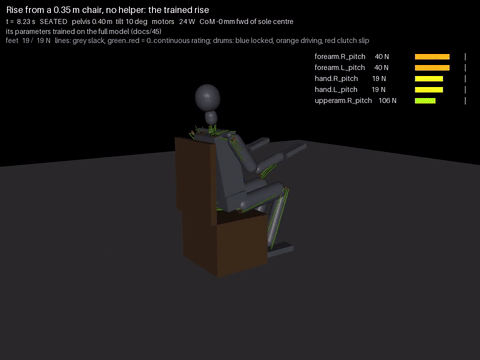

# 45 - The drunken sailor, and training the chair rise with the helper as curriculum (P-069, P-070, D-071, D-072)

The owner accepted D-069 and D-070's defaults and asked for two things before weaning and the crew work (P-069):
- the drunken sailor: docs/43's Phase C, a lopsided and wandering helper;
- training on the simulation: training round 1's first slice (hub task `training-round-1`, docs/43).

| The 0.35 m chair, no helper, with the default low-seat rise (D-072), 2x speed |
| --- |
|  |

## The drunken sailor

```bash
python tools/helper.py --drunk [--seat 0.35]     # 14 runs in parallel
```

The wander is an Ornstein-Uhlenbeck force on each helper hand (time constant 0.7 s), N its scale. The robot's side is
the hand-written controller (docs/44). B25 is give 0.25 with a 150 N cap, D-070's baseline; B50 is Phase B, give 0.5
with a 60 N cap.

| Helper | Rises | Impulse N s | Worst arm line held | Slip deg | Overload law |
| --- | --- | --- | --- | --- | --- |
| B25, steady | stands | 107 | elbow 1.49x | 0 | ok |
| B25, wander 4 N (2 seeds) | stands, stands | 113, 102 | elbow 1.72x, 1.68x | 0 | **fails** |
| B25, wander 8 N (2 seeds) | fails, stands | 176, 98 | elbow 1.76x, 1.71x | 288, 0 | **fails** |
| B25, wander 16 N (2 seeds) | fails, fails | 100, 108 | elbow 1.52x, 1.62x | 408, 429 | ok, fails |
| B50, wander 4 N | stands | 158 | elbow 1.35x | 0 | ok |
| B50, wander 8 N | fails | 256 | elbow 1.35x | 620 | ok |
| Lopsided, give 0.1 / 0.5 | stands | 104 | elbow 1.83x | 0 | **fails** |
| Lopsided 0.1 / 0.5, wander 8 N | fails | 160 | elbow 2.30x | 316 | **fails** |
| One hand, give 0.25 | stands | 259 | elbow 1.72x | 0 | **fails** |
| One hand, give 0 | stands | 92 | elbow 2.08x | 0 | **fails** |
| None | fails | - | - | 25 | - |

What it shows:
1. **The wander loads the elbows and the wrists.**
   - With the firmer helper, a 4 N wander already pushes the elbow lines past the law (1.7x, against 1.42x
     unassisted plus 10%).
   - At 8 N and more the wrist clutches slip by hundreds of degrees and the rise fails.
2. **Yielding is what makes a wandering helper safe.** The softer B50 takes a 4 N wander within the law; the firmer
   B25 does not.
3. **One hand, or a lopsided helper, can stand the robot up, but only by overloading the held arm.** That is not help
   under D-069.

So the training below uses a 4 N wander: enough to keep the rise off a perfectly steady hand, and survivable.

## Training the rise

```bash
python tools/rise_train.py [--gens 40] [--pop 13] [--jobs 13] [--no-gate] [--start-level 7] [--out sim/out/rise]
python tools/rise_train.py --grid  sim/out/rise/best.json             # the chair grid, no helper
python tools/rise_train.py --probe sim/out/rise/best.json --level 3   # that level's best against weaker helpers
python tools/rise_train.py --show  sim/out/rise/best.json --level 7 --video rise35
```

**What learns:** the robot's side of the rise, the hand-written chair controller's 11 parameters:
- the knees' lead and top rate, and the CoM gate;
- the hips' extra flexion and rate limit;
- the spine's bend and over-command;
- the arms' forward angle and the knee angle at which they lower;
- the trunk's lean time;
- the knee angle at which the balance loop takes the ankles.

It is a cross-entropy search (CEM): 13 candidates a generation, each run on the full tendon model in its own process,
with 13 processes. It is not a network and not the stand-in. That keeps it on the model where the helper lives, and
it answers the round's first question cheaply: can the robot's own rise be weaned off the helper?

**The curriculum is the helper:**

| Level | 0 | 1 | 2 | 3 | 4 | 5 | 6 | 7 |
| --- | --- | --- | --- | --- | --- | --- | --- | --- |
| give | 0.25 | 0.5 | 0.75 | 0.9 | 0.9 | 0.9 | 0.9 | withdrawn |
| cap per hand N | 150 | 60 | 40 | 15 | 6 | 3 | 1 | - |

- **Each candidate runs twice per generation:** with the helper steady, and with it drunk (4 N, a fresh seed).
- **The score per run:**
  - 10 if it stands, otherwise up to 5 for how far the knees straightened;
  - minus 3 times the impulse over the 107 N s baseline;
  - minus 8 for an overload;
  - minus a small energy cost.
- **The level goes up** once three quarters of the best quarter pass every run.
- **The gate:** in the second and third runs, each candidate also rises from the 0.40 m seat with no helper, the
  lowest seat that stood before. Failing it costs 6 and keeps the candidate from counting as passing (D-069's second
  law).

### Results

| Run | Curriculum | Generations | Reached | 0.35 m with no helper | Chair grid with no helper (8 seats) |
| --- | --- | --- | --- | --- | --- |
| 1 | levels 0-4, no gate | 40 | level 3 (15 N) by gen 4; level 4 never stood in 35 gens | fails | levels 1-3's sets lose 0.40 m |
| 2 | levels 0-7, gate | 40 | level 6 (1 N) by gen 8; level 7 at gen 39 | **stands** (gen 39's best) | 0.35 m stands, 0.40-0.50 m lost |
| Control | level 7 only, gate | 40 | stands from gen 7; every candidate stands by gen 38 | **stands** | **0.35-0.45 m stand** (with and without armrests), 0.50 m lost |

The defaults stand on 0.40 to 0.50 m only. Run 2's sets for levels 0 to 6 keep that grid unchanged.

Along the fade (run 2, the best per level):

| Level | Impulse N s (steady, drunk) | Held s | Worst arm line held |
| --- | --- | --- | --- |
| 0 (give 0.25) | 69, 74 | 1.6 | 1.40x |
| 1 (give 0.5) | 42, 44 | 1.3 | 1.35x |
| 2 (give 0.75) | 24, 23 | 1.0 | 1.39x |
| 3 (15 N) | 19, 18 | 1.1 | 1.40x |
| 5 (3 N) | 16, 20 | 1.5 | 1.36x |
| 6 (1 N) | 15, 16 | 2.5 | 1.41x |
| 7 (withdrawn) | 0 | - | - (unassisted: 1.39x) |

What it shows:
1. **The robot's own rise can be trained to need far less of the helper.**
   - At give 0.25, the impulse fell from 107 to 69 N s within a generation.
   - With a 1 N pull it stood with 15 N s, all inside the overload law.
   - The residue of about 15 N s is the arms' weight resting on the held wrists (docs/44's "cleaner measure").
     That is why the impulse cannot reach D-069's 11 N s while anyone holds the wrists at all.
2. **The 0.35 m seat stands with no helper.** That has not happened before (docs/33, docs/41, docs/44).
   - Its rise has the arms further forward (-111 degrees against -90), a straighter spine (10 against 20 degrees), a
     faster knee (35 against 25 degrees/s) and a quicker lean.
   - Its arm lines stay at their unassisted level (1.39 to 1.41x).
3. **The helper's curriculum did not help this search.**
   - The control, straight at withdrawn from the defaults, stood by generation 7 and kept more of the grid.
   - The curriculum spent 39 generations fading the helper, and its withdrawn rise lost 0.40 m.
   - Run 1 sat at withdrawn for 35 generations from its 15 N set and never stood.
   - The helper levels pulled the search into rises that lean on the hold. With 11 parameters, plain search finds the
     unassisted rise directly. So the 0.35 m failure was the hand-written rise's tuning, not the robot's strength.
4. **Both withdrawn rises are marginal.** With every parameter jittered by 2%, 5 of 12 stand (each, 13 runs). Neither
   is the default.

### D-069's laws, against these results

- **Overload:** no passing set broke it; the elbows stay within 1.35 to 1.41x.
- **Withdrawal:**
  - The impulse is 0 with no helper.
  - The old gates are not all met by one set: the control's set loses the 0.50 m seats.
  - A rise that picks its set by seat height (the planner knows the seat) would pass all 8. That is not built.

## Robust, and the default for low seats (P-070, D-072)

```bash
python tools/rise_train.py --robust sim/rise_params.json:control_withdrawn --gens 25
python tools/rise_train.py --jitter-test sim/rise_params.json:low_seat --n 24
```

No helper. Each candidate runs six times, every run with its parameters jittered by 2% (a fresh draw each time): three
times on 0.35 m, once each on 0.40, 0.45 and 0.50 m. The score is the mean over those runs. The search starts from the
control's set, 13 candidates a generation, 25 generations (about 55 minutes).

Under 2% jitter, separate draws:

| Set | 0.35 m | 0.40 m | 0.45 m | 0.50 m |
| --- | --- | --- | --- | --- |
| Defaults | 0 of 12 | 11 of 12 | 12 of 12 | 11 of 12 |
| The control's set (above) | 9 of 12 | 12 of 12 | 12 of 12 | 1 of 12 |
| Robust, best candidate (gen 18) | **23 of 24** | **24 of 24** | 20 of 24 | 11 of 24 |
| Robust, the search's final mean | 23 of 24 | 24 of 24 | 20 of 24 | 12 of 24 |

- **The low seats are now robust.**
- **One set does not suit both ends of the grid:**
  - the low seats want the arms further forward and a quicker lean;
  - the 0.50 m seat stands better on the defaults.
- **So the rise is scheduled by seat height, which the planner knows** (D-072):
  - `sim_tendon.SIT_LOW` holds the robust set;
  - seats under `SIT_LOW_BELOW` (0.42 m) use it, and higher seats keep the old defaults.
  - Under jitter that gives 23, 24, 12 and 11 of 24, 24, 12 and 12, from 0.35 to 0.50 m.
  - `helper.py` and `rise_train.py` turn it off so their own tables are unchanged.

**The gate:**
- every chair scene stands: sit35, sit35a, sit40, sit40a, sit45, sit45a, sit50, sit50a;
- the full default gauntlet stands, 14 of 14. Its only chair is 0.45 m, which the schedule does not touch.

The set's differences from the defaults:

| | knee lead | knee rate | CoM gate | hip K | hip rate | spine over | spine | arms | lean | balance on |
| --- | --- | --- | --- | --- | --- | --- | --- | --- | --- | --- |
| Defaults | 12 | 25 /s | 2.0 cm | 3.0 | 22.5 /s | 15 | 20 | -90 | 1.0 s | 30 |
| Low seats | 10.7 | 33.5 /s | 4.0 cm | 1.8 | 27.0 /s | 15 | 12 | -111 | 0.81 s | 25 |

In words, for the low seats:
- the arms reach 21 degrees further forward, and the spine bends less;
- the trunk swings to the seat-off pose 20% faster;
- the knees drive harder, with a looser CoM gate and less extra hip flexion.

That is a momentum rise rather than a static one, where docs/33 had found the CoM 10 cm behind the feet at seat-off.

## Not yet

- **The low-seat set stands on 0.35 m 23 of 24 times under 2% jitter.** Larger errors, the 775 layout and
  `ROBOT_MOTORS=low` are not tried.
- **The search is over the hand-written rise's parameters, not a network.**
  - The stand-in has no helper.
  - The felt-weight and head-IMU channels, and the stiff-against-relaxed comparison, wait for a learned policy.
- **The get-up from a fall has no helper yet** (`helper-instructor-getup`).
- **One seed per run.** The control's lead over the curriculum is one comparison, not a scatter.

## Next

- Done since: the chair demos re-recorded with the low-seat set, 8 of 8 episodes (`teacher_chair.npz`, 7 985 steps).
- **Weaning where the curriculum should matter:**
  - a learned policy on the rise (many dimensions, where search from scratch fails);
  - the get-up from a fall.
  - The helper's fade, with the drunken wander at 4 N, is ready for both.
- **Then the double-sided, joint and group work** (docs/43 rounds 3 and 4): the role flip, the shelter, the crew.
