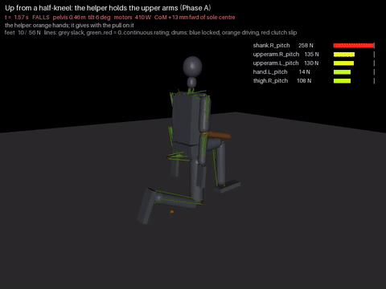

# 46 - The helper on getting up from a half-kneel (P-071, D-073)

Hub task `helper-instructor-getup`, the helper's second target (docs/43). Getting up has only been tried by learned
policies on the stand-in. They rose from a half-kneel 61% of the time with the elbow lines at 2.3x their rating, and
never from a fall (docs/32). The tendon model had no get-up at all.

| Up from a half-kneel, the helper holding the upper arms (Phase A, `sim/getup_params.json` firm), 2x speed |
| --- |
|  |

```bash
python tools/getup.py --settle                                   # the half-kneel alone: does it rest?
GETUP_GRIP=elbow python tools/getup.py --train A --reps 2 [--fade] [--init best.json] --out sim/out/getup_x
GETUP_GRIP=elbow python tools/getup.py --jitter-test sim/out/getup_x/best.json:last --n 24
```

## The start and the script

- **The start:** the stand-in's resting half-kneel (docs/32):
  - front (left) hip flexed 90 degrees, knee 95, ankle 5 dorsiflexed;
  - back hip +5, knee 100; spine 10.

  `getup.kneel(r)` homes every gear and drum at that pose, as `reset()` does for standing, and drops the body onto
  the floor. It rests: pelvis 0.46 m, steady. Its CoM is 0.49 m behind the front sole's centre.
- **The script:**
  1. *Lean:* the arms reach forward and the trunk leans.
  2. *Rise:* every joint eases to the standing pose. The front foot slides back, the pelvis reaches about 0.9 m, and
     the robot ends in a lunge 0.8 m long.
  3. *Shift:* the front ankle and knee bend forward, the back hip pushes and the trunk leans, until the back foot is
     nearly unloaded.
  4. *Step:* the back foot lifts, swings through, and is lowered beside the front foot until it carries 30% of the
     weight.
  5. *Up:* every joint to the standing pose, with the balance loop on.
  6. *Done:* the helper lets go. The robot must stand 3 s alone.

  16 parameters are searched (`GPARAMS`), as `rise_train.py` does for the chair (docs/45).

## The helper for getting up (D-073)

The chair's helper (docs/44) pulls along the arms only in tension and follows the shoulders, so it cannot catch a
robot that tips toward it. The kneel tipped forward as soon as the arms moved: the back knee's clutch slipped. The
get-up helper is a **lifter**:
- **It holds an anchor:** from where the grips hang, to where they reach forward over the lean, then up by LIFT over
  the rise.
- **It holds by a stiffness:** each hand moves as v = (F_robot + F_own) / B, with F_own = K (anchor - hand), capped.
  The stiffness K is the give: 3,000 N/m firm, 300 yielding.

What it took, each found by a failure:

| Version | What happened | The rule it set |
| --- | --- | --- |
| The chair's helper, wrists | The kneel tipped forward before it took hold | Hold from the lean, toward an anchor |
| Lifter, no step | Rose to 0.89 m in a lunge 0.8 m long; fell when let go | Step the back foot through while held |
| Lifter, step, no shift | The back foot was still loaded and never came through | Shift the weight first |
| Lifter, anchor rising freely | Lifted the robot off its feet (0 N on them), then dropped it | Lift only what the feet leave uncarried |
| Wrists, searched (30 generations) | Stood, with the elbow lines at 2.5x their rating, at every arm angle tried | Hold the upper arms (below) |
| Elbows, "only what the feet leave" | Hung the robot again: once the feet are off, they carry nothing | A ceiling below the standing grip height |
| Elbows, ceiling, touchdown, searched | **Stands** | - |

- **Holding under the arms** (`GETUP_GRIP=elbow`): the helper holds each upper arm at the elbow (a site at the
  elbow joint), so the elbow's own line carries none of the lift.
  - The arm lines fall from 2.5x their rating (the elbows) to 0.9x (the shoulders).
  - That is how a person helps someone off the floor. The arms' W-mid elbow lines are too small to carry the robot,
    which is docs/32's finding again.
- **It lifts only what the feet do not carry,** at most the body's weight less the soles' load, plus about 30 N a
  side. Its anchor never rises above the robot's standing grip height less 15 to 21 cm (`Z_TOP`, searched): a helper sets
  a person down onto their feet, not up off them.
- **It eases off before letting go:** over the stand-up, its stiffness falls to zero, then it lets go.

## Results

The firm helper (Phase A). A search of 20 generations with two jittered runs per candidate (`getup_A5`):

| | Stands under 2% jitter | Impulse N s | Held s | Worst arm line held |
| --- | --- | --- | --- | --- |
| The search's last-generation best (`firm`) | **24 of 24** | 666 | 9.5 | 0.89x (the shoulder) |

The fade, with the robot's side as tuned for the firm helper (6 jittered runs each):

| The helper | Stands | Impulse N s | Worst arm line |
| --- | --- | --- | --- |
| Firm (give 0), 150 N a side | 5 of 6 | 669 | 0.85x |
| give 0.25 | 6 of 6 | 584 | 0.90x |
| give 0.5 (Phase B) | 1 of 6 | 577 | 1.02x |
| give 0.75, 1.0 | 0 of 6 | 617, 642 | 0.88x |
| Firm, capped at 100 / 60 / 30 N a side | 6 / 6 / 0 of 6 | 668 / 610 / 591 | 0.86x |
| One hand (Phase C1) | 0 of 6 | 823 | 1.30x |
| Lopsided (give 0 and 0.5), drunk 4 N (Phase C2) | 4 of 6 | 630 | 1.01x |
| Firm, drunk 8 N | 5 of 6 | 676 | 0.87x |
| Withdrawn (Phase D) | 0 of 6 | - | - |

The fade with the robot's side retuned at each level (`--fade`, two jittered runs per candidate):

| Level | The helper | Passed at generation | Impulse N s |
| --- | --- | --- | --- |
| 0 | give 0.25, 150 N | 2 | 580 |
| 1 | give 0.5, 150 N | 4 | 636 |
| 2 | give 0.5, 60 N | 7 | 635 |
| 3 | give 0.75, 60 N | 12 | 624 |
| 4 | give 0.75, 30 N | not in 17 generations | - |

Level 3's set (`faded`):
- with its own helper, it stands 16 of 24 under jitter, with the arm lines at 0.86x;
- with the firm helper, it stands 0 of 12. It has adapted to the yielding helper, and a stiff one gets in its way.

What it shows:
1. **The tendon model gets up from a half-kneel**, scripted, with a helper. It stands 24 of 24 under jitter, within
   every arm line's rating.
2. **Where the helper holds matters more than how hard.** At the wrists no setting kept the elbows under 2.3x. Under
   the arms, every two-handed setting kept them at 1.07x or under.
3. **Weaning works down to a yielding helper capped at 60 N a side, and stops there.**
   - At 30 N, nothing stood in 17 generations.
   - The impulse barely falls along the fade (666 to 620 N s): the helper still carries about 60 N for most of the
     rise.
   - That fits docs/32: no slow rise is possible below a pelvis height of 0.90 m, because the CoM cannot get over the
     front foot with 20 degrees of ankle. The helper is supplying what the robot's geometry cannot.
   - Withdrawal (D-069: under 10% of the impulse) needs a different rise: a dynamic lunge, as the stand-in's
     policies found, or more ankle range.
4. **The drunken helper is tolerated:** 8 N of wander costs one run in six. Phase C1 (one hand) fails: one upper arm
   cannot carry the lift.

## Not yet

- **From lying down:** the task's second start. Only the half-kneel is tried.
- **A learned get-up with the helper:** this is the scripted rise. A dynamic rise that needs no helper is a learned
  policy's job (docs/32).
- **The withdrawal law cannot be met by this rise** (above).
- **The step lands with the feet 0.15 to 0.3 m apart in some runs.** The stage counter then reads 2, though the
  robot stands.
- **The stand-in has no helper.**

## Next

- A get-up from lying down: roll to the side, to hands and knees, then to the half-kneel, with the helper.
- A learned get-up on the tendon model, the helper as curriculum, aiming for the dynamic rise the script cannot make.
- Then the role flip (docs/43, round 3): a robot is the helper. This doc gives it a target: hold under the arms with
  about 60 N a side, never above standing height, and ease off before letting go.
