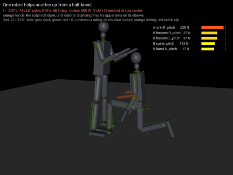

# 48 - Two robots in one simulation: a robot helps another up (P-073, D-075, D-076)

docs/47's Next: the role flip with two bodies. Robot A gets up from a half-kneel as in docs/46. Robot B, the same
build, stands facing it and takes the scripted helper's place: A's upper arms rest on B's elbows (D-074).

| Robot B (left, feet apart) takes A's upper arms from the scripted helper (orange) at the stand-up, then lets go (`sim/duo_params.json` standup) |
| --- |
|  |

```bash
python tools/duo.py --probe                                    # docs/46's get-up with B standing by: the geometry
python tools/duo.py --one --params sim/duo_params.json:standup [--trace] [--video duo --gif]
python tools/duo.py --train --levels [--from 6] --init sim/duo_params.json:standup --out sim/out/duo_x
python tools/duo.py --jitter-test sim/out/duo_x/best.json:levels.6 --n 24
```

## The model (D-075)

- **One model, two robots.** `duo.build()` attaches a second copy of `sim/robot.xml` with every name prefixed `b.`
  (MuJoCo's spec attach). The floor is shared: 204 degrees of freedom, 64 motors, 128 lines.
- **One `sim_tendon.Rig` each, on the same data.** `Rig(model, data, prefix, base, winches)`:
  - a rig with a prefix looks its names up under it, stands at `base` (x, y, heading), and never resets or steps the
    shared data;
  - the first rig's `step()` runs the partners' controllers before the physics and their readouts after it
    (`Rig.partners`, `pre_step()`, `readout()`);
  - the balance loop reads the world through `Rig.loc()`, the rig's heading frame, so a robot facing the other way
    balances with the same code;
  - `cop()` counts only its own feet's contacts.

  With one robot nothing changes: the gauntlet's 14 scenes print the same tables as before, and docs/46's get-up
  still stands 24 of 24 under jitter with 666 N s.
- **The cradle** is a soft connect per side between A's elbow site and B's (`duo.L`, `duo.R`; time constant 30 ms).
  The two robots' arms do not collide with each other: the connect stands for a forearm under an upper arm. Every
  other part does collide, and the contacts between the robots are logged.
- A run takes about 16 s for 12 s simulated.

## Robot B's controller

- **A posture solver** (`duo.Posture`, `duo.Carer`). 100 times a second it moves B's ankle, knee, hip, spine and
  shoulder angles (both sides alike) one step down a cost:
  - its elbows on the goal points (the pull of a far goal is bounded);
  - its centre of pressure at its soles' centre, under the load it measures at its elbows plus a reserve;
  - each loaded joint's static torque: free up to 0.2 of the continuous rating, a wall past 0.7;
  - the distance from a resting posture.

  An integral on the measured elbow position takes out what the model misses (line stretch, the balance loop's lean).
- **Its balance loop** is the standing one. It counts the load as weight at the elbows, as `FEEL_LOAD` does for a bag.
- **The helper's law is docs/46's `Lifter`** (`duo.Cradle`): hold toward an anchor with a stiffness, lift only what
  A's feet leave, ease off, let go. Its commanded points are B's goals, and the force it feels is the cradle's.
- **The handover.** The scripted hands hold A from the lean, as in docs/46. B follows A's elbows with its own and
  takes over once they are within 2.5 cm for 0.2 s, from a set phase of the get-up on (`take`).

## What it took (D-076)

Each row is a run that failed and the rule it set.

| Tried | What happened | The rule |
| --- | --- | --- |
| B standing by, 0.95 m ahead, docs/46's get-up | A's stand-up moves it 0.4 to 0.7 m forward: its hands and head hit B | A must stand up where it is (below) |
| B reaching for A's elbows, a plain least-squares posture | It fell forward chasing a point 0.86 m away | A far goal pulls no harder than a 3 cm error; the balance outweighs it |
| B bowing 35 degrees, arms forward, nothing carried | Its spine's clutch slipped and the trunk folded to its stop | The W-max clutch slips at 1.03 of the continuous rating: joint torque is in the solver, with a wall at 0.7 |
| B at 0.78 m, feet together | Its feet stood on A's front foot | B stands with its feet 0.44 m apart (hips out 8 degrees), astride A's front foot |
| A's arms swung forward straight | Its hands pushed B's thighs with 123 N | A folds its forearms up first |
| B took A's arms 0.2 m ahead of its soles, 46 N | Its trunk folded within 0.7 s; both fell | B stands close and carries beside its body, upper arms near vertical |
| B close (0.55 m), docs/46's get-up | B carried A through the rest of the rise, the weight shift and the step (5 s, 59% of the impulse), spine intact. Both fell at the stand-up: A came 0.4 m forward into B | The stepping foot is planted under the body, and A stands up in a stride (`getup.STRIDE`) |
| B chasing the scripted anchor up to 1.24 m | It could not hold that height: A's elbows were dragged 14 cm down and its pelvis back | Once B holds, the anchor moves to B's strong spot (the perch). A comes to B |
| A search of A's script and B's place together, B free to take over at any time | It converged on B never taking over: the scripted hands did it all | A curriculum on the takeover: the stand-up first, then earlier; no credit unless B held A |
| B holding from the foot's planting on | The perch, lower than A's rising elbows, held A down (90 N) and pitched it forward | A cradle only carries: it never pulls down |

B's static joint loads by where its elbows carry the load (`duo.Posture.ratios`, standing upright):

| Upper arms | Elbows ahead of its soles' centre | Load on both elbows | Spine / rating | Shoulder / rating |
| --- | --- | --- | --- | --- |
| Hanging | 0.01 m | 90 N | 0.26 | 0.02 |
| 40 degrees forward | 0.21 m | 40 N | 0.75 | 0.53 |
| 45 degrees forward | 0.23 m | 90 N | 1.19 | 0.99 |
| 60 degrees forward | 0.28 m | 46 N | 0.96 | 0.75 |
| 60 degrees forward, hips bowed 13 degrees (the run that folded) | 0.35 m | 46 N | 1.25 | 0.64 |

- **Standing up in a stride** (`getup.STRIDE`, searched): the stepping foot lands that far behind the front foot, under
  the pelvis, and the stand-up's targets keep the legs half the stride off vertical. docs/46's get-up
  (`STRIDE = 0`) is unchanged.
- **The perch** (`PERCH_FWD`, `PERCH_Z`, searched): B's elbows a few centimetres ahead of its soles' centre at about
  1.1 m, its upper arms near vertical. A downward load there passes down the upper arm and the trunk with little
  torque at the shoulder or the spine.

## Results

A joint search of A's script and B's place and reach (`duo.train`), with B in the loop:
- 27 parameters: `getup.GPARAMS` (19, with `STRIDE` and `UP_SHARE`) and `duo.DPARAMS` (8: where B stands, its reach,
  its reserve, the perch, its forearms' angle);
- two or three jittered runs per candidate, about 70 s a generation at 13 processes;
- a curriculum on the takeover (`duo.LEVELS`): B may take A's arms from the stand-up on, then from the foot's
  landing, its planting, the step's lift, the weight shift, the rise.

Each level's set, 24 runs with every parameter jittered by 2%:

| B may take A's arms from | Both stand, B having held A | B stands | B's share of the helper's impulse | Set |
| --- | --- | --- | --- | --- |
| The stand-up (searched again for robustness, 22 generations) | **19 of 24** | 24 of 24 | 12% | `standup` |
| The same set, from the foot's landing | 18 of 24 | 24 of 24 | 12% | `standup`, `take=6` |
| The same set, B standing by | A stands 7 of 24 | 24 of 24 | 0 | `standup`, `take=99` |
| The foot's landing (curriculum level 2) | 10 of 24 | 24 of 24 | 16% | `land` |
| That set, B standing by | A stands 23 of 24 | 23 of 24 | 0 | `land`, `take=99` |
| The foot's planting (level 3) | 4 of 24 | 20 of 24 | 25% | `plant` |
| The step's lift (level 4) | none in 17 generations (at most 2 of 26 runs) | - | about 35% | - |

The `standup` set, one run without jitter:

| | |
| --- | --- |
| B takes over | at 10.1 s, in the stand-up; it holds A through it (0.8 s), eases off and lets go |
| B carries | 80 of 573 N s (14%), peak 139 N on both elbows |
| The scripted hands before it | peak 70 N |
| A's arm lines while held | 1.00x their rating at worst |
| B's lines while holding | neck pitch 1.62x, forearms 1.26x, spine pitch 1.21x, hands 1.21x; no clutch slip |
| Contacts between them | chest to chest 109 N, head to head 106 N |
| Where B stands | its ankles 0.63 m ahead of A's kneeling pelvis; the perch 9 cm ahead of its soles' centre at 1.13 m |
| A's stride | 0.39 m |

Before the stride and the perch, with docs/46's get-up and B at 0.55 m (one run): B took over at 6.1 s and carried A
through the rest of the rise, the weight shift and the step, 466 of 786 N s (59%), with its spine intact. Both fell
at the stand-up.

What it shows:
1. **Two tendon robots run in one model, and one helps the other.** B takes A's arms from the scripted helper, holds
   A through its stand-up and lets go; both stand 19 of 24 under jitter, and B never falls.
2. **B's help is load-bearing in the searched set.** With B standing by, the same get-up stands 7 of 24. The set has
   come to lean on the robot helper, as docs/46's faded set leaned on its yielding one.
3. **The earlier the takeover, the less often it works.** 19 of 24 at the stand-up, 10 at the landing, 4 at the
   planting, none before the step. B's share of the impulse rises the same way, from 12% to 35%.
4. **The helper's limit is its spine, then its shoulders.**
   - The W-max clutch slips at 1.03 of the continuous rating, so there is no margin above it. The trunk folds once it
     slips, because the fold lengthens the lever.
   - Where B holds the load decides it (the table under "What it took"): 90 N beside its body costs its spine 0.26
     of its rating, and 0.23 m ahead it costs 1.19.
   - So B cannot reach: it carries at its perch, and A must come to it.
5. **A must not travel.** docs/46's get-up ends 0.4 to 0.7 m ahead of where it kneels. The stride cuts that to about
   0.3 m, and the robots still end chest to chest, touching with about 110 N.
6. **Not within every rating.** B's neck line peaks at 1.6x (the heads touch), its forearm and hand lines at 1.2x,
   its spine line at 1.2x without slipping.

## Not yet

- **The scripted hands still make the catch and hold A until B takes over.** B does not reach the kneeling robot
  (docs/47's first exception stands).
- **The cradle is a connect, not a contact.** It can pull sideways and forward as a grip would. It is made one-sided
  only in the vertical, by the helper's law. A forearm under an upper arm, held by friction, is not modelled.
- **The arms pass through each other.** The other contacts are real, and the robots do touch.
- **B's controller is hand-written and static.** It plans with statics, 100 times a second, and does not step.
- **One start, one helper setting.** The half-kneel, the firm helper's law, the 20 kg model.
- **The step grid and the chair sweep** were not re-run after the `Rig` change. The gauntlet (with its step, walk
  and chair scenes) is identical.

## Next

- **A must stand up in place.** After the back foot is planted under the body, step the front foot back beside it
  (a second step, held by B), so the robots end apart and not chest to chest. Then move the takeover earlier again.
- **The step with B holding.** The takeover before the step fails; with the old get-up B once carried A through it.
  Search that level alone, with more runs per candidate.
- **The catch.** B cannot reach a kneeling robot. Try A bracing on its own front knee, or B kneeling.
- **A contact cradle.** Replace the connect by a forearm under an upper arm, with friction.
- **B's spine.** A 2:1 tackle on the spine's pitch (`export_mjcf.TACKLE_OVERRIDE`) doubles its rating: measure what
  it buys the helper, and what it costs the gauntlet.
- Hub: `nurturer-role-flip` (the trained robot as the helper) still waits on round 2. This is the scripted version.
