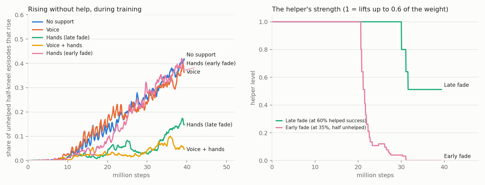

# 49 - A coach's voice and fading hands in training; ears on the model; a regression gate (P-074, D-077, D-078)

P-074 asked for four things: keep going and capture the skills, fix what is fundamental, work with the sibling
project (`ai-embedded-dynamic-diversity`) for mutual benefit, and give the get-up stages there a second form of
support: spoken instruction heard through two ears, as a trainer gives hands off, with or instead of the helping
hands. It also asked which ideas in the Agent Hub and outside are not applied yet, and for a view of the project.

Short answers:
- **The helping hands can be withdrawn if they leave early, but they do not beat training alone.** Fading from 35%
  helped success, with half the episodes unhelped, the helper withdrew itself completely on three seeds of three.
  The policy then rises unaided 46% of the time, against 52% with no support. Fading late, the policy learned to
  lean: 22% (one seed).
- **The voice is built and heard, and not yet obeyed.** Cues during the rise went unused. Asked to wait for "get
  up", the policy learned never to rise, twice. These arms are one seed each.
- **Both models have ears now**, and the stand-in reports where they are.
- **Fundamental:** a regression gate, and through it a reset fault: every scene run after the weight-shift scene in
  one process ran without drum locks. Fixed; no outcome changed.
- **Ideas and directions:** the last two sections. First on my list is a one-drive bench rig, which is the owner's
  call.

## The coach in the sibling's training

The sibling trains the learned policy on this robot's fast stand-in (`sim/robot_standin.xml`). Its get-up stages
(its issue #49) start half-kneeling, then add fallen starts. Until now they trained alone. Its new `rl/coach.py`
(its issue #66) adds two supports, both outside the policy and both meant to be withdrawn.

### The voice

| Part | What it is |
| --- | --- |
| Words | `get_up`, `stand_up` (either means: rise), `stay`, `come_here`, the cues `lean`, `push`, `tall`, `easy`, and `good` |
| A word | Two or three syllables of 0.14 s. A syllable is a pattern of energy over 8 frequency bands: two formant peaks, or a hiss. `get_up` and `stand_up` share the syllable "up" |
| A voice | Each episode has its own pitch (the pattern shifted along the bands), tempo (0.8 to 1.25) and loudness (within 6 dB) |
| Where it comes from | The coach stands 1.2 to 3 m away in a random direction, 1.2 to 1.7 m up |
| To each ear | Spreading (1 / r²); the head's shadow on the far ear, 0 dB in the lowest band to 12 dB in the highest; ambient noise; and the robot's own drive noise, which grows with the square of the joints' speed |
| Between the ears | The interaural time difference from the two path lengths (at most 0.44 ms across 0.15 m), noisy when the voice is faint |
| The observation | 25 channels: 8 log band energies per ear, the time difference, and an 8-band echo (the bands averaged over about the last second), which lets a policy without memory know what was just said |

It is not a waveform. The model is what a cochlea, or a microphone front end, gives at the 50 Hz control rate
(D-077). Two bare ears cannot tell front from back, here as on a real head without shaped ears (docs/42).

The script, per episode:
1. **"Stay"**, repeated, for a wait drawn from `coach_wait` (none by default). Rising before the command is a
   false start: it earns nothing and does not count as a success. A wait longer than the episode means the robot
   is never told to rise. The wait can begin only once the rise is learned (`--coach-wait-after`).
2. **The command**, `get_up` or `stand_up` at random.
3. **Cues**, on a `coach_guide` share of episodes, from what the coach sees:
   - `easy` when a gated line is above its continuous rating (the observation has no line force);
   - `lean` below 0.6 of standing height, `push` below 0.85, `tall` above.
   On the other episodes the coach only repeats the command.
4. **"Good"**, once, when the robot has stood for a second. Then silence.

### The hands

A lift on the trunk, as docs/46's helper lifts under the arms (D-073), in the form a batched trainer can run:
- it lifts only what the soles leave uncarried, up to a cap (0.6 of the weight at full strength, and 0.6 to 1.0 of
  that from one episode to the next);
- it steadies the trunk's horizontal speed, and eases off over the last 0.1 m below standing height;
- **it fades itself:** when more than a set share of the helped episodes at a level rise (over at least 300 of
  them), the cap falls to 0.8 of itself; when fewer than 25% do, it comes part of the way back. Each start of the
  curriculum has its own level;
- **a quarter of the episodes are never helped.** Their success is the unassisted gate, logged next to the helped
  success and the helper's impulse (D-069's two conditions);
- **it may quit:** in a fifth of the helped episodes the helper lets go at a random moment and does not come back.
  This is the owner's point of 2026-11-11 (hub record `marques-withdrawal-laws-response-20261111`): support that
  may give out without warning.

The test is the sibling's `rl.getup_eval`: 64 half-kneel starts, the policy's mean action, never with the hands.

### What it measured

Plain MLP, half-kneel curriculum, 800 iterations (39 M steps, about 21 minutes). Every arm ran on seed 0. The
no-support and early-fade arms then ran on seeds 1 and 2 as well, before the release (P-075): the first table is
seed 0, the second all three.

| Unassisted success during training (left), and the helper's level (right) |
| --- |
|  |

| Arm | Rises and stands 1 s, unaided | Still standing at 10 s | Ended by a line over its rating | In training |
| --- | --- | --- | --- | --- |
| No support | 48% | 19% | 34 of 64 | |
| **Hands, early fade** (steps down at 35% helped success, half the episodes unhelped) | **47%** | **25%** | **11** | Full help to iteration 419, withdrawn by 632. The impulse fell from 4.3 to 0.13 weight-seconds an episode before it left |
| Hands, late fade (at 60%, a quarter unhelped) | 22% | 2% | 41 | Full help for 610 of 800 iterations. Helped episodes rose 53%, unhelped 15% |
| Voice, cues on every episode | 38% (42% muted) | 2% | 26 | The policy does not use the voice |
| Voice and hands, late fade | 14% | 0% | 43 | Fallen starts unlocked, and their failures brought the help back to full. Each start now has its own level |

The two arms that matter, on three seeds (0, 1, 2):

| Arm | Rise and stand 1 s | Still standing at 10 s | Ended by a line over its rating (of 64) | The helper |
| --- | --- | --- | --- | --- |
| No support | 48, 53, 53%: **52%** | 19, 5, 16%: 13% | 34, 17, 25: 25 | |
| Hands, early fade | 47, 47, 44%: **46%** | 25, 13, 3%: 14% | 11, 22, 17: 17 | Withdrawn in training on every seed (by iteration 632, 621, 736) |

Seed 0 alone said the early fade cost nothing and cut overloaded lines to a third. The other two seeds did not bear
that out.

Waiting for the word (rising early is a false start; about one episode in six is never told):

| Arm | Rises when told | Stays when not told |
| --- | --- | --- |
| The wait from the first step | 0 of 51 | 13 of 13 |
| The wait begun once 30% rise, with the echo, 1,200 iterations | 0 of 52 | 12 of 12 |

What the ears can tell, by a simple listener (the nearest word by long-term spectrum; the side by the sign of the
time difference), 4,000 words each:

| Coach at | Joints' speed | Word named (9 words, chance 11%) | Side told |
| --- | --- | --- | --- |
| 3 m | still | 69% | 100% |
| 3 m | 0.5 rad/s | 46% | 100% |
| 3 m | 1 rad/s | 25% | 100% |
| 3 m | 2 rad/s | 15% | 98% |
| 6 m | 2 rad/s | 12% | 87% |

What it shows:
1. **Help that stays becomes the skill.** With the late fade, the policy rose 53% of the time with the hands and 22%
   without. This is the dependence D-069's withdrawal laws were written against, measured.
2. **Help that leaves early can be withdrawn, at a small cost and no gain.** Over three seeds the early fade rises
   46% against 52% (lower on every seed), is still standing as often, and ends fewer runs by overloading a line (17
   against 25 of 64, on two seeds of three). The helper is gone before training ends on every seed, so withdrawal
   is met in training and in the test. Its use is for starts that are not learned alone. On the tendon model the same law was not
   met with a scripted get-up (docs/46): there nothing learns.
3. **Spoken cues were not used.** Without a wait the voice tells the policy nothing it needs, and the extra noisy
   inputs cost some rise rate at equal steps.
4. **A lunging robot hears little.** With the drive-noise constant assumed here, words are lost above about 1 rad/s
   of joint speed, while the side the voice comes from stays readable. A coach should speak while the robot is
   still, and "come here" (a direction) is the easier thing to hear.
5. **Obeying a spoken command is not learned yet.** From the first step, the wait teaches staying down. Begun
   after the rise is learned, the policy false-starts in up to half the episodes, then unlearns rising. A
   memoryless network did not come to tell "stay" from "get up", even with the echo.

## Ears on both models

Both models now have two ear sites on the head (`export_mjcf.EARS`: 7.5 cm either side of the head's axis, 9 cm
above the neck joint). The stand-in also has two sensors, `ear.L_pos` and `ear.R_pos`, their world positions. The sibling renders the
voice to them, so the head's pose, neck included, sets what each ear hears. Nothing else in the stand-in changed:
the joints, their order and the 72-channel observation are the same, and the sibling's 32 `rl` tests pass on the
new export. On the tendon model the sites change nothing either: the regression gate below reports nothing moved.

## A regression gate, and what it found

P-073 checked "one robot is unchanged" by comparing printed tables by eye. `tools/regress.py` does it in one
command (D-078):

| Check | How |
| --- | --- |
| The generated models are current | `sim/robot.xml` and `sim/robot_standin.xml` against what the exporters write now |
| The gauntlet | Each of the 14 scenes in its own process: outcome, flags, and energy within 2% of `sim/baseline.json` |
| `--more` | The get-up with the scripted helper (24 of 24) and with a robot helper (19 of 24), within 2 runs of 24 |

About 2 minutes on 12 processes; `--more` adds about 15.

**It found a fault on its first run.** The 0.45 m chair scene gave 835.7 J alone and 841.5 J in the full gauntlet,
with a different forearm flagged. A fresh rig compared with a used one, attribute by attribute, showed why:

| Left behind by a scene | Effect on the next scene |
| --- | --- |
| `lock_enabled = False` (the weight-shift and one-foot scenes turn the drum locks off) | **Every later scene in that process ran without drum locks** |
| The balance loop's last CoM sample and the single-support integral | None found (both are set again before use) |
| The lock friction on the gear joints | None found (set again on the first control step) |

`Rig.reset()` now restores all three. The chair scene gives 835.7 J either way. No scene's outcome changed. The
energies of the step, the walk and the chair in earlier docs came from full gauntlet runs, so they can differ from
today's by up to about 1%.

Two smaller repairs came with it:
- `getup.py --jitter-test` could not read the committed `sim/getup_params.json` (it wanted a search's `cfg`); it
  now reads either.
- `regress.py --update` refuses to record a test that did not run.

## Ideas in the hub and outside: applied, queued, or set aside

| Idea | From | Status |
| --- | --- | --- |
| The helper may give out without warning; its strength varies | Hub record `marques-withdrawal-laws-response-20261111` (the owner, 2026-11-11) | **Applied** in the sibling's `Hands` (quits in a fifth of helped episodes; strength 0.6 to 1.0) |
| Impulse as the early signal, unassisted success as the gate, and slowing the fade when success slips | The same record | **Applied**: both are logged every iteration, and the level comes back when helped success falls |
| A lifting force that fades, for learning to stand up | HoST ([Huang et al. 2025](https://arxiv.org/abs/2502.08378)); the pulling-force detail is from memory, not checked today | **Applied** as `Hands` |
| Spoken commands choosing among skills | [Semantic audio-driven humanoid control (2026)](https://arxiv.org/abs/2607.14182), as its search summary describes it: speech picks a skill from a library | **Related.** Here the sound goes into the policy itself. Their route (speech picks a scripted skill) fits `tools/chain.py` |
| Balance measures (capture point, CoM, centroidal momentum) as critic inputs and shaping rewards for fall recovery | [arXiv 2603.08619 (2026)](https://arxiv.org/abs/2603.08619), from its search summary: 93% recovery on an H1-2 | **Queued** (hub task `balance-critic-capture-point`). docs/32 found the policies miss the balance loop's CoP strategy; the sibling's critic has neither CoM nor capture point |
| Two stages: find a get-up with loose limits, then learn to track it slowed down within the limits | HumanUP ([He et al. 2025](https://arxiv.org/abs/2502.12152)) | **Queued** with the task above. The learned get-up is a half-second lunge with the forearm lines at 2.3x |
| A learned actuator model, so the fast simulator matches the real drive | [Hwangbo et al. 2019](https://arxiv.org/abs/1901.08652) | **Proposed** for the stand-in to tendon gap (hub task `standin-tendon-gap`): fit a small network per drive class to tendon-model rollouts and run it in the stand-in |
| Model-based balance under a learned whole-body policy | Hub record on Atlas on wheels (2026-11-09) | **Already here**: docs/32's hybrid (hand-written ankles under the policy) |
| A second open body as a benchmark | Hub records on Menlo's Asimov 1 (2026-11-08) | **Queued** before today (sibling issue #57, hub task `external-teacher-transfer`) |
| Camera exposure, resolution and frame age as ablations | Hub record `codex-camera-exposure-ablation-20261111` | **Not applicable yet**: no camera in the model. It is the plan for round 2 |
| Two humanoids in physical contact | [Harmanoid (2025)](https://arxiv.org/abs/2510.10206), motion imitation for two robots | **Noted.** A search found no work on one humanoid helping another stand; docs/48 may be the first measured attempt |

## A view of the project, and proposed directions

The owner asked what a first run-through shows. These are opinions; the numbers behind them are in the docs named.

**What is strong.** The simulation is honest about hardware: every result is judged against line ratings, clutch
slip and electrical power, under jitter, and each doc says what it did not do. The decision log makes the reasons
recoverable. That is rarer than the results themselves.

**Where it is thin.**
1. **Margins are smaller than the model's uncertainty.** The skills pass at 16 to 19 of 24 under 2% parameter
   jitter (docs/45, docs/46, docs/48). The model has never met hardware: guide friction, line creep and the
   clutch's real behaviour are datasheet values. The real gap will be several times 2%.
2. **The body, not the controller, sets the limit in four results.** The 0.35 m chair (docs/33), the get-up that
   needs a lift (docs/32, docs/46), the helper's spine (docs/48) and the walk with a bag (docs/39) all end at the
   same places: the W-max clutch slips at 1.03 of its continuous rating, so there is no peak torque; the ankle
   dorsiflexes 20 degrees; the foot has no toe.
3. **Scripted skills do not add up.** Each one took a session and a parameter search, and yields one parameter set
   for one scene. The learned route is the one that scales, and it is stuck at the gate: a learned stand passes 9
   or 10 scenes of the tendon gate, and the learned get-up exists only on the stand-in.
4. **Single seeds.** Several learned results rest on one seed each. Today's own first reading of the early fade
   (one seed) was too kind; two more seeds corrected it.

**Proposed directions, in the order I would take them:**

| # | Direction | Why first | Needs |
| --- | --- | --- | --- |
| 1 | **A one-drive bench rig**: one W-max drive, its line, clutch and a lever with weights | It measures the three numbers everything rests on (friction, stretch, slip torque) and shrinks the uncertainty in point 1 for the price of one drive | The owner: it is hardware and spending |
| 2 | **Close the gate by fitting the stand-in to the tendon model with a learned actuator model**, or run the tendon physics on the GPU (hub task `tendon-physics-on-gpu`) | Point 3: until a policy trained fast passes the tendon gate, every skill stays a script | Simulation only |
| 3 | **A body revision study**: treat the spine's and knee's drive, the ankle's range and a toe joint as variables, scored by the static tools (`rise_static.py`, `sit_static.py`, `role_flip.py`) and three scenes | Point 2: cheaper than tuning three more controllers against the same limits | Simulation only; a mass and cost check per option |
| 4 | **One policy, many skills, chosen by word** | The voice is the interface for it, and the cues can carry the phase of a scripted skill into a memoryless policy when cloning it | The sibling; teacher recordings labelled with the cue being spoken |
| 5 | **Balance measures for the critic, and the two-stage get-up** (the table above) | Aimed at the two learned failures: the 8 m/s wind and the 2.3x forearms | The sibling |
| 6 | **Two robots that speak**: the helper robot counts the takeover aloud | docs/48's hard part was timing the handover; a heard count is the cheapest shared clock | `tools/duo.py`, ears on the tendon model |

## Not yet

- **Obeying a spoken command.** 0% in both attempts.
- **Seeds.** Three for the no-support and early-fade arms; one for the others.
- **Fallen starts.** 0% in every arm, with or without the helper.
- **The tendon gate with ears.** The sibling's gate computes its observation from the rig; it does not render the
  voice, so a policy trained with it cannot be judged on the full model yet.
- **"Come here".** The word exists; no task uses it.
- **The drive noise** is one assumed constant (D-077). Nothing has measured a W-max drive's sound.
- **`regress.py --more`** covers the get-up and the two-robot stand-up; the chair grid, the step grid and the chains
  are not in the gate.

## Next

- **Obeying the word:** a recurrent policy (`--arch gru`), a reward that does not pay more for kneeling than for a
  failed rise, and a start where staying down is not an option (standing, with "sit" and "stand").
- **The early fade on fallen starts** (sibling issue #69), where training alone gets 0%.
- **Hub tasks filed:** `balance-critic-capture-point`, `voice-cued-skill-cloning`, and for the owner
  `bench-rig-one-drive-decision`.
- **The directions above**, in their order.
